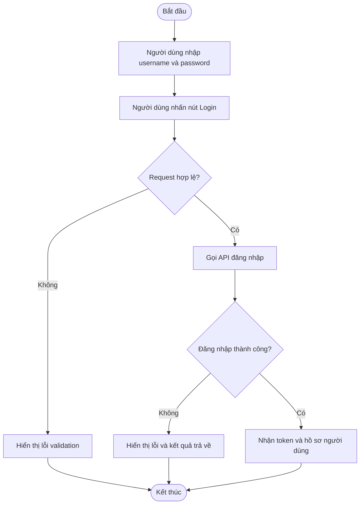
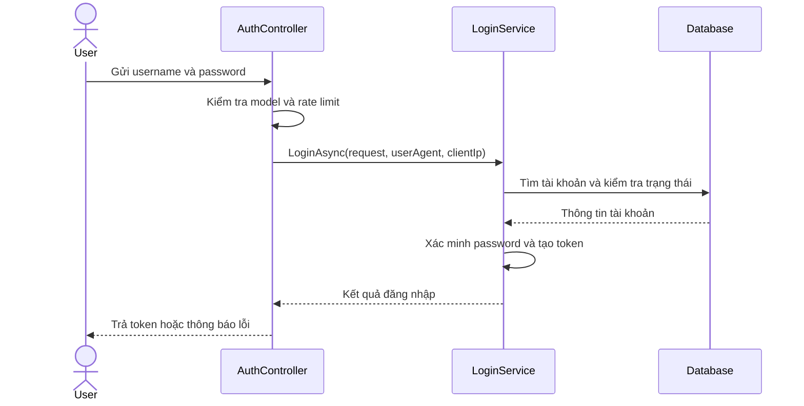

# API Design — Smart Parking

**Trạng thái:** Tài liệu thiết kế tham chiếu; đối chiếu lại với code trước khi dùng làm hợp đồng triển khai.
**API mẫu:** Đăng nhập
**Mốc tài liệu hiện trạng:** `Sprint3/demo` — commit `4bed0c8a929fe050d644aa4e07c0a1caa77d8d0e`.

Tài liệu này chuyển các mục phù hợp trong `API Design Template` sang Markdown và bổ sung thông tin hệ thống từ [`apidesign.md`](../apidesign.md). Danh mục route và kiểu DTO có cấu trúc đầy đủ tiếp tục được duy trì tại [API endpoints](./endpoints.md) và [data contracts](./data-contracts.md).

## Overview

Smart Parking là hệ thống OJT gồm backend ASP.NET Core/.NET 10, PostgreSQL qua EF Core, giao diện React/Vite, giao diện HTML demo cũ cùng các dịch vụ AI và simulator. Backend chia thành bốn layer: API, Application, Domain và Infrastructure.

### Backend và nghiệp vụ

- Auth hỗ trợ đăng nhập, refresh và logout; dùng JWT, lưu hash refresh token trong DB, giới hạn tốc độ đăng nhập và khóa tạm khi nhập sai nhiều lần.
- Các role hiện có: `ADMIN`, `MANAGER`, `STAFF`, `USER`. Quyền vận hành được giới hạn theo bãi được phân công.
- Nghiệp vụ gồm quản lý bãi/tầng/ô, phương tiện, phiên gửi xe, đặt chỗ, điều phối ô và phân công nhân viên vào bãi.
- Booking giữ sức chứa thay vì giữ cứng một ô. Check-in kiểm tra booking/công suất; dispatch tách riêng phân công ô và xác nhận xe đã đỗ.
- EF Core/PostgreSQL có migration cho Accounts, parking core, staff assignments và booking/capacity. Chưa xác minh module thanh toán/biểu phí trong backend tại mốc tài liệu.

### Event, IoT và AI

- Parking event pipeline xử lý `VehicleEntered`, `SensorTriggered`, `SlotParked`, `VehicleExited` và kiểm tra sự kiện trùng; repository hiện dùng in-memory và DI chọn `NoOpParkingEventBridge`. Adapter EF và live bridge chưa được bật.
- IoT simulator cũ cập nhật bãi mẫu qua JSON; telemetry và xe đang đỗ lưu trong bộ nhớ tiến trình, không bền sau khi restart.
- Viewer 3D dùng dữ liệu ô mẫu trong bộ nhớ, không phải slot thật trong PostgreSQL. API viewer tách biệt với API quản lý slot thật tại `/api/v1/parking-slots`.
- AI nhận diện biển số là dịch vụ FastAPI riêng, endpoint `POST /api/v1/detect`, dùng YOLOv8 và PaddleOCR ONNX. Tích hợp Gemini của backend chạy NoOp nếu chưa có API key.

### Frontend và kiểm thử

- React/Vite tại `frontend/smart-parking` được backend phục vụ ở `/app/` và gọi API.
- Bản HTML/CSS/JS tại `frontend/` là demo độc lập, dùng `localStorage` cho đặt chỗ, QR, giá và dữ liệu mẫu.
- Backend có test xUnit và EF InMemory; frontend có test cho API wrapper.

## API Specification

### Thông tin endpoint

| Thuộc tính | Giá trị |
|---|---|
| API | `POST` |
| URL hiện tại | `/api/v1/auth/login` |
| URL trong template cũ | `/api/auth/login` |
| Permission | `N/A` — endpoint public, không cần JWT |
| Content-Type | `application/json` |
| Mục đích | Xác thực username/password và trả access token, refresh token cùng hồ sơ người dùng |

> **Khác biệt với template cũ:** tài liệu đầu vào mô tả `/api/auth/login` và response có trường `result`. Route được ghi nhận trong tài liệu API hiện trạng là `/api/v1/auth/login`; response thành công dùng `data`. Không dùng hai dạng này thay thế cho nhau.

### Request

#### Trường dữ liệu

| Trường | Kiểu | Bắt buộc | Mô tả |
|---|---|---:|---|
| `username` | string | Có | Tên đăng nhập |
| `password` | string | Có | Mật khẩu |

#### Request sample

```http
POST /api/v1/auth/login
Content-Type: application/json
```

```json
{
  "username": "sample_user",
  "password": "replace-with-a-valid-password"
}
```

Template PDF dùng `userName`; API hiện tại nhận `username`. Ví dụ request trong tài liệu này theo DTO hiện tại.

### Response sample

#### Thành công — HTTP 200

Response API được bọc bởi `message` và `data`. Các giá trị token dưới đây chỉ là placeholder, không phải thông tin xác thực thật.

```json
{
  "message": "Đăng nhập thành công.",
  "data": {
    "accessToken": "<access-token>",
    "refreshToken": "<refresh-token>",
    "tokenType": "Bearer",
    "expiresIn": 900,
    "userProfile": {
      "id": 123,
      "username": "sample_user",
      "email": "user@example.com",
      "fullName": "Sample User",
      "phoneNumber": null,
      "avatarUrl": null,
      "role": "USER",
      "isEmailVerified": true,
      "approvalStatus": "APPROVED",
      "createdAt": "2026-01-01T00:00:00Z"
    }
  }
}
```

#### Các trường response chính

| Trường | Kiểu | Mô tả |
|---|---|---|
| `message` | string | Kết quả xử lý |
| `data.accessToken` | string | JWT access token |
| `data.refreshToken` | string | Token dùng để làm mới access token |
| `data.tokenType` | string | Loại token; mặc định `Bearer` |
| `data.expiresIn` | integer | Thời hạn access token tính bằng giây; DTO đặt mặc định `900` |
| `data.userProfile` | object | Hồ sơ người dùng và role |

Template PDF cũ đặt token trong `result` và có `isSuccess`/`statusCode`. API hiện tại bọc thành công trong `data`; không dùng mẫu `result` cũ cho client hiện tại.

### Validation

| Status code | Mô tả | Ví dụ response |
|---:|---|---|
| `400` | Thiếu `username` hoặc `password`, hoặc request không hợp lệ | Model validation response của ASP.NET Core |
| `401` | Username/password không chính xác | `{"message":"Tên đăng nhập hoặc mật khẩu không chính xác."}` |
| `403` | Email chưa xác minh, tài khoản bị vô hiệu hóa hoặc chưa được duyệt | `{"message":"Tài khoản đã bị vô hiệu hóa. Vui lòng liên hệ quản trị viên."}` |
| `423` | Tài khoản đang bị khóa tạm thời sau nhiều lần nhập sai mật khẩu | `{"message":"Tài khoản tạm thời bị khóa do nhập sai mật khẩu nhiều lần. Vui lòng thử lại sau 15 phút."}` |
| `429` | Vượt giới hạn gọi API đăng nhập | Response từ rate-limiting middleware |

Thông báo cụ thể có thể thay đổi theo nguyên nhân và cấu hình. Với lỗi từ xử lý đăng nhập, controller trả JSON có trường `message`; lỗi kiểm tra model hoặc rate limit có thể dùng response shape riêng. Client cần dựa vào HTTP status và body thực tế.

### Activity Diagram



### Sequence Diagram



## Implementation Notes

- Tài khoản được cấp mới đăng nhập theo chính sách hiện hành; không suy ra API đăng ký/OTP chỉ từ tài liệu cũ.
- Response mẫu thể hiện cấu trúc DTO; giá trị token, thời gian và hồ sơ trong ví dụ chỉ nhằm minh họa.
- API viewer 3D và dữ liệu simulator không phải nguồn dữ liệu slot thật trong PostgreSQL.
- Backend hiện chưa có API/entity thanh toán được xác nhận trong tài liệu tại mốc đối chiếu.
- Hướng dẫn IoT cũ dùng `deviceId`, trong khi DTO backend được ghi nhận nhận `carId`.
- Đối chiếu commit và code hiện hành trước khi dùng tài liệu này làm hợp đồng cho môi trường triển khai.

## References

- [API endpoints](./endpoints.md) — route, quyền, HTTP status và trạng thái triển khai.
- [Data contracts](./data-contracts.md) — DTO, kiểu dữ liệu và trường request.
- [Tổng quan sản phẩm](../product/overview.md) — kiến trúc và phạm vi nghiệp vụ.
- [Tổng quan hiện trạng `apidesign.md`](../apidesign.md).
