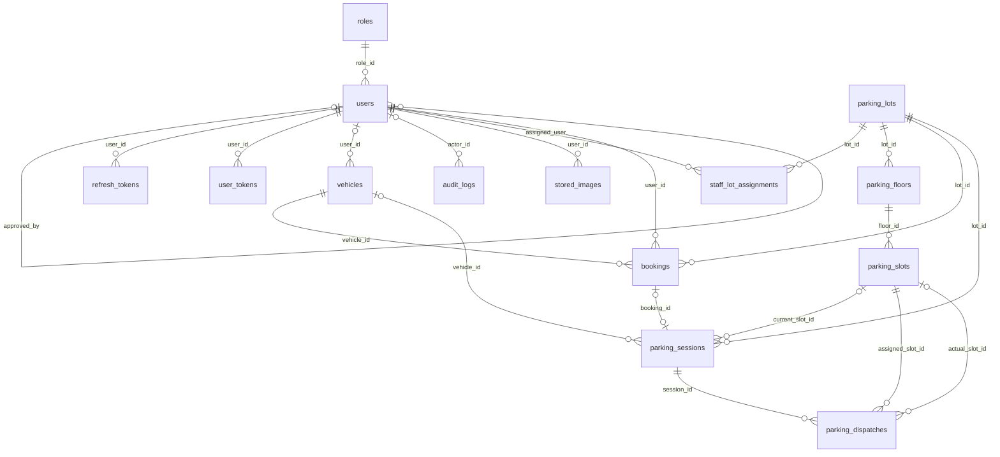

# Mô hình dữ liệu và từ điển bảng Smart Parking

**Trạng thái:** Hiện hành cho mô hình đã xác minh và thiết kế bổ sung được đánh dấu ĐỀ XUẤT.  
**Chủ sở hữu:** Backend/Data.  
**Rà soát gần nhất:** 28/10/2026.  
**Phạm vi:** Schema hiện có tại mốc đối chiếu và hướng đích Sprint 3–5.

**Mốc đối chiếu:** `Sprint3/demo` tại `4bed0c8a929fe050d644aa4e07c0a1caa77d8d0e`, ngày 28/10/2026. Xem [README](../README.md) để biết nguồn, quy ước và trạng thái.

## 1 Phạm vi xác minh

Danh mục dưới đây được lấy từ design-time model EF Core của mã nguồn; không mở kết nối DB. Có **14 bảng được ánh xạ**, không phải kết quả khẳng định 14 bảng đã được migration thành công trên một Neon cụ thể. Bảng migration nội bộ của EF không tính là bảng nghiệp vụ.

Khóa chính hiện dùng `integer` hoặc `bigint`, không dùng UUID đồng loạt như AITasker. Thời gian theo model là `timestamp with time zone`; `total_fee` dùng `numeric(12,2)`, không sao chép quy ước BIGINT tiền của mẫu. JSON trong audit hiện lưu `text`, không tự đổi thành JSONB trong mô tả hiện trạng.

## 2 ERD hiện có

ERD lược bớt hai liên kết actor cấp/thu hồi phân công để dễ đọc; toàn bộ FK và delete behavior có ở từ điển bên dưới. Cardinality nhiều phiên trên một ô thể hiện lịch sử, không cho phép nhiều xe chiếm đồng thời.

## 3 Danh mục bảng

| Bảng | Entity | Mục đích |
|---|---|---|
| `audit_logs` | `AuditLog` | Lưu actor, hành động, đối tượng, giá trị trước/sau và thời điểm; không đồng nghĩa có API báo cáo audit riêng. |
| `bookings` | `Booking` | Yêu cầu giữ khả năng tiếp nhận theo bãi/xe; chưa có hold expiry, payment hoặc slot cụ thể. |
| `parking_dispatches` | `ParkingDispatch` | Liên kết phiên với ô được phân và ô thực tế; trạng thái xác nhận tách khỏi physical status. |
| `parking_floors` | `ParkingFloor` | Tầng thuộc bãi; có số tầng, tên, tổng ô và cờ hoạt động. |
| `parking_lots` | `ParkingLot` | Danh mục bãi hiện có; chưa có tọa độ địa lý/giờ mở cửa/khu cố định trong entity này. |
| `parking_sessions` | `ParkingSession` | Phiên vãng lai/nhận booking; giờ vào/ra, ô hiện tại, ảnh, phí dạng trường dữ liệu. |
| `parking_slots` | `ParkingSlot` | Ô thuộc tầng, mã, trạng thái vật lý và tọa độ mô hình; chưa có nhiên liệu tương thích. |
| `refresh_tokens` | `RefreshToken` | Hash refresh token, người dùng, thời hạn, thu hồi và thiết bị/IP. |
| `roles` | `Role` | Bốn mã ADMIN, MANAGER, STAFF, USER; Guest không phải một dòng role. |
| `staff_lot_assignments` | `StaffLotAssignment` | Phân công người dùng vào bãi, người cấp/thu hồi và lịch sử; chưa có loại nhiệm vụ Staff. |
| `stored_images` | `StoredImage` | Metadata ảnh Cloudinary và người tải; chưa có FK phiên/bãi/quyền chia sẻ ảnh theo bãi. |
| `user_tokens` | `UserToken` | Cấu trúc token EMAIL_VERIFICATION/PASSWORD_RESET còn tồn tại; không chứng minh endpoint xác minh/đổi mật khẩu còn có. |
| `users` | `User` | Tài khoản, một role, trạng thái xác minh/duyệt/khóa và hồ sơ. |
| `vehicles` | `Vehicle` | Biển số unique và chủ tài khoản có thể null cho vãng lai; hãng/model/màu và cờ hoạt động. |

## 4 Từ điển vật lý

Default dưới đây là metadata SQL/EF đã khai báo, không suy diễn từ giá trị khởi tạo trong constructor. PK sinh `OnAdd` không có nghĩa mọi cột số đều tự tăng. Cột nullable được ghi riêng; một FK nullable không bắt buộc có actor/chủ tài khoản.

### `audit_logs`

Lưu actor, hành động, đối tượng, giá trị trước/sau và thời điểm; không đồng nghĩa có API báo cáo audit riêng.

| Cột | Kiểu PostgreSQL | NULL | Khóa | Default khai báo | Thuộc tính C# |
|---|---|---|---|---|---|
| `action` | `character varying(50)` | Không | — | Không khai báo | `Action` |
| `actor_id` | `bigint` | Có | — | Không khai báo | `ActorId` |
| `created_at` | `timestamp with time zone` | Không | — | now() | `CreatedAt` |
| `id` | `bigint` | Không | PK | Không khai báo | `Id` |
| `ip_address` | `character varying(45)` | Có | — | Không khai báo | `IpAddress` |
| `new_values` | `text` | Có | — | Không khai báo | `NewValues` |
| `old_values` | `text` | Có | — | Không khai báo | `OldValues` |
| `target_entity` | `character varying(50)` | Không | — | Không khai báo | `TargetEntity` |
| `target_id` | `character varying(50)` | Có | — | Không khai báo | `TargetId` |

**Khóa ngoại**

| Tên | Cột | Tham chiếu | Khi xóa cha |
|---|---|---|---|
| `fk_audit_logs_actor` | actor_id | users(id) | SetNull |

**Chỉ mục**

| Tên | Cột | Unique | Điều kiện |
|---|---|---|---|
| `ix_audit_logs_actor_id` | actor_id | Không | Toàn bảng |
| `ix_audit_logs_created_at` | created_at | Không | Toàn bảng |
| `ix_audit_logs_target` | target_entity, target_id | Không | Toàn bảng |

### `bookings`

Yêu cầu giữ khả năng tiếp nhận theo bãi/xe; chưa có hold expiry, payment hoặc slot cụ thể.

| Cột | Kiểu PostgreSQL | NULL | Khóa | Default khai báo | Thuộc tính C# |
|---|---|---|---|---|---|
| `cancellation_reason` | `character varying(500)` | Có | — | Không khai báo | `CancellationReason` |
| `cancelled_at` | `timestamp with time zone` | Có | — | Không khai báo | `CancelledAt` |
| `checked_in_at` | `timestamp with time zone` | Có | — | Không khai báo | `CheckedInAt` |
| `created_at` | `timestamp with time zone` | Không | — | Không khai báo | `CreatedAt` |
| `end_time` | `timestamp with time zone` | Có | — | Không khai báo | `EndTime` |
| `id` | `bigint` | Không | PK | Không khai báo | `Id` |
| `lot_id` | `integer` | Không | — | Không khai báo | `LotId` |
| `notes` | `character varying(500)` | Có | — | Không khai báo | `Notes` |
| `plate_number` | `character varying(20)` | Không | — | Không khai báo | `PlateNumber` |
| `start_time` | `timestamp with time zone` | Không | — | Không khai báo | `StartTime` |
| `status` | `character varying(20)` | Không | — | "PENDING" | `Status` |
| `updated_at` | `timestamp with time zone` | Không | — | Không khai báo | `UpdatedAt` |
| `user_id` | `bigint` | Không | — | Không khai báo | `UserId` |
| `vehicle_id` | `bigint` | Không | — | Không khai báo | `VehicleId` |

**Khóa ngoại**

| Tên | Cột | Tham chiếu | Khi xóa cha |
|---|---|---|---|
| `fk_bookings_lot` | lot_id | parking_lots(id) | Restrict |
| `fk_bookings_user` | user_id | users(id) | Restrict |
| `fk_bookings_vehicle` | vehicle_id | vehicles(id) | Restrict |

**Chỉ mục**

| Tên | Cột | Unique | Điều kiện |
|---|---|---|---|
| `ix_bookings_user_id` | user_id | Không | Toàn bảng |
| `uq_bookings_pending_vehicle` | vehicle_id | Có | status = 'PENDING' |
| `ix_bookings_lot_status` | lot_id, status | Không | Toàn bảng |
| `ix_bookings_plate_status` | plate_number, status | Không | Toàn bảng |

**CHECK**

| Tên | Biểu thức |
|---|---|
| `chk_bookings_plate_normalized` | `plate_number = UPPER(TRIM(plate_number))` |
| `chk_bookings_status` | `status IN ('PENDING', 'CHECKED_IN', 'CANCELLED', 'EXPIRED')` |
| `chk_bookings_time_order` | `end_time IS NULL OR end_time >= start_time` |

### `parking_dispatches`

Liên kết phiên với ô được phân và ô thực tế; trạng thái xác nhận tách khỏi physical status.

| Cột | Kiểu PostgreSQL | NULL | Khóa | Default khai báo | Thuộc tính C# |
|---|---|---|---|---|---|
| `actual_slot_id` | `bigint` | Có | — | Không khai báo | `ActualSlotId` |
| `assigned_slot_id` | `bigint` | Không | — | Không khai báo | `AssignedSlotId` |
| `confirmed_at` | `timestamp with time zone` | Có | — | Không khai báo | `ConfirmedAt` |
| `created_at` | `timestamp with time zone` | Không | — | now() | `CreatedAt` |
| `dispatch_mode` | `character varying(20)` | Không | — | "AUTO" | `DispatchMode` |
| `dispatched_at` | `timestamp with time zone` | Không | — | now() | `DispatchedAt` |
| `id` | `bigint` | Không | PK | Không khai báo | `Id` |
| `notes` | `character varying(255)` | Có | — | Không khai báo | `Notes` |
| `session_id` | `bigint` | Không | — | Không khai báo | `SessionId` |
| `status` | `character varying(20)` | Không | — | "PENDING" | `Status` |
| `updated_at` | `timestamp with time zone` | Không | — | now() | `UpdatedAt` |

**Khóa ngoại**

| Tên | Cột | Tham chiếu | Khi xóa cha |
|---|---|---|---|
| `fk_parking_dispatches_actual_slot` | actual_slot_id | parking_slots(id) | Restrict |
| `fk_parking_dispatches_assigned_slot` | assigned_slot_id | parking_slots(id) | Restrict |
| `fk_parking_dispatches_session` | session_id | parking_sessions(id) | Cascade |

**Chỉ mục**

| Tên | Cột | Unique | Điều kiện |
|---|---|---|---|
| `ix_parking_dispatches_actual_slot_id` | actual_slot_id | Không | Toàn bảng |
| `uq_parking_dispatches_assigned_slot` | assigned_slot_id | Có | status = 'ASSIGNED' |
| `uq_parking_dispatches_active_session` | session_id | Có | status IN ('PENDING', 'ASSIGNED') |

**CHECK**

| Tên | Biểu thức |
|---|---|
| `chk_parking_dispatches_mode` | `dispatch_mode IN ('AUTO', 'MANUAL')` |
| `chk_parking_dispatches_status` | `status IN ('PENDING', 'ASSIGNED', 'OCCUPIED', 'WRONG_SLOT', 'CANCELLED')` |

### `parking_floors`

Tầng thuộc bãi; có số tầng, tên, tổng ô và cờ hoạt động.

| Cột | Kiểu PostgreSQL | NULL | Khóa | Default khai báo | Thuộc tính C# |
|---|---|---|---|---|---|
| `created_at` | `timestamp with time zone` | Không | — | now() | `CreatedAt` |
| `floor_number` | `integer` | Không | — | Không khai báo | `FloorNumber` |
| `id` | `integer` | Không | PK | Không khai báo | `Id` |
| `is_active` | `boolean` | Không | — | true | `IsActive` |
| `lot_id` | `integer` | Không | — | Không khai báo | `LotId` |
| `name` | `character varying(50)` | Không | — | Không khai báo | `Name` |
| `total_slots` | `integer` | Không | — | 0 | `TotalSlots` |
| `updated_at` | `timestamp with time zone` | Không | — | now() | `UpdatedAt` |

**Khóa ngoại**

| Tên | Cột | Tham chiếu | Khi xóa cha |
|---|---|---|---|
| `fk_parking_floors_lot` | lot_id | parking_lots(id) | Cascade |

**Chỉ mục**

| Tên | Cột | Unique | Điều kiện |
|---|---|---|---|
| `uq_parking_floors_lot_floor_number` | lot_id, floor_number | Có | Toàn bảng |
| `uq_parking_floors_lot_name` | lot_id, name | Có | Toàn bảng |

**CHECK**

| Tên | Biểu thức |
|---|---|
| `chk_parking_floors_slots` | `total_slots >= 0` |

### `parking_lots`

Danh mục bãi hiện có; chưa có tọa độ địa lý/giờ mở cửa/khu cố định trong entity này.

| Cột | Kiểu PostgreSQL | NULL | Khóa | Default khai báo | Thuộc tính C# |
|---|---|---|---|---|---|
| `address` | `character varying(255)` | Có | — | Không khai báo | `Address` |
| `created_at` | `timestamp with time zone` | Không | — | now() | `CreatedAt` |
| `id` | `integer` | Không | PK | Không khai báo | `Id` |
| `is_active` | `boolean` | Không | — | true | `IsActive` |
| `name` | `character varying(100)` | Không | — | Không khai báo | `Name` |
| `total_capacity` | `integer` | Không | — | 0 | `TotalCapacity` |
| `updated_at` | `timestamp with time zone` | Không | — | now() | `UpdatedAt` |

**Chỉ mục**

| Tên | Cột | Unique | Điều kiện |
|---|---|---|---|
| `uq_parking_lots_name` | name | Có | Toàn bảng |

**CHECK**

| Tên | Biểu thức |
|---|---|
| `chk_parking_lots_capacity` | `total_capacity >= 0` |

### `parking_sessions`

Phiên vãng lai/nhận booking; giờ vào/ra, ô hiện tại, ảnh, phí dạng trường dữ liệu.

| Cột | Kiểu PostgreSQL | NULL | Khóa | Default khai báo | Thuộc tính C# |
|---|---|---|---|---|---|
| `booking_id` | `bigint` | Có | — | Không khai báo | `BookingId` |
| `check_in_image_url` | `character varying(500)` | Có | — | Không khai báo | `CheckInImageUrl` |
| `check_in_time` | `timestamp with time zone` | Không | — | now() | `CheckInTime` |
| `check_out_image_url` | `character varying(500)` | Có | — | Không khai báo | `CheckOutImageUrl` |
| `check_out_time` | `timestamp with time zone` | Có | — | Không khai báo | `CheckOutTime` |
| `created_at` | `timestamp with time zone` | Không | — | now() | `CreatedAt` |
| `current_slot_id` | `bigint` | Có | — | Không khai báo | `CurrentSlotId` |
| `id` | `bigint` | Không | PK | Không khai báo | `Id` |
| `lot_id` | `integer` | Không | — | Không khai báo | `LotId` |
| `paid_at` | `timestamp with time zone` | Có | — | Không khai báo | `PaidAt` |
| `plate_number` | `character varying(20)` | Không | — | Không khai báo | `PlateNumber` |
| `status` | `character varying(20)` | Không | — | "ACTIVE" | `Status` |
| `total_fee` | `numeric(12,2)` | Không | — | 0 | `TotalFee` |
| `updated_at` | `timestamp with time zone` | Không | — | now() | `UpdatedAt` |
| `vehicle_id` | `bigint` | Có | — | Không khai báo | `VehicleId` |

**Khóa ngoại**

| Tên | Cột | Tham chiếu | Khi xóa cha |
|---|---|---|---|
| `fk_parking_sessions_booking` | booking_id | bookings(id) | Restrict |
| `fk_parking_sessions_slot` | current_slot_id | parking_slots(id) | Restrict |
| `fk_parking_sessions_lot` | lot_id | parking_lots(id) | Restrict |
| `fk_parking_sessions_vehicle` | vehicle_id | vehicles(id) | Restrict |

**Chỉ mục**

| Tên | Cột | Unique | Điều kiện |
|---|---|---|---|
| `IX_parking_sessions_booking_id` | booking_id | Có | Toàn bảng |
| `ix_parking_sessions_check_in_time` | check_in_time | Không | Toàn bảng |
| `ix_parking_sessions_current_slot_id` | current_slot_id | Không | Toàn bảng |
| `uq_parking_sessions_active_plate` | plate_number | Có | status IN ('ACTIVE', 'PAID') |
| `ix_parking_sessions_vehicle_id` | vehicle_id | Không | Toàn bảng |
| `ix_parking_sessions_lot_status` | lot_id, status | Không | Toàn bảng |

**CHECK**

| Tên | Biểu thức |
|---|---|
| `chk_parking_sessions_checkout_time` | `check_out_time IS NULL OR check_out_time >= check_in_time` |
| `chk_parking_sessions_fee` | `total_fee >= 0` |
| `chk_parking_sessions_plate_normalized` | `plate_number = UPPER(TRIM(plate_number))` |
| `chk_parking_sessions_status` | `status IN ('ACTIVE', 'PAID', 'COMPLETED', 'CANCELLED')` |

### `parking_slots`

Ô thuộc tầng, mã, trạng thái vật lý và tọa độ mô hình; chưa có nhiên liệu tương thích.

| Cột | Kiểu PostgreSQL | NULL | Khóa | Default khai báo | Thuộc tính C# |
|---|---|---|---|---|---|
| `created_at` | `timestamp with time zone` | Không | — | now() | `CreatedAt` |
| `floor_id` | `integer` | Không | — | Không khai báo | `FloorId` |
| `id` | `bigint` | Không | PK | Không khai báo | `Id` |
| `is_active` | `boolean` | Không | — | true | `IsActive` |
| `physical_status` | `character varying(20)` | Không | — | "EMPTY" | `PhysicalStatus` |
| `position_x` | `numeric(10,2)` | Có | — | Không khai báo | `PositionX` |
| `position_y` | `numeric(10,2)` | Có | — | Không khai báo | `PositionY` |
| `position_z` | `numeric(10,2)` | Có | — | Không khai báo | `PositionZ` |
| `slot_code` | `character varying(20)` | Không | — | Không khai báo | `SlotCode` |
| `updated_at` | `timestamp with time zone` | Không | — | now() | `UpdatedAt` |

**Khóa ngoại**

| Tên | Cột | Tham chiếu | Khi xóa cha |
|---|---|---|---|
| `fk_parking_slots_floor` | floor_id | parking_floors(id) | Cascade |

**Chỉ mục**

| Tên | Cột | Unique | Điều kiện |
|---|---|---|---|
| `uq_parking_slots_floor_slot_code` | floor_id, slot_code | Có | Toàn bảng |
| `ix_parking_slots_status_active` | physical_status, is_active | Không | Toàn bảng |

**CHECK**

| Tên | Biểu thức |
|---|---|
| `chk_parking_slots_physical_status` | `physical_status IN ('EMPTY', 'OCCUPIED', 'MAINTENANCE', 'UNAVAILABLE')` |

### `refresh_tokens`

Hash refresh token, người dùng, thời hạn, thu hồi và thiết bị/IP.

| Cột | Kiểu PostgreSQL | NULL | Khóa | Default khai báo | Thuộc tính C# |
|---|---|---|---|---|---|
| `created_at` | `timestamp with time zone` | Không | — | now() | `CreatedAt` |
| `expires_at` | `timestamp with time zone` | Không | — | Không khai báo | `ExpiresAt` |
| `id` | `bigint` | Không | PK | Không khai báo | `Id` |
| `ip_address` | `character varying(45)` | Có | — | Không khai báo | `IpAddress` |
| `is_revoked` | `boolean` | Không | — | false | `IsRevoked` |
| `revoked_at` | `timestamp with time zone` | Có | — | Không khai báo | `RevokedAt` |
| `token_hash` | `character varying(64)` | Không | — | Không khai báo | `TokenHash` |
| `user_agent` | `character varying(255)` | Có | — | Không khai báo | `UserAgent` |
| `user_id` | `bigint` | Không | — | Không khai báo | `UserId` |

**Khóa ngoại**

| Tên | Cột | Tham chiếu | Khi xóa cha |
|---|---|---|---|
| `fk_refresh_tokens_user` | user_id | users(id) | Cascade |

**Chỉ mục**

| Tên | Cột | Unique | Điều kiện |
|---|---|---|---|
| `uq_refresh_tokens_hash` | token_hash | Có | Toàn bảng |
| `idx_refresh_tokens_user_id` | user_id | Không | Toàn bảng |

### `roles`

Bốn mã ADMIN, MANAGER, STAFF, USER; Guest không phải một dòng role.

| Cột | Kiểu PostgreSQL | NULL | Khóa | Default khai báo | Thuộc tính C# |
|---|---|---|---|---|---|
| `code` | `character varying(50)` | Không | — | Không khai báo | `Code` |
| `created_at` | `timestamp with time zone` | Không | — | now() | `CreatedAt` |
| `description` | `character varying(255)` | Có | — | Không khai báo | `Description` |
| `id` | `integer` | Không | PK | Không khai báo | `Id` |
| `name` | `character varying(100)` | Không | — | Không khai báo | `Name` |

**Chỉ mục**

| Tên | Cột | Unique | Điều kiện |
|---|---|---|---|
| `uq_roles_code` | code | Có | Toàn bảng |

### `staff_lot_assignments`

Phân công người dùng vào bãi, người cấp/thu hồi và lịch sử; chưa có loại nhiệm vụ Staff.

| Cột | Kiểu PostgreSQL | NULL | Khóa | Default khai báo | Thuộc tính C# |
|---|---|---|---|---|---|
| `assigned_at` | `timestamp with time zone` | Không | — | CURRENT_TIMESTAMP | `AssignedAt` |
| `assigned_by` | `bigint` | Không | — | Không khai báo | `AssignedBy` |
| `created_at` | `timestamp with time zone` | Không | — | CURRENT_TIMESTAMP | `CreatedAt` |
| `id` | `bigint` | Không | PK | Không khai báo | `Id` |
| `is_active` | `boolean` | Không | — | true | `IsActive` |
| `lot_id` | `integer` | Không | — | Không khai báo | `LotId` |
| `notes` | `text` | Có | — | Không khai báo | `Notes` |
| `revocation_reason` | `character varying(255)` | Có | — | Không khai báo | `RevocationReason` |
| `revoked_at` | `timestamp with time zone` | Có | — | Không khai báo | `RevokedAt` |
| `revoked_by` | `bigint` | Có | — | Không khai báo | `RevokedBy` |
| `updated_at` | `timestamp with time zone` | Không | — | CURRENT_TIMESTAMP | `UpdatedAt` |
| `user_id` | `bigint` | Không | — | Không khai báo | `UserId` |

**Khóa ngoại**

| Tên | Cột | Tham chiếu | Khi xóa cha |
|---|---|---|---|
| `fk_staff_lot_assignments_assigned_by` | assigned_by | users(id) | Restrict |
| `fk_staff_lot_assignments_lot` | lot_id | parking_lots(id) | Restrict |
| `fk_staff_lot_assignments_revoked_by` | revoked_by | users(id) | Restrict |
| `fk_staff_lot_assignments_user` | user_id | users(id) | Restrict |

**Chỉ mục**

| Tên | Cột | Unique | Điều kiện |
|---|---|---|---|
| `IX_staff_lot_assignments_assigned_by` | assigned_by | Không | Toàn bảng |
| `ix_staff_lot_assignments_lot_active` | lot_id | Không | is_active = TRUE |
| `IX_staff_lot_assignments_revoked_by` | revoked_by | Không | Toàn bảng |
| `ix_staff_lot_assignments_user_active` | user_id | Không | is_active = TRUE |
| `uq_staff_lot_assignments_active` | user_id, lot_id | Có | is_active = TRUE |

### `stored_images`

Metadata ảnh Cloudinary và người tải; chưa có FK phiên/bãi/quyền chia sẻ ảnh theo bãi.

| Cột | Kiểu PostgreSQL | NULL | Khóa | Default khai báo | Thuộc tính C# |
|---|---|---|---|---|---|
| `bytes` | `bigint` | Không | — | Không khai báo | `Bytes` |
| `created_at` | `timestamp with time zone` | Không | — | now() | `CreatedAt` |
| `format` | `character varying(10)` | Không | — | Không khai báo | `Format` |
| `height` | `integer` | Không | — | Không khai báo | `Height` |
| `id` | `bigint` | Không | PK | Không khai báo | `Id` |
| `public_id` | `character varying(255)` | Không | — | Không khai báo | `PublicId` |
| `url` | `character varying(2048)` | Không | — | Không khai báo | `Url` |
| `user_id` | `bigint` | Không | — | Không khai báo | `UserId` |
| `width` | `integer` | Không | — | Không khai báo | `Width` |

**Khóa ngoại**

| Tên | Cột | Tham chiếu | Khi xóa cha |
|---|---|---|---|
| `fk_stored_images_user` | user_id | users(id) | Cascade |

**Chỉ mục**

| Tên | Cột | Unique | Điều kiện |
|---|---|---|---|
| `uq_stored_images_public_id` | public_id | Có | Toàn bảng |
| `ix_stored_images_user_id` | user_id | Không | Toàn bảng |

### `user_tokens`

Cấu trúc token EMAIL_VERIFICATION/PASSWORD_RESET còn tồn tại; không chứng minh endpoint xác minh/đổi mật khẩu còn có.

| Cột | Kiểu PostgreSQL | NULL | Khóa | Default khai báo | Thuộc tính C# |
|---|---|---|---|---|---|
| `attempts_count` | `integer` | Không | — | 0 | `AttemptsCount` |
| `created_at` | `timestamp with time zone` | Không | — | now() | `CreatedAt` |
| `expires_at` | `timestamp with time zone` | Không | — | Không khai báo | `ExpiresAt` |
| `id` | `bigint` | Không | PK | Không khai báo | `Id` |
| `is_used` | `boolean` | Không | — | false | `IsUsed` |
| `token_hash` | `character varying(64)` | Không | — | Không khai báo | `TokenHash` |
| `token_type` | `character varying(50)` | Không | — | Không khai báo | `TokenType` |
| `used_at` | `timestamp with time zone` | Có | — | Không khai báo | `UsedAt` |
| `user_id` | `bigint` | Không | — | Không khai báo | `UserId` |

**Khóa ngoại**

| Tên | Cột | Tham chiếu | Khi xóa cha |
|---|---|---|---|
| `fk_user_tokens_user` | user_id | users(id) | Cascade |

**Chỉ mục**

| Tên | Cột | Unique | Điều kiện |
|---|---|---|---|
| `idx_user_tokens_user_type` | user_id, token_type | Không | Toàn bảng |

**CHECK**

| Tên | Biểu thức |
|---|---|
| `chk_user_tokens_attempts` | `attempts_count >= 0` |
| `chk_user_tokens_type` | `token_type IN ('EMAIL_VERIFICATION', 'PASSWORD_RESET')` |

### `users`

Tài khoản, một role, trạng thái xác minh/duyệt/khóa và hồ sơ.

| Cột | Kiểu PostgreSQL | NULL | Khóa | Default khai báo | Thuộc tính C# |
|---|---|---|---|---|---|
| `approval_status` | `character varying(20)` | Không | — | "PENDING" | `ApprovalStatus` |
| `approved_at` | `timestamp with time zone` | Có | — | Không khai báo | `ApprovedAt` |
| `approved_by` | `bigint` | Có | — | Không khai báo | `ApprovedBy` |
| `avatar_url` | `character varying(500)` | Có | — | Không khai báo | `AvatarUrl` |
| `created_at` | `timestamp with time zone` | Không | — | now() | `CreatedAt` |
| `email` | `character varying(255)` | Không | — | Không khai báo | `Email` |
| `failed_login_attempts` | `integer` | Không | — | 0 | `FailedLoginAttempts` |
| `full_name` | `character varying(100)` | Không | — | Không khai báo | `FullName` |
| `id` | `bigint` | Không | PK | Không khai báo | `Id` |
| `is_active` | `boolean` | Không | — | true | `IsActive` |
| `is_email_verified` | `boolean` | Không | — | false | `IsEmailVerified` |
| `lockout_end_at` | `timestamp with time zone` | Có | — | Không khai báo | `LockoutEndAt` |
| `password_hash` | `character varying(255)` | Không | — | Không khai báo | `PasswordHash` |
| `phone_number` | `character varying(20)` | Có | — | Không khai báo | `PhoneNumber` |
| `role_id` | `integer` | Không | — | Không khai báo | `RoleId` |
| `updated_at` | `timestamp with time zone` | Không | — | now() | `UpdatedAt` |
| `username` | `character varying(50)` | Không | — | Không khai báo | `Username` |

**Khóa ngoại**

| Tên | Cột | Tham chiếu | Khi xóa cha |
|---|---|---|---|
| `fk_users_approved_by` | approved_by | users(id) | SetNull |
| `fk_users_role` | role_id | roles(id) | Restrict |

**Chỉ mục**

| Tên | Cột | Unique | Điều kiện |
|---|---|---|---|
| `IX_users_approved_by` | approved_by | Không | Toàn bảng |
| `uq_users_email` | email | Có | Toàn bảng |
| `IX_users_role_id` | role_id | Không | Toàn bảng |
| `uq_users_username` | username | Có | Toàn bảng |

**CHECK**

| Tên | Biểu thức |
|---|---|
| `chk_users_approval_status` | `approval_status IN ('PENDING', 'APPROVED', 'REJECTED')` |
| `chk_users_failed_login_attempts` | `failed_login_attempts >= 0` |

### `vehicles`

Biển số unique và chủ tài khoản có thể null cho vãng lai; hãng/model/màu và cờ hoạt động.

| Cột | Kiểu PostgreSQL | NULL | Khóa | Default khai báo | Thuộc tính C# |
|---|---|---|---|---|---|
| `brand` | `character varying(50)` | Có | — | Không khai báo | `Brand` |
| `color` | `character varying(30)` | Có | — | Không khai báo | `Color` |
| `created_at` | `timestamp with time zone` | Không | — | now() | `CreatedAt` |
| `id` | `bigint` | Không | PK | Không khai báo | `Id` |
| `is_active` | `boolean` | Không | — | true | `IsActive` |
| `model` | `character varying(50)` | Có | — | Không khai báo | `Model` |
| `plate_number` | `character varying(20)` | Không | — | Không khai báo | `PlateNumber` |
| `updated_at` | `timestamp with time zone` | Không | — | now() | `UpdatedAt` |
| `user_id` | `bigint` | Có | — | Không khai báo | `UserId` |

**Khóa ngoại**

| Tên | Cột | Tham chiếu | Khi xóa cha |
|---|---|---|---|
| `fk_vehicles_user` | user_id | users(id) | SetNull |

**Chỉ mục**

| Tên | Cột | Unique | Điều kiện |
|---|---|---|---|
| `uq_vehicles_plate_number` | plate_number | Có | Toàn bảng |
| `ix_vehicles_user_id` | user_id | Không | Toàn bảng |

**CHECK**

| Tên | Biểu thức |
|---|---|
| `chk_vehicles_plate_normalized` | `plate_number = UPPER(TRIM(plate_number))` |

## 5 Các ràng buộc cần đọc đúng

- `uq_parking_sessions_active_plate` là unique theo biển số khi ACTIVE/PAID, áp dụng toàn hệ thống. Không có unique tương đương trên `current_slot_id` trong schema hiện tại.
- Quyết định mới cho phép OCR tạo phiên trước khi biển số được Staff xác minh tại ô. Không được ghi kết quả OCR chưa xác minh vào trường đang chịu `uq_parking_sessions_active_plate` như dữ liệu chính thức một cách mù quáng. Thiết kế bổ sung phải giữ provisional plate trong `recognition_results` (hoặc trường tạm có trạng thái), chống trùng đầu vào bằng EventId/vé/thẻ; khi xác minh mới chuẩn hóa và áp unique biển số chính thức trong cùng giao dịch.
- `uq_parking_dispatches_assigned_slot` chỉ unique khi ASSIGNED. `uq_parking_dispatches_active_session` áp dụng PENDING/ASSIGNED. Chúng chưa tự bảo đảm mọi tranh chấp actual slot đã OCCUPIED; cần guard/giao dịch/ràng buộc bổ sung.
- `booking_id` ở session có quan hệ một-một; vẫn phải kiểm tra nghiệp vụ đúng xe/bãi/khung giờ khi nhận booking.
- Delete behavior hiện tại có Cascade ở một số quan hệ như tầng → ô, tài khoản → ảnh/token. Đây là cấu hình, không phải khuyến nghị xóa lịch sử; API phải chặn xóa khi có tham chiếu nghiệp vụ. Cần xem lại retention ở DEC-17.
- `CurrentSlotId` được gán cả khi mới phân ô. Cần kết hợp dispatch/physical confirmation, không dùng FK này làm chứng cứ đã đỗ.
- `OldValues/NewValues` là text JSON có thể chứa thông tin nội bộ; không đưa toàn bộ ra public hoặc ghi bí mật/token.

## 6 Entity không thuộc 14 bảng đang ánh xạ

`EventParkingSession`, `ParkingEventLog` có class nhưng chưa được đưa vào DbContext đang dùng; repository thực tế là InMemory. Các file EF adapter còn dưới `#if EF_REPOSITORIES`; bridge còn dưới `#if LIVE_BRIDGE`. `SimulatorParkingLot` dùng nguồn JSON. Dictionary của viewer và localStorage của HTML cũ cũng không phải bảng PostgreSQL.

## 7 Thiết kế dữ liệu bổ sung

Các tên sau là **ĐỀ XUẤT**, chưa có migration/API; chỉ chốt sau khi giải quyết quyết định tương ứng. Không cộng chúng vào 14 bảng hiện có.

| Thành phần đề xuất | Dữ liệu cần lưu | Ràng buộc/phụ thuộc |
|---|---|---|
| staff_lot_assignments + nhiệm vụ | Cổng/điều phối độc lập theo bãi, người cấp/thu hồi và ngày hiệu lực | DEC-14; không lấy role STAFF làm cả hai nhiệm vụ |
| vehicles / parking_sessions + nhận dạng/nhiên liệu | Kết quả AI/OCR tạm, trạng thái xác minh, loại xe riêng với nhiên liệu, giá trị Staff tại ô xác nhận/sửa | BR-VEH-03, BR-IMG-01; tạo phiên từ OCR không biến biển số tạm thành dữ liệu đã xác minh |
| parking_zones + parent lot | Khu TRANSIENT/FIXED bên trong hoặc bên ngoài bãi gốc, barrier liên quan | DEC-09, DEC-12, SP-DEC-19; slot thuộc đúng khu; DB trung tâm là nguồn chính, thiết bị chỉ cache/offline queue |
| parking_slots + tương thích và bố cục | Nhiên liệu cho phép, kích thước/hướng, định danh ổn định và layout version | DEC-06/16; phải khớp 2D/3D |
| pricing_policies / fee_assessments | Giá có hiệu lực, phiên bản quy tắc, mốc tính và chi tiết phí theo phiên | DEC-04; lưu snapshot căn cứ phí |
| payments / payment_refunds | Mã yêu cầu unique, số tiền, trạng thái, chứng từ/người thu, đối soát và giao dịch gốc | DEC-13; không ghi trùng, hoàn không vượt khoản hợp lệ |
| tickets / ticket_assignments | Mã vé/thẻ, trạng thái, thời gian cấp/thu, liên kết phiên đang dùng | DEC-12; một mã không gắn hai phiên mở |
| barriers / access_events | Barrier, cache/quyền thẻ và log quẹt vào/ra | DEC-12; thiết bị xác thực riêng, không giả token người dùng |
| slot_display_assignments | Slot cố định, biển số đầy đủ được phép hiển thị, thời gian hiệu lực và version cấu hình bảng IoT | BR-FIX-01, BR-PRV-01; không dùng payload thiết bị làm public Web projection |
| parking_event_logs | EventId unique, core session ID, lot/slot, actor hoặc thiết bị, nguồn/thời điểm/kết quả | DEC-16; một nguồn trạng thái; không thêm event session cạnh tranh |
| session_images / recognition_results | Liên kết ảnh-bãi-phiên, kết quả OCR gốc, xác nhận sửa, quyền xem và retention | DEC-02/17; ảnh tồn tại không chứng minh xe tại slot |
| bookings + hold/time controls | Hạn giữ, khung giờ hợp lệ, mã nhận chỗ, điều kiện xác nhận và khoản tiền liên quan | DEC-06/07/08; giữ sức chứa vãng lai, không để khách chiếm slot |
| subscription_plans / parking_passes / renewals | Quyền ô cố định, xe, bãi/khu, kỳ, thanh toán/duyệt, lịch sử đổi/gia hạn | DEC-09/10/11; không mặc định năm bằng 365 ngày |
| slot_reports / report_evidences | Người có quyền ô, slot/xe, ảnh, người xử lý, kết quả, thông báo | SP-DEC-18; report không tự tạo khoản phạt |
| notifications | Người nhận, loại, tham chiếu nghiệp vụ, kênh và kết quả gửi | Không ghi thông báo đã tới khi kênh gửi thất bại |

## 8 Giao dịch và phục hồi

Nhận xe tự động cần kiểm tra sức chứa và chống lặp EventId/vé/thẻ cùng giao dịch; không dùng OCR chưa xác minh làm căn cứ duy nhất chặn/trùng xe. Khi Staff tại ô chốt biển số phải kiểm tra phiên xe trùng và actual slot đồng thời. Phân/xác nhận/đổi ô cần xử lý đồng thời; thu tiền cần unique idempotency key; event cần unique EventId bền. Check-out bắt đầu từ lần quẹt vé/thẻ tại cổng ra, phải kiểm tra phí và bằng chứng trước khi đóng, cập nhật ô/vé/nhật ký cùng kết quả nghiệp vụ. Transaction có trong code không tự chứng minh đã xử lý mọi race condition: thử bằng hai kết nối PostgreSQL thật, không chỉ EF InMemory.

Migration từ schema hiện tại phải giữ lịch sử; không dùng reset/seed để vượt lỗi. Thử backup/restore trên DB riêng, đối chiếu mã phiên/ô/ảnh/tiền và timestamp. Thiết lập thời gian UTC, hiển thị Việt Nam UTC+7. Không đưa connection string thật vào tài liệu.

Nguồn: [DbContext](https://github.com/silver-phung/smart-parking-system/blob/4bed0c8a929fe050d644aa4e07c0a1caa77d8d0e/backend/src/SmartParking.Infrastructure/Data/SmartParkingDbContext.cs), [cấu hình entity](https://github.com/silver-phung/smart-parking-system/blob/4bed0c8a929fe050d644aa4e07c0a1caa77d8d0e/backend/src/SmartParking.Infrastructure/Data/Configurations), [migrations hiện có](https://github.com/silver-phung/smart-parking-system/blob/4bed0c8a929fe050d644aa4e07c0a1caa77d8d0e/backend/src/SmartParking.Infrastructure/Migrations).
