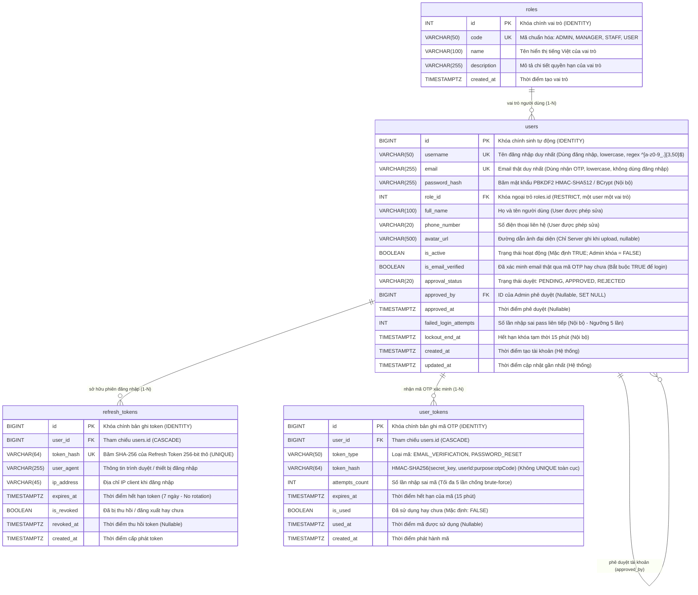

# SMART PARKING SYSTEM – ACCOUNTS & AUTHENTICATION ERD
## SƠ ĐỒ QUAN HỆ THỰC THỂ CHI TIẾT PHÂN HỆ TÀI KHOẢN & XÁC THỰC

- **Dự án:** Smart Parking System (FPT Software OJT)
- **Tài liệu:** Task 02D – Thiết kế ERD Chi tiết Phân hệ Accounts (Bản Thiết kế Chính thức)
- **Chịu trách nhiệm kiến trúc CSDL:** Phụng (Backend / Database Lead)
- **Hệ quản trị CSDL:** PostgreSQL (Neon Serverless Postgres)
- **Trạng thái phê duyệt:** **APPROVED BY OWNER** (Đã chính thức phê duyệt toàn bộ quyết định thiết kế).

---

## 1. QUYẾT ĐỊNH NGHIỆP VỤ XÁC THỰC CHÍNH THỨC (CONFIRMED & APPROVED)

1. **Đăng ký (Registration):** Người dùng đăng ký bằng **Username + Email + Password** (kèm `fullName`, `phoneNumber`). `username` là tên đăng nhập độc lập duy nhất, không phải email. `email` bắt buộc phải là email thật và được xác minh bằng mã OTP gửi về hộp thư.
2. **reCAPTCHA tại Đăng ký:** Áp dụng server-side reCAPTCHA chỉ tại API Register. Token reCAPTCHA gửi từ client được Backend xác minh trực tiếp với nhà cung cấp dịch vụ (Google), **tuyệt đối không lưu token reCAPTCHA vào cơ sở dữ liệu**.
3. **Xác minh Email (Email Verification):** Xác minh bằng mã OTP 6 số ngẫu nhiên an toàn (CSPRNG) gửi qua dịch vụ email thật. **Chỉ cần xác minh một lần khi đăng ký tài khoản, không yêu cầu mã OTP mỗi lần đăng nhập.**
4. **Đăng nhập (Login):** Đăng nhập bằng **Username + Password**. Không sử dụng Email làm định danh đăng nhập trong phiên bản này. Không bắt OTP hay reCAPTCHA khi đăng nhập thông thường.
5. **Điều kiện tiên quyết đăng nhập:** Tài khoản chưa hoàn tất xác minh email (`is_email_verified = FALSE`) **tuyệt đối không được phép đăng nhập**.
6. **Mô hình Phân quyền:** Sử dụng **mô hình một user một vai trò (1-N)** qua cột `users.role_id` tham chiếu `roles.id`. **Loại bỏ hoàn toàn bảng `user_roles` khỏi thiết kế chính thức.**
7. **Quy trình Phê duyệt Tài khoản (Account Approval):**
   - Tài khoản vai trò `USER` được **tự động chuyển `approval_status = 'APPROVED'` ngay sau khi xác minh email thành công**.
   - Tài khoản `STAFF`, `MANAGER` và `ADMIN` được cấp quyền qua quy trình quản trị an toàn do Quản trị viên chỉ định; không cho phép đăng ký công khai yêu cầu vai trò `ADMIN`, `MANAGER` hoặc `STAFF`.
8. **Google Login:** Xếp loại **OPTIONAL / FUTURE** (chưa triển khai trong Sprint 3, không thêm cột/bảng OAuth).

---

## 2. SƠ ĐỒ ERD CHÍNH THỨC 4 BẢNG ACCOUNTS (MERMAID ERD)



---

## 3. CƠ CHẾ BẢO MẬT & RÀNG BUỘC CƠ SỞ DỮ LIỆU ĐÃ ĐƯỢC PHÊ DUYỆT

### 3.1. Ràng buộc toàn vẹn & Khóa chính
- **Khóa chính (PK):** `BIGINT IDENTITY` cho `users`, `refresh_tokens`, `user_tokens`; `INT IDENTITY` cho `roles`.
- **Ràng buộc duy nhất (Unique Constraints):**
  - `uq_users_username UNIQUE (username)`.
  - `uq_users_email UNIQUE (email)`.
  - `uq_roles_code UNIQUE (code)`.
  - `uq_refresh_tokens_hash UNIQUE (token_hash)`.
  - *(Lưu ý: Đã bỏ ràng buộc UNIQUE toàn cục trên `user_tokens.token_hash` theo quyết định bảo mật đã duyệt).*
- **Ràng buộc khóa ngoại (Foreign Keys):**
  - `fk_users_role FOREIGN KEY (role_id) REFERENCES roles(id) ON DELETE RESTRICT`.
  - `fk_users_approved_by FOREIGN KEY (approved_by) REFERENCES users(id) ON DELETE SET NULL`.
  - `fk_refresh_tokens_user FOREIGN KEY (user_id) REFERENCES users(id) ON DELETE CASCADE`.
  - `fk_user_tokens_user FOREIGN KEY (user_id) REFERENCES users(id) ON DELETE CASCADE`.

### 3.2. Cơ chế băm HMAC-SHA256 cho mã OTP Email
- Mã OTP 6 chữ số sinh ngẫu nhiên an toàn bằng CSPRNG (`100000`..`999999`).
- Database chỉ lưu giá trị băm:
  $$\text{token\_hash} = \text{HMAC\_SHA256}(\text{OTP\_SECRET\_KEY}, \text{userId} : \text{token\_type} : \text{otpCode})$$
- Khóa bí mật `OTP_SECRET_KEY` được cấu hình qua User Secrets / biến môi trường, tuyệt đối không hardcode.
- Thời hạn mã OTP: **15 phút**. Số lần nhập sai tối đa: **5 lần** (`attempts_count >= 5` thì hủy mã).
- Cooldown tối thiểu giữa 2 lần yêu cầu gửi lại mã: **60 giây**.

### 3.3. Xác minh OTP & Cập nhật nguyên tử (Atomic Verification)
- Khi xác minh, hệ thống cập nhật đồng thời:
  ```sql
  -- Bước 1: Consume OTP và kiểm tra điều kiện
  UPDATE user_tokens
  SET is_used = TRUE, used_at = NOW()
  WHERE id = :tokenId
    AND user_id = :userId
    AND token_type = 'EMAIL_VERIFICATION'
    AND is_used = FALSE
    AND expires_at > NOW()
    AND attempts_count < 5;

  -- Bước 2: Chỉ khi số dòng bị ảnh hưởng = 1 (affected rows == 1) mới cập nhật users:
  UPDATE users
  SET is_email_verified = TRUE,
      approval_status = 'APPROVED',
      updated_at = NOW()
  WHERE id = :userId;
  ```
- Nếu `affected rows == 0` (mã đã dùng, hết hạn, hoặc bị nhập sai quá 5 lần), toàn bộ transaction bị hủy bỏ (Rollback).

### 3.4. Refresh Token & Đăng xuất (Logout)
- Refresh Token có TTL **7 ngày**, lưu giá trị băm SHA-256 duy nhất. Không thực hiện rotation trong Sprint 3.
- Access Token JWT có TTL **15 phút**.
- **Quy tắc Đăng xuất chính thức:** API Logout chỉ yêu cầu **Refresh Token hợp lệ** để thu hồi phiên (`is_revoked = TRUE`). **Kể cả khi Access Token JWT đã hết hạn**, người dùng vẫn có thể đăng xuất thành công khỏi hệ thống.

### 3.5. Bootstrap Admin đầu tiên
- Tự động seed 01 tài khoản Admin đầu tiên khi chạy Migration/Startup nếu CSDL chưa có Admin.
- Thông tin `username` và `password` được cấu hình an toàn qua User Secrets / biến môi trường, **tuyệt đối không hardcode**.

---

## 4. TÍNH TƯƠNG THÍCH BÀN GIAO CHO FRONTEND (SONG)

1. **Form Đăng ký (Register):** Nhập `username`, `email`, `password`, `fullName`, `phoneNumber` (kèm reCAPTCHA token gửi lên để server verify). Không gửi trường role.
2. **Form Nhập OTP Xác minh Email:** Nhập `email` và `code` (6 chữ số). Kèm nút "Gửi lại mã" (Cooldown 60s).
3. **Form Đăng nhập (Login):** Nhập **`username`** và `password` (không nhận email).
4. **Form Hồ sơ Cá nhân (Profile):** Hiển thị `username`, `email`, `fullName`, `phoneNumber`, `role`, `isEmailVerified`, `approvalStatus`. Chỉ cho phép cập nhật: `fullName`, `phoneNumber` (không cho gửi `avatarUrl`).
5. **Đăng xuất (Logout):** Client gửi `refreshToken` lên API Logout để thu hồi phiên, sau đó xóa token khỏi bộ nhớ trình duyệt.

---

## 5. TỔNG KẾT
Sơ đồ quan hệ thực thể 4 bảng của Phân hệ Accounts (`users`, `roles`, `refresh_tokens`, `user_tokens`) đã đạt độ hoàn thiện cao nhất, tuân thủ 100% quyết định chính thức đã duyệt của Owner Phụng và sẵn sàng chuyển giao cho Task 02E.
