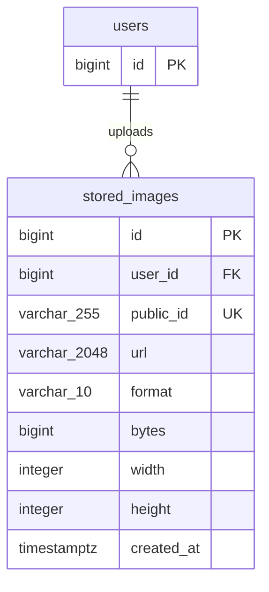

# Cloudinary Image Storage ERD

## Purpose

This document describes how the application stores image metadata for assets hosted by Cloudinary. The image bytes are stored by Cloudinary; PostgreSQL stores the Cloudinary identifiers and metadata needed by the API.

## ERD

`users.id` is the primary key of the existing `users` table. `stored_images.user_id` references it. A user may own zero or more stored images; every stored image belongs to exactly one user.

## `stored_images` data dictionary

| Column | PostgreSQL type | Constraints / index | Meaning |
|---|---|---|---|
| `id` | `bigint` | Primary key; identity-always | Application image ID used in API routes such as `/api/v1/images/{id}`. |
| `user_id` | `bigint` | Required; foreign key to `users.id`; indexed | User who uploaded the image. |
| `public_id` | `varchar(255)` | Required; unique | Cloudinary asset identifier. The server uses this stored value to delete the asset; clients do not supply it for deletion. |
| `url` | `varchar(2048)` | Required | HTTPS delivery URL returned by Cloudinary. |
| `format` | `varchar(10)` | Required | Image format reported by Cloudinary, such as `jpg`, `png`, or `webp`. |
| `bytes` | `bigint` | Required | Uploaded asset size in bytes. |
| `width` | `integer` | Required | Image width in pixels. |
| `height` | `integer` | Required | Image height in pixels. |
| `created_at` | `timestamp with time zone` | Required; default `now()` | Time the image metadata record was created. |

### Keys and deletion behavior

- `pk_stored_images` is the primary key on `id`.
- `uq_stored_images_public_id` enforces uniqueness of `public_id`.
- `ix_stored_images_user_id` supports queries by owner.
- `fk_stored_images_user` references `users(id)` with `ON DELETE CASCADE`. Deleting a user removes their image metadata records.

## Storage and API behavior

1. An authenticated user uploads a JPEG, PNG, or WebP file to `POST /api/v1/images`.
2. The service validates the content, sends the file to Cloudinary, then persists the returned asset metadata and authenticated user's ID.
3. The API returns the database `id`, delivery URL, format, size, dimensions, and creation time. The database ID—not `public_id`—is used with `GET /api/v1/images/{id}` and `DELETE /api/v1/images/{id}`.
4. Metadata retrieval is limited to the owning user; administrators may retrieve any image.
5. Deletion looks up `public_id` from the database, deletes the Cloudinary asset, then removes the metadata row. The API does not trust a client-provided Cloudinary identifier.

The Cloudinary API key and secret are application configuration secrets, not ERD columns. Do not store credentials in this table or commit them to source control.

## Current relationship scope

The implemented schema associates images with their uploading user only. It does **not** currently have a foreign key or relationship to `vehicles`, `parking_sessions`, or another business entity. If the application needs to attach images to those records, design an explicit relationship and migration before treating an image as a vehicle/profile/session image.

## Source of truth

The current implementation is defined by:

- `backend/src/SmartParking.Domain/Entities/StoredImage.cs`
- `backend/src/SmartParking.Infrastructure/Data/Configurations/StoredImageConfiguration.cs`
- Migration `20261028013753_AddStoredImages`
