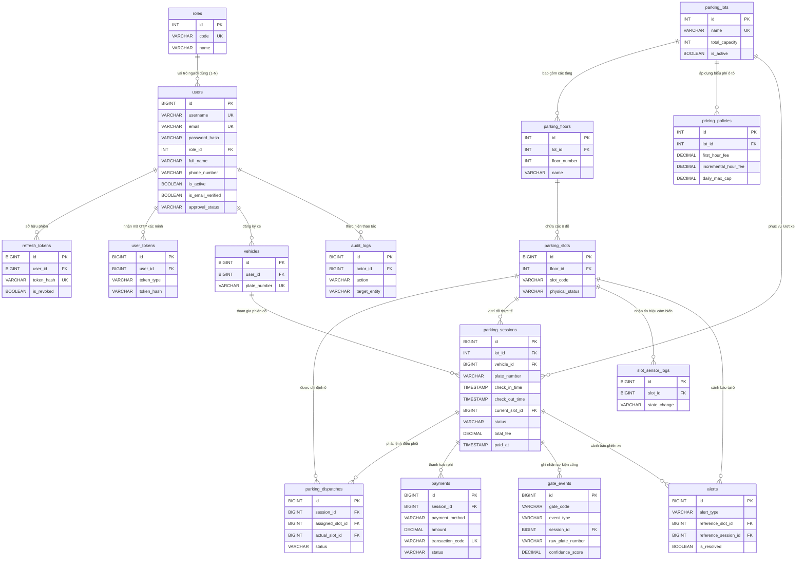

# SMART PARKING SYSTEM – HIGH-LEVEL ERD OVERVIEW
## SƠ ĐỒ QUAN HỆ THỰC THỂ TỔNG THỂ TOÀN HỆ THỐNG

- **Dự án:** Smart Parking System (Mô phỏng 3D kết hợp Quản trị Vận hành Thực tế)
- **Chương trình:** FPT Software OJT
- **Chịu trách nhiệm kiến trúc CSDL:** Phụng (Backend / Database Lead)
- **Tài liệu:** Task 02B – Sơ đồ ERD Tổng thể (High-Level ERD)
- **Hệ quản trị CSDL mục tiêu:** PostgreSQL trên Neon Cloud
- **Trạng thái:** Thiết kế kiến trúc dữ liệu (Chưa tạo Entity/DbContext/Migration/SQL)

---

## 1. TỔNG QUAN KIẾN TRÚC THỰC THỂ HỆ THỐNG

Hệ thống cơ sở dữ liệu Smart Parking được tổ chức thành **7 nhóm nghiệp vụ chính** với sự phân cấp rõ ràng giữa các bảng **CORE** (Bắt buộc cho Sprint 3), **CONDITIONAL** (Cần nhóm xác nhận kỹ thuật), và **FUTURE** (Dự phòng cho Sprint 4):

```
+----------------------------------------------------------------------------------------------------+
|                                    SMART PARKING SYSTEM DOMAINS                                    |
+----------------------------------------------------------------------------------------------------+
  [A. Identity & Access]            [B. Parking Structure]           [C. Vehicles & Sessions]
   - users (CORE)                    - parking_lots (CORE)            - vehicles (CORE)
   - roles (CORE)                    - parking_floors (CORE)          - parking_sessions (CORE)
   - user_tokens (CORE)              - parking_slots (CORE)           - parking_reservations (FUTURE)
   - refresh_tokens (CORE)                                            - subscriptions (FUTURE)
              |                                 |                                |
              +---------------------------------+--------------------------------+
                                                |
                            [D. Parking Dispatch & Allocation]
                             - parking_dispatches (CORE)
                                                |
              +---------------------------------+--------------------------------+
              |                                 |                                |
  [E. Pricing & Payments]           [F. Hardware Events & IoT]       [G. Audit & Operations]
   - pricing_policies (CORE)         - gate_events (CORE)             - audit_logs (CORE)
   - payments (CORE)                 - slot_sensor_logs (CONDITIONAL) - alerts (CONDITIONAL)
                                                                      - system_configs (CONDITIONAL)
+----------------------------------------------------------------------------------------------------+
```

---

## 2. SƠ ĐỒ ERD TỔNG THỂ HỆ THỐNG (SYSTEM-WIDE ERD)

Dưới đây là sơ đồ Mermaid thể hiện mối quan hệ liên kết giữa các bảng trong toàn bộ 7 phân hệ (đã loại bỏ `vehicle_types` do hệ thống chỉ phục vụ ô tô thông thường):



---

## 3. PHÂN ĐỊNH RANH GIỚI VÀ MỐI QUAN HỆ GIỮA CÁC PHÂN HỆ

### 3.1. Phân hệ Trung tâm: Phiên gửi xe (`parking_sessions`)
- Bảng `parking_sessions` là trái tim kết nối toàn bộ hệ thống.
- **Vào cổng:** Nhận dữ liệu từ `gate_events` (Nhận diện biển số, ảnh chụp vào).
- **Hồ sơ phương tiện:** Tra cứu `vehicles` để xác định xe ô tô đã đăng ký hoặc ghi nhận xe ô tô vãng lai.
- **Điều phối:** Kích hoạt tạo bản ghi trong `parking_dispatches` để chỉ định ô đỗ.
- **Đỗ xe thực tế:** Khi cảm biến ô đỗ xác nhận, trường `current_slot_id` liên kết trực tiếp tới `parking_slots`.
- **Thanh toán:** Tạo liên kết 1-N tới `payments` để ghi nhận các giao dịch thanh toán.
- **Xuất bãi:** Xác nhận điều kiện xuất bãi với `gate_events` cổng ra, ghi nhận `check_out_time` và chuyển trạng thái `COMPLETED`.

### 3.2. Mối quan hệ giữa Accounts và Vận hành bãi xe
- Người dùng (`users`) có thể liên kết 1-N với phương tiện cá nhân (`vehicles`).
- Khách vãng lai chưa có tài khoản vẫn có thể vào bãi: Khi đó, trường `vehicles.user_id` có giá trị `NULL`, hệ thống vẫn lưu biển số xe vào `parking_sessions.plate_number` bình thường.
- Nhân viên vận hành (`users` có role `STAFF`), Quản lý (`MANAGER`) và Quản trị viên (`ADMIN`) tương tác với hệ thống qua các hành động ghi nhận vào `audit_logs` (thao tác điều phối thủ công, mở barrier cưỡng bức, sửa giá).

### 3.3. Tách biệt Trạng thái Ô đỗ và Trạng thái Điều phối
- Ô đỗ (`parking_slots`) **chỉ quản lý trạng thái vật lý thực tế** (`physical_status`: `EMPTY`, `OCCUPIED`, `MAINTENANCE`, `UNAVAILABLE`). Không tự giả định toàn bộ slot có cùng kích thước.
- Lệnh điều phối (`parking_dispatches`) **quản lý trạng thái phân công logic** (`PENDING`, `ASSIGNED`, `OCCUPIED`, `WRONG_SLOT`, `CANCELLED`).
- Tính khả dụng của một slot được tính toán bằng biểu thức:
  $$\text{Slot Available} \iff \text{physical\_status} = \text{'EMPTY'} \land \neg \exists \text{ active dispatch with status 'ASSIGNED' trỏ tới slot đó}$$

---

## 4. DANH MỤC PHÂN BỔ TRẠNG THÁI TRIỂN KHAI (19 BẢNG TOÀN HỆ THỐNG)

Toàn hệ thống thống nhất chuẩn hóa **19 bảng** (14 CORE, 3 CONDITIONAL, 2 FUTURE):

| Nhóm nghiệp vụ | Bảng CORE (14 bảng - Sprint 3) | Bảng CONDITIONAL (3 bảng - Cần xác nhận) | Bảng FUTURE (2 bảng - Sprint 4) |
| :--- | :--- | :--- | :--- |
| **A. Accounts** | `users`, `roles`, `user_tokens`, `refresh_tokens` | - | - |
| **B. Structure** | `parking_lots`, `parking_floors`, `parking_slots` | - | - |
| **C. Sessions** | `vehicles`, `parking_sessions` | - | `parking_reservations`, `subscriptions` |
| **D. Dispatch** | `parking_dispatches` | - | - |
| **E. Pricing** | `pricing_policies`, `payments` | - | - |
| **F. Hardware** | `gate_events` | `slot_sensor_logs` | - |
| **G. Audit/Ops** | `audit_logs` | `alerts`, `system_configs` | - |

*(Ghi chú: Mô hình phân hệ Accounts đã được Owner phê duyệt chính thức sử dụng mô hình 1-N `users.role_id`, loại bỏ bảng `user_roles`; bổ sung đầy đủ `user_tokens` và `refresh_tokens` vào CORE).*

---

## 5. TỔNG KẾT
Sơ đồ ERD tổng thể cung cấp cái nhìn toàn cảnh về kiến trúc liên kết giữa các bảng. Tài liệu tiếp theo [07_ACCOUNTS_ERD.md](file:///e:/smartparking/docs/database/07_ACCOUNTS_ERD.md) sẽ đi sâu vào thiết kế chi tiết cấp thuộc tính cho Phân hệ Accounts & Authentication theo yêu cầu bàn giao cho Song.
