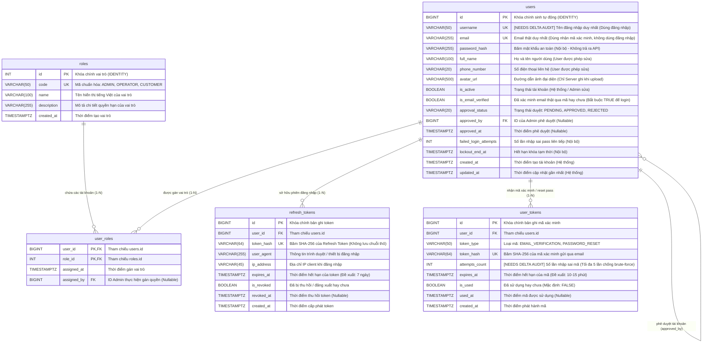

# SMART PARKING SYSTEM – ACCOUNTS & AUTHENTICATION ERD
## SƠ ĐỒ QUAN HỆ THỰC THỂ CHI TIẾT PHÂN HỆ TÀI KHOẢN & XÁC THỰC

- **Dự án:** Smart Parking System (FPT Software OJT)
- **Tài liệu:** Task 02B & Task 02D – Thiết kế ERD Chi tiết Phân hệ Accounts (Bản cập nhật xác thực chính thức)
- **Hệ quản trị CSDL:** PostgreSQL (Neon Serverless Postgres)
- **Trạng thái:** Phương án thiết kế đề xuất cập nhật theo quyết định chính thức của Owner Phụng.
- **Đánh dấu kiểm toán:** Toàn bộ nội dung cập nhật mới được gắn cờ **`[NEEDS DELTA AUDIT]`** để Agent Cursor kiểm toán bổ sung trước khi triển khai code.

---

## 1. QUYẾT ĐỊNH NGHIỆP VỤ XÁC THỰC CHÍNH THỨC (CONFIRMED BY OWNER)

1. **Đăng ký (Registration):** Người dùng đăng ký bằng **Username + Email + Password** (kèm họ tên, số điện thoại). `username` là tên đăng nhập riêng biệt, không phải email. `email` bắt buộc phải là email thật và phải được xác minh bằng mã gửi qua email.
2. **Đăng nhập (Login):** Đăng nhập bằng **Username + Password**. Trong phiên bản này, **không sử dụng Email làm định danh đăng nhập**. Tài khoản chưa hoàn tất xác minh email (`is_email_verified = FALSE`) **tuyệt đối không được phép đăng nhập**.
3. **Google Login:** Xếp loại **OPTIONAL / FUTURE** (chưa triển khai trong Sprint 3, không thêm cột/bảng OAuth làm ảnh hưởng tiến độ).

---

## 2. SƠ ĐỒ ERD CHI TIẾT 5 BẢNG ACCOUNTS (MERMAID ERD)

---

## 3. PHÂN TÍCH THUỘC TÍNH VÀ QUY TẮC DỮ LIỆU [NEEDS DELTA AUDIT]

### 3.1. Bảng `users` – Phân định rõ ràng giữa `username` và `email`
- **`username` (Tên đăng nhập):**
  - Định dạng: Chuỗi ký tự từ 3 đến 50 ký tự, cho phép chữ cái thường (`a-z`), chữ số (`0-9`), dấu gạch dưới (`_`) và dấu chấm (`.`).
  - Chuẩn hóa: Bắt buộc chuyển về chữ thường không dấu (`username = username.Trim().ToLowerInvariant()`) trước khi lưu và trước khi kiểm tra đăng nhập.
  - Ràng buộc: `NOT NULL`, `UNIQUE` (`uq_users_username`). Không cho phép người dùng tự đổi `username` sau khi tạo.
  - Sử dụng làm định danh duy nhất để đối soát mật khẩu trong luồng Đăng nhập.
- **`email` (Địa chỉ email thật):**
  - Định dạng: Chuỗi chuẩn RFC 5322 (`VARCHAR(255)`).
  - Chuẩn hóa: `email = email.Trim().ToLowerInvariant()`.
  - Ràng buộc: `NOT NULL`, `UNIQUE` (`uq_users_email`).
  - Mục đích: Dùng để nhận mã xác minh OTP qua dịch vụ gửi email thật (SMTP/MailKit/SendGrid). **Không dùng làm định danh đăng nhập trong phiên bản này**.
- **Điều kiện tiên quyết đăng nhập (Login Invariant):**
  - Mọi tài khoản muốn đăng nhập thành công bắt buộc phải thỏa mãn đồng thời:
    $$\text{Đăng nhập thành công} \iff \text{Mật khẩu khớp} \land \text{is\_email\_verified} = \text{TRUE} \land \text{is\_active} = \text{TRUE} \land (\text{approval\_status} = \text{'APPROVED'} \lor \text{Role} = \text{'CUSTOMER'})$$

### 3.2. Bảng `user_tokens` – Cơ chế xác thực mã an toàn qua email thật
- **Bản chất mã xác minh:** Mã số gồm 6 chữ số ngẫu nhiên sinh bằng bộ sinh số ngẫu nhiên an toàn (`RandomNumberGenerator` / CSPRNG).
- **Lưu trữ an toàn:** Database **chỉ lưu `token_hash = SHA256(code)`**, không lưu mã thô.
- **Chống dò quét mã (Anti-Brute Force):** Bổ sung trường `attempts_count INT DEFAULT 0`. Mỗi lần nhập sai mã, tăng 1; nếu nhập sai quá 5 lần, mã bị vô hiệu hóa ngay lập tức.
- **Thời hạn mã (TTL):** Đề xuất 10 - 15 phút.
- **Chống sử dụng lại (Anti-Reuse & Atomic Consume):** Khi người dùng nhập đúng mã, hệ thống thực thi cập nhật nguyên tử `UPDATE user_tokens SET is_used = TRUE, used_at = NOW() WHERE ... AND is_used = FALSE AND expires_at > NOW() RETURNING user_id`.

---

## 4. TÍNH TƯƠNG THÍCH ĐỂ BÀN GIAO CHO FRONTEND (SONG)

Dựa trên sơ đồ cập nhật này, Song (Frontend Developer) thiết kế các màn hình giao diện:
1. **Màn hình Đăng ký (Register):** Form nhập `username`, `email`, `password`, `fullName`, `phoneNumber`. Frontend không gửi role (mặc định server gán CUSTOMER).
2. **Màn hình Nhập mã xác minh Email (Verify Email Code):** Form hiển thị thông báo đã gửi mã tới email, người dùng nhập mã 6 số (kèm nút "Gửi lại mã" / Resend Code sau cooldown 60 giây).
3. **Màn hình Đăng nhập (Login):** Nhận **`username`** và `password` (không nhận email). Nếu tài khoản chưa xác minh email, hiển thị thông báo lỗi và điều hướng sang màn hình nhập mã xác minh.
4. **Màn hình Hồ sơ cá nhân (Profile):** Hiển thị `username`, `email`, `fullName`, `phoneNumber`, `avatarUrl`, `roles`, `isEmailVerified`, `approvalStatus`. Cho phép sửa: `fullName`, `phoneNumber`.

---

## 5. TỔNG KẾT
Sơ đồ Accounts ERD đã cập nhật trọn vẹn theo quyết định nghiệp vụ chính thức của Owner Phụng và sẵn sàng cho đợt **Cursor Delta Audit** tại Task 02D.
