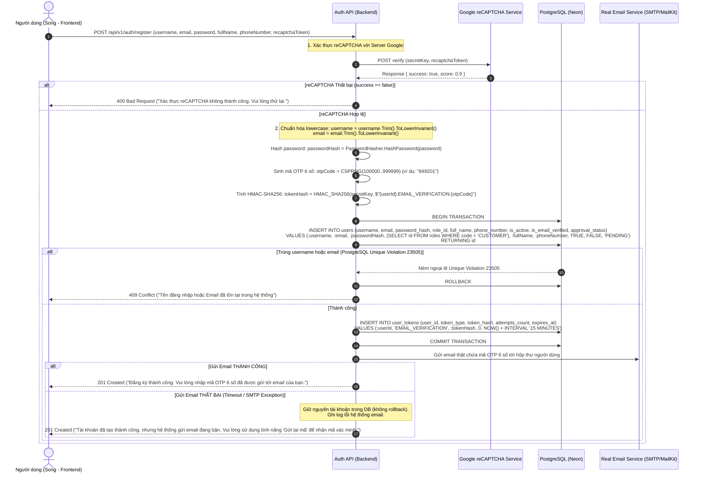
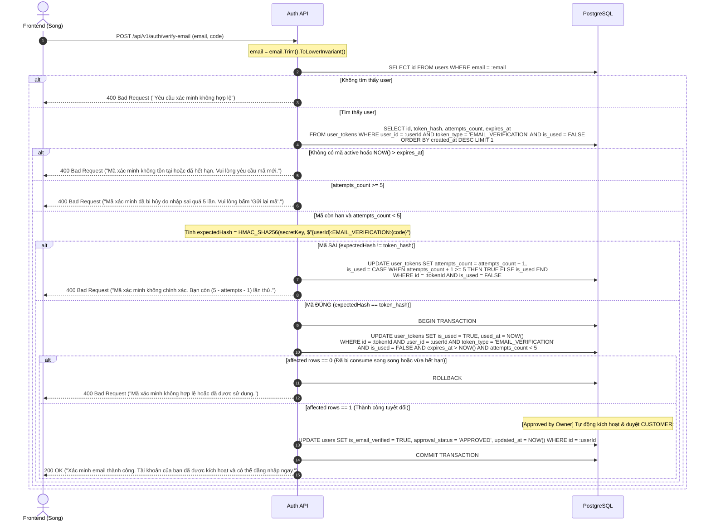
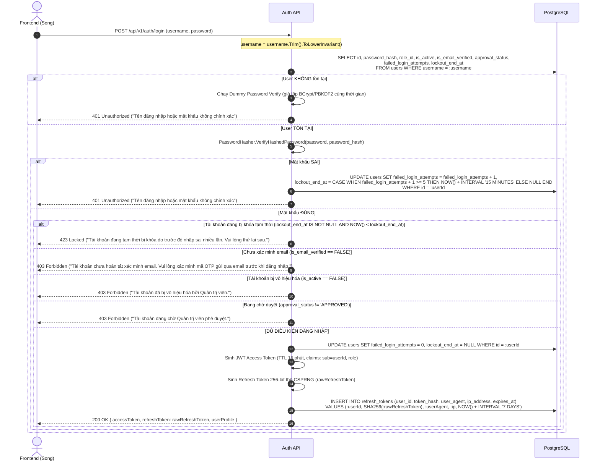

# SMART PARKING SYSTEM – ACCOUNTS AUTHENTICATION FLOWS
## ĐẶC TẢ CHI TIẾT CÁC LUỒNG NGHIỆP VỤ TÀI KHOẢN & XÁC THỰC

- **Dự án:** Smart Parking System (FPT Software OJT)
- **Tài liệu:** Task 02D – Đặc tả luồng dữ liệu Accounts & Auth (Bản Thiết kế Chính thức)
- **Chịu trách nhiệm kiến trúc CSDL:** Phụng (Backend / Database Lead)
- **Hệ quản trị CSDL:** PostgreSQL trên Neon Cloud
- **Trạng thái phê duyệt:** **APPROVED BY OWNER** (Đã chính thức phê duyệt toàn bộ quyết định thiết kế).

---

## 1. CẤU HÌNH BẢO VỆ RATE LIMITING BẮT BUỘC (APPROVED BY OWNER)

Để bảo vệ hệ thống trước tấn công DoS, vét cạn mật khẩu (Brute-force) và spam email, hệ thống áp dụng Rate Limiting tại tầng ASP.NET Core Middleware theo địa chỉ IP:

| Endpoint | Method | Giới hạn tối đa (Rate Limit) | Hành vi khi vượt ngưỡng |
| :--- | :---: | :--- | :--- |
| `/api/v1/auth/register` | `POST` | **5 requests / phút / IP** | Trả về `429 Too Many Requests` |
| `/api/v1/auth/login` | `POST` | **10 requests / phút / IP** | Trả về `429 Too Many Requests` |
| `/api/v1/auth/verify-email` | `POST` | **10 requests / phút / IP** | Trả về `429 Too Many Requests` |
| `/api/v1/auth/resend-verification`| `POST` | **3 requests / 10 phút / IP** | Trả về `429 Too Many Requests` (kèm Cooldown tối thiểu 60s) |

---

## 2. LUỒNG 1: ĐĂNG KÝ TÀI KHOẢN & VERIFY RECAPTCHA SERVER-SIDE

### 2.1. Mục tiêu & Nguyên tắc nghiệp vụ
- Người dùng đăng ký bằng **Username + Email + Password** (kèm `fullName`, `phoneNumber`, `recaptchaToken`).
- **reCAPTCHA Server-Side Verification:** Token `recaptchaToken` được Backend xác minh trực tiếp với Google; **không lưu token reCAPTCHA vào cơ sở dữ liệu**.
- `username` là tên đăng nhập độc lập duy nhất; `email` là email thật nhận mã xác minh OTP 6 chữ số.
- Không nhận trường role từ client; hệ thống tự động gán khóa ngoại `users.role_id` trỏ đến vai trò `CUSTOMER`.

### 2.2. Sơ đồ tuần tự (Sequence Diagram)



---

## 3. LUỒNG 2: XÁC MINH EMAIL BẰNG MÃ OTP (CUSTOMER AUTO-APPROVED)

### 3.1. Mục tiêu & Nguyên tắc nghiệp vụ
- Người dùng gửi `email` và `code` (6 chữ số).
- **Atomic OTP Consume:** Kiểm tra điều kiện và consume mã trong cùng transaction. Kiểm tra affected rows: nếu bằng 0 (hết hạn, mã sai quá 5 lần, hoặc đã bị consume) thì Rollback.
- **CUSTOMER Auto-Approve:** Khi mã OTP hợp lệ, tài khoản khách hàng tự động được cập nhật `is_email_verified = TRUE` và `approval_status = 'APPROVED'`.

### 3.2. Sơ đồ xử lý chi tiết



---

## 4. LUỒNG 3: GỬI LẠI MÃ XÁC MINH (RESEND VERIFICATION)

1. Client gửi: `POST /api/v1/auth/resend-verification` kèm `{ "email": "phung.vo@example.com" }`.
2. Backend chuẩn hóa email lowercase, tra cứu `users`:
   - Nếu user không tồn tại: Trả về `200 OK` trung tính để tránh user enumeration.
   - Nếu `is_email_verified == TRUE`: Trả về `200 OK` ("Tài khoản đã được xác minh trước đó. Bạn có thể đăng nhập ngay.").
3. **Cơ chế Cooldown 60 giây chống spam:**
   - Tra cứu bản ghi gần nhất trong `user_tokens`: Nếu `NOW() - created_at < 60 SECONDS`, trả về `429 Too Many Requests` ("Vui lòng chờ 60 giây trước khi yêu cầu gửi lại mã.").
4. **Vô hiệu hóa toàn bộ mã cũ chưa dùng:**
   ```sql
   UPDATE user_tokens
   SET is_used = TRUE
   WHERE user_id = :userId AND token_type = 'EMAIL_VERIFICATION' AND is_used = FALSE;
   ```
5. Sinh mã OTP 6 số mới, tính `HMAC-SHA256`, ghi vào `user_tokens` với TTL 15 phút.
6. Gửi email thật chứa mã mới tới email của user. Trả về `200 OK`.

---

## 5. LUỒNG 4: ĐĂNG NHẬP BẰNG USERNAME + PASSWORD

### 5.1. Quy tắc an ninh đăng nhập chuẩn OWASP
1. Đăng nhập **BẮT BUỘC bằng Username + Password**. Không nhận Email. Không bắt OTP hay reCAPTCHA khi đăng nhập thông thường.
2. **Thứ tự kiểm tra an ninh:**
   - **Xác thực Mật khẩu PHẢI ĐƯỢC THỰC HIỆN TRƯỚC TIÊN**.
   - Nếu `username` không tồn tại: Chạy Dummy Password Verify để ngăn ngừa Timing Attack dò tìm tên đăng nhập.
   - Nếu mật khẩu SAI: Tăng `failed_login_attempts` (ngưỡng 5 lần khóa 15 phút) $\rightarrow$ Trả `401 Unauthorized`.
   - **Chỉ sau khi mật khẩu ĐÚNG** mới kiểm tra các trạng thái: `lockout_end_at`, `is_email_verified`, `is_active`, `approval_status`.

### 5.2. Sơ đồ tuần tự



---

## 6. LUỒNG 5: CẤP MỚI ACCESS TOKEN (REFRESH TOKEN FLOW)

Thực hiện cơ chế không xoay vòng (No-rotation) cho Sprint 3 theo quyết định chính thức:
1. Client gửi: `POST /api/v1/auth/refresh` kèm `{ "refreshToken": rawRefreshToken }`.
2. Backend tính: `tokenHash = SHA256(rawRefreshToken)`.
3. Backend tra cứu:
   ```sql
   SELECT r.id, r.user_id, u.is_active, u.is_email_verified, u.approval_status
   FROM refresh_tokens r
   JOIN users u ON r.user_id = u.id
   WHERE r.token_hash = :tokenHash AND r.is_revoked = FALSE AND r.expires_at > NOW();
   ```
4. Nếu không hợp lệ hoặc user bị khóa: Trả về `401 Unauthorized`.
5. Nếu hợp lệ: Cấp mới một **JWT Access Token mới (TTL 15 phút)**. Giữ nguyên Refresh Token hiện tại. Trả về `200 OK { "accessToken": newJwt }`.

---

## 7. LUỒNG 6: ĐĂNG XUẤT (LOGOUT & LOGOUT-ALL)

### 7.1. Đăng xuất phiên hiện tại (`POST /api/v1/auth/logout`)
- Client gửi: `{ "refreshToken": rawRefreshToken }`.
- **Quy tắc quan trọng đã được Owner duyệt:** API Logout **chỉ yêu cầu Refresh Token hợp lệ** để thu hồi phiên. **Kể cả khi JWT Access Token đã hết hạn**, người dùng vẫn đăng xuất thành công.
- Xử lý CSDL:
  ```sql
  UPDATE refresh_tokens 
  SET is_revoked = TRUE, revoked_at = NOW() 
  WHERE token_hash = SHA256(:refreshToken) AND is_revoked = FALSE;
  ```
- Trả về `200 OK` ("Đăng xuất thành công.").

### 7.2. Đăng xuất tất cả thiết bị (Logout-All)
- Áp dụng khi đổi mật khẩu hoặc phát hiện tài khoản bị xâm nhập:
  ```sql
  UPDATE refresh_tokens 
  SET is_revoked = TRUE, revoked_at = NOW() 
  WHERE user_id = :userId AND is_revoked = FALSE;
  ```

---

## 8. LUỒNG 7: XEM VÀ CẬP NHẬT HỒ SƠ NGƯỜI DÙNG

1. **Xem hồ sơ (`GET /api/v1/users/me`):** Trả về `UserProfileDto` (`id`, `username`, `email`, `fullName`, `phoneNumber`, `avatarUrl`, `role`, `isEmailVerified`, `approvalStatus`).
2. **Cập nhật hồ sơ (`PUT /api/v1/users/me`):**
   - Request DTO: `UpdateProfileRequestDto(fullName, phoneNumber)`.
   - **Đã loại bỏ `avatarUrl`**. Client không được tự gửi avatar url để chống XSS.
   - **Tuyệt đối cấm sửa `username`, `email`, `role`, `approvalStatus`** qua API này.
