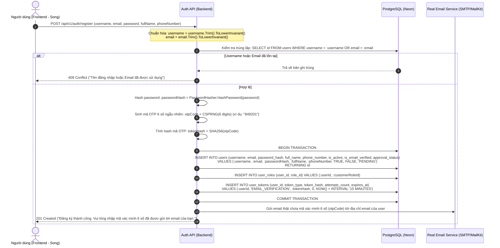
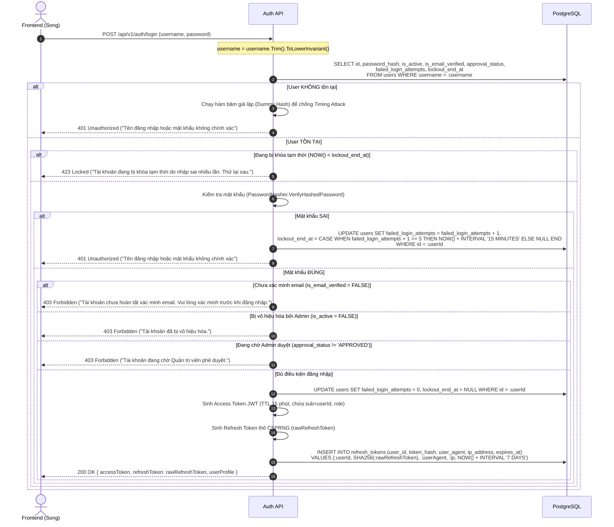

# SMART PARKING SYSTEM – ACCOUNTS AUTHENTICATION FLOWS
## ĐẶC TẢ CHI TIẾT CÁC LUỒNG NGHIỆP VỤ TÀI KHOẢN & XÁC THỰC

- **Dự án:** Smart Parking System (FPT Software OJT)
- **Tài liệu:** Task 02B & Task 02D – Đặc tả luồng dữ liệu Accounts & Auth (Bản cập nhật xác thực chính thức)
- **Hệ quản trị CSDL:** PostgreSQL trên Neon Cloud
- **Đánh dấu kiểm toán:** Toàn bộ nội dung cập nhật mới được gắn cờ **`[NEEDS DELTA AUDIT]`** để Agent Cursor kiểm toán bổ sung.

---

## 1. LUỒNG 1: ĐĂNG KÝ TÀI KHOẢN (USER REGISTRATION) [NEEDS DELTA AUDIT]

### 1.1. Mục tiêu nghiệp vụ
Người dùng đăng ký tài khoản mới bằng **Username + Email + Password** (kèm họ tên, số điện thoại). `username` là tên đăng nhập duy nhất; `email` là email thật dùng để nhận mã xác minh 6 số qua dịch vụ email thực tế.

### 1.2. Sơ đồ tuần tự (Sequence Diagram)



### 1.3. Trạng thái dữ liệu sau khi đăng ký
- `users`: `username` và `email` lưu dạng lowercase; `is_email_verified = FALSE`; `approval_status = 'PENDING'`.
- `user_tokens`: Bản ghi mã với `token_type = 'EMAIL_VERIFICATION'`, `token_hash = SHA256(otpCode)`, `attempts_count = 0`, thời hạn 15 phút.

---

## 2. LUỒNG 2: XÁC MINH EMAIL BẰNG MÃ THẬT (EMAIL OTP VERIFICATION) [NEEDS DELTA AUDIT]

### 2.1. Mục tiêu nghiệp vụ
Người dùng nhập mã xác minh 6 chữ số nhận được từ hộp thư email thật để hoàn tất kích hoạt tài khoản.

### 2.2. Các bước tương tác Database & Chống Brute-force mã
1. Frontend gửi yêu cầu: `POST /api/v1/auth/verify-email` kèm `{ "identifier": "username_hoac_email", "code": "849201" }`.
2. Backend chuẩn hóa `identifier` (lowercase), tra cứu `users.id`.
3. Backend tìm mã xác minh đang hoạt động trong `user_tokens`:
   ```sql
   SELECT id, token_hash, attempts_count, expires_at, is_used 
   FROM user_tokens 
   WHERE user_id = :userId AND token_type = 'EMAIL_VERIFICATION' AND is_used = FALSE
   ORDER BY created_at DESC LIMIT 1;
   ```
4. **Kiểm tra an ninh và giới hạn số lần thử:**
   - Nếu không tìm thấy mã hoặc `NOW() > expires_at`: Trả về `400 Bad Request` ("Mã xác minh đã hết hạn. Vui lòng yêu cầu gửi mã mới.").
   - Nếu `attempts_count >= 5`: Trả về `429 Too Many Requests` ("Mã xác minh đã bị vô hiệu hóa do nhập sai quá 5 lần. Vui lòng yêu cầu mã mới.").
   - Tính toán hash: `inputHash = SHA256(code)`.
   - **Nếu mã SAI (`inputHash != token_hash`):**
     ```sql
     UPDATE user_tokens 
     SET attempts_count = attempts_count + 1 
     WHERE id = :tokenId;
     ```
     Trả về lỗi `400 Bad Request` ("Mã xác minh không chính xác. Bạn còn " || (5 - attempts_count - 1) || " lần thử.").
   - **Nếu mã ĐÚNG (`inputHash == token_hash`):**
     Thực thi Transaction cập nhật nguyên tử:
     ```sql
     BEGIN;
     -- Đánh dấu mã đã sử dụng nguyên tử (chống race condition)
     UPDATE user_tokens 
     SET is_used = TRUE, used_at = NOW() 
     WHERE id = :tokenId AND is_used = FALSE AND expires_at > NOW();

     -- Kích hoạt tài khoản
     UPDATE users 
     SET is_email_verified = TRUE,
         approval_status = CASE 
             WHEN approval_status = 'PENDING' AND id IN (
                 SELECT user_id FROM user_roles WHERE role_id = (SELECT id FROM roles WHERE code = 'CUSTOMER')
             ) THEN 'APPROVED'
             ELSE approval_status 
         END,
         updated_at = NOW()
     WHERE id = :userId;
     COMMIT;
     ```
5. Backend trả về thông báo xác minh thành công. Người dùng có thể đăng nhập bằng `username` + `password`.

---

## 3. LUỒNG 3: GỬI LẠI MÃ XÁC MINH (RESEND VERIFICATION CODE) [NEEDS DELTA AUDIT]

1. Client gửi: `POST /api/v1/auth/resend-verification-code` kèm `{ "identifier": "username_hoac_email" }`.
2. Backend tra cứu `users`:
   - Nếu tài khoản đã `is_email_verified = TRUE`: Trả về `200 OK` ("Tài khoản đã được xác minh. Bạn có thể đăng nhập ngay.").
3. **Cơ chế Cooldown chống spam:** Kiểm tra thời điểm tạo mã gần nhất trong `user_tokens`. Nếu `NOW() - created_at < 60 SECONDS`, từ chối và trả về `429 Too Many Requests` ("Vui lòng chờ 60 giây trước khi yêu cầu gửi lại mã.").
4. Vô hiệu hóa các mã cũ chưa dùng của user:
   ```sql
   UPDATE user_tokens 
   SET is_used = TRUE 
   WHERE user_id = :userId AND token_type = 'EMAIL_VERIFICATION' AND is_used = FALSE;
   ```
5. Sinh mã OTP 6 số mới, băm SHA-256, ghi vào `user_tokens` với hạn 15 phút.
6. Gửi email thật chứa mã mới tới email của người dùng. Trả về `200 OK`.

---

## 4. LUỒNG 4: ĐĂNG NHẬP BẰNG USERNAME & CHỐNG BRUTE-FORCE [NEEDS DELTA AUDIT]

### 4.1. Quy tắc đăng nhập chính thức
- Đăng nhập **BẮT BUỘC bằng Username + Password**. Không nhận Email.
- **Tài khoản chưa xác minh email (`is_email_verified = FALSE`) TUYỆT ĐỐI KHÔNG ĐƯỢC PHÉP ĐĂNG NHẬP.**

### 4.2. Sơ đồ tuần tự



---

## 5. LUỒNG 5: CẤP MỚI ACCESS TOKEN (REFRESH TOKEN FLOW) [NEEDS DELTA AUDIT]

Theo phát hiện C1 của Cursor Audit, luồng Refresh Token được đặc tả chuẩn mực (không xoay vòng):
1. Client gửi: `POST /api/v1/auth/refresh` kèm `{ "refreshToken": rawRefreshToken }`.
2. Backend tính toán: `tokenHash = SHA256(rawRefreshToken)`.
3. Backend tra cứu:
   ```sql
   SELECT r.id, r.user_id, u.is_active, u.is_email_verified
   FROM refresh_tokens r
   JOIN users u ON r.user_id = u.id
   WHERE r.token_hash = :tokenHash AND r.is_revoked = FALSE AND r.expires_at > NOW();
   ```
4. Nếu không tìm thấy hoặc user bị khóa: Trả về `401 Unauthorized` ("Phiên đăng nhập không hợp lệ hoặc đã hết hạn.").
5. Nếu hợp lệ: Cấp mới một **JWT Access Token mới (TTL 15 phút)**. Giữ nguyên Refresh Token hiện hành trong thời hạn hiệu lực của nó. Trả về `200 OK { "accessToken": newJwt }`.

---

## 6. LUỒNG 6: ĐĂNG XUẤT (LOGOUT & LOGOUT-ALL)

1. **Đăng xuất phiên hiện tại:** `POST /api/v1/auth/logout` kèm `{ "refreshToken": rawRefreshToken }`. Backend cập nhật `UPDATE refresh_tokens SET is_revoked = TRUE, revoked_at = NOW() WHERE token_hash = SHA256(:refreshToken);`.
2. **Đăng xuất khỏi tất cả thiết bị (Logout-All):** Dùng khi đổi mật khẩu hoặc phát hiện sự cố:
   ```sql
   UPDATE refresh_tokens 
   SET is_revoked = TRUE, revoked_at = NOW() 
   WHERE user_id = :userId AND is_revoked = FALSE;
   ```

---

## 7. LUỒNG 7: XEM HỒ SƠ & CẬP NHẬT THÔNG TIN

1. **Xem hồ sơ (`GET /api/v1/users/me`):** Trả về `UserProfileDto` gồm `username`, `email`, `fullName`, `phoneNumber`, `avatarUrl`, `role`, `isEmailVerified`, `approvalStatus`.
2. **Cập nhật hồ sơ (`PUT /api/v1/users/me`):**
   - Chỉ nhận: `fullName`, `phoneNumber`.
   - **Tuyệt đối cấm sửa `username` và `email` qua API này.**

---

## 8. TỔNG KẾT
Đặc tả luồng nghiệp vụ đã hoàn thiện, phản ánh chính xác yêu cầu: Đăng ký đầy đủ Username + Email thật, xác minh bằng mã OTP 6 số qua email thật, và Đăng nhập bằng Username + Password.
