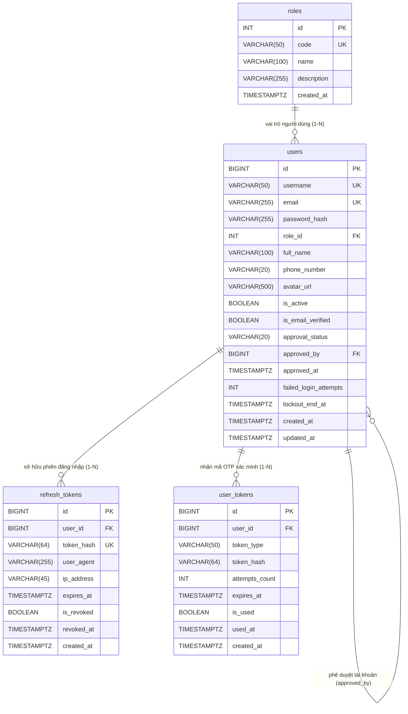

# SMART PARKING SYSTEM – ACCOUNTS DESIGN DECISIONS
## BÁO CÁO PHÂN TÍCH QUYẾT ĐỊNH THIẾT KẾ PHÂN HỆ TÀI KHOẢN & XÁC THỰC

- **Dự án:** Smart Parking System (FPT Software OJT)
- **Tài liệu:** Task 02D – Quyết định Thiết kế Accounts (Bản Chính thức Sau Kiểm toán)
- **Chịu trách nhiệm kiến trúc CSDL:** Phụng (Backend / Database Lead)
- **Hệ quản trị CSDL:** PostgreSQL trên Neon Cloud
- **Trạng thái phê duyệt:** **APPROVED BY OWNER** (Owner Phụng đã chính thức phê duyệt toàn bộ quyết định thiết kế).

---

## 1. QUYẾT ĐỊNH NGHIỆP VỤ CHÍNH THỨC (CONFIRMED & APPROVED BY OWNER)

1. **Cơ chế Đăng ký (Registration):**
   - Đăng ký bằng **`username` + `email` + `password`** (kèm `fullName`, `phoneNumber`, `recaptchaToken`).
   - `username` là tên đăng nhập độc lập duy nhất, không phải email.
   - `email` bắt buộc phải là **email thật** và phải được xác minh bằng mã OTP gửi về hộp thư.
   - **reCAPTCHA:** Chỉ áp dụng tại API Register; bắt buộc xác minh server-side với nhà cung cấp (Google); token reCAPTCHA **tuyệt đối không lưu vào cơ sở dữ liệu**.
2. **Cơ chế Xác minh Email (Email Verification):**
   - Xác minh bằng mã OTP 6 chữ số gửi qua dịch vụ email thực tế (SMTP/MailKit/SendGrid).
   - **Email chỉ cần xác minh một lần khi đăng ký; không yêu cầu mã OTP mỗi lần đăng nhập.**
3. **Cơ chế Đăng nhập (Login):**
   - Đăng nhập duy nhất bằng **`username` + `password`**. Không sử dụng Email làm định danh đăng nhập trong phiên bản này.
   - **Không bắt OTP hay reCAPTCHA khi đăng nhập thông thường.**
   - Tài khoản chưa hoàn tất xác minh email (`is_email_verified = FALSE`) **tuyệt đối không được phép đăng nhập**.
4. **Phạm vi Google Login:**
   - Xếp loại **OPTIONAL / FUTURE** (chưa triển khai trong Sprint 3). Không thêm cột/bảng OAuth nào vào CSDL.

---

## 2. QUYẾT ĐỊNH CƠ SỞ DỮ LIỆU CHÍNH THỨC (DATABASE DECISIONS – APPROVED)

1. **Mô hình Phân quyền Một User Một Role (1-N Model):**
   - Sử dụng mô hình 1-N: Bổ sung cột khóa ngoại `users.role_id INT NOT NULL REFERENCES roles(id) ON DELETE RESTRICT`.
   - **Loại bỏ hoàn toàn bảng `user_roles` khỏi thiết kế chính thức.**
   - Giúp kiến trúc CSDL tinh gọn, đơn giản hóa việc nạp Role Claim vào JWT, triệt tiêu nguy cơ leo quyền khi auto-approve.
2. **Danh mục 4 Bảng Thuộc Phân hệ Accounts:**
   - `users`: Quản lý danh tính, tài khoản và hồ sơ người dùng.
   - `roles`: Danh mục vai trò chuẩn hóa (`ADMIN`, `OPERATOR`, `CUSTOMER`).
   - `user_tokens`: Quản lý mã OTP 6 số xác minh email qua dịch vụ email thật.
   - `refresh_tokens`: Quản lý phiên đăng nhập dài hạn và thu hồi phiên an toàn.
3. **Quy trình Phê duyệt Tài khoản (Account Approval Policy):**
   - Giữ nguyên các trường nghiệp vụ: `approval_status` (`PENDING`, `APPROVED`, `REJECTED`), `approved_by`, `approved_at`.
   - Tài khoản vai trò `CUSTOMER` được **tự động chuyển `approval_status = 'APPROVED'` ngay sau khi xác minh email thành công**.
   - Tài khoản `OPERATOR` và `ADMIN` được cấp quyền qua quy trình quản trị an toàn do Quản trị viên chỉ định; tuyệt đối không cho phép đăng ký công khai yêu cầu vai trò `ADMIN` hoặc `OPERATOR`.

---

## 3. QUYẾT ĐỊNH AN NINH & BẢO MẬT CHÍNH THỨC (SECURITY DECISIONS – APPROVED)

1. **Thông số Mã OTP Email:**
   - Độ dài: **6 chữ số** ngẫu nhiên sinh bằng CSPRNG (`100000`..`999999`).
   - Thời hạn hiệu lực (TTL): **15 phút**.
   - Giới hạn nhập sai: **Tối đa 5 lần** (`attempts_count >= 5` thì tự động hủy mã).
   - Thời gian chờ gửi lại mã (Resend Cooldown): **Tối thiểu 60 giây**.
2. **Cơ chế Hash Mã OTP An toàn (Fix C1):**
   - Lưu trữ mã OTP bằng **`HMAC-SHA256`** có gắn `userId` và `purpose`:
     $$\text{token\_hash} = \text{HMAC\_SHA256}(\text{OTP\_SECRET\_KEY}, \text{userId} : \text{token\_type} : \text{otpCode})$$
   - Khóa bí mật `OTP_SECRET_KEY` được nạp từ User Secrets / biến môi trường, tuyệt đối không hardcode.
   - **Không áp dụng ràng buộc UNIQUE toàn cục trên `user_tokens.token_hash`**.
3. **Xác minh OTP Nguyên tử (Fix C2):**
   - Consume OTP và cập nhật user trong cùng một Database Transaction.
   - Bắt buộc kiểm tra số dòng bị ảnh hưởng (`affected rows`):
     - Nếu `affected rows == 1`: Cập nhật `is_email_verified = TRUE`, `approval_status = 'APPROVED'` và COMMIT.
     - Nếu `affected rows == 0`: ROLLBACK và từ chối xác minh.
4. **Quy tắc Đăng nhập & Mật khẩu (Fix C2 Audit):**
   - Ngưỡng khóa tài khoản: **Sai mật khẩu 5 lần liên tiếp sẽ khóa tạm thời 15 phút**.
   - **Xác thực Mật khẩu PHẢI ĐƯỢC THỰC HIỆN TRƯỚC TIÊN**:
     - Nếu `username` không tồn tại: Chạy Dummy Password Verify để chống Timing Attack.
     - Nếu mật khẩu SAI: Tăng `failed_login_attempts` và trả `401 Unauthorized`.
     - Chỉ khi mật khẩu ĐÃ ĐÚNG: Mới kiểm tra trạng thái khóa tạm thời, trạng thái xác minh email và trạng thái phê duyệt.
5. **Thời hạn Token Phiên:**
   - **JWT Access Token:** **15 phút**.
   - **Refresh Token:** **7 ngày**, không xoay vòng (No rotation) trong Sprint 3. Lưu giá trị băm SHA-256 duy nhất (`uq_refresh_tokens_hash`).
6. **Quy tắc Đăng xuất (Logout):**
   - API Logout chỉ yêu cầu **Refresh Token hợp lệ** để thu hồi phiên trong CSDL (`is_revoked = TRUE`).
   - **Kể cả khi Access Token JWT đã hết hạn**, người dùng vẫn có thể đăng xuất thành công.
7. **Cơ chế Bootstrap Admin Đầu tiên:**
   - Tự động seed 01 tài khoản Admin đầu tiên khi chạy Migration/Startup.
   - Mật khẩu và thông tin Admin được cấu hình qua User Secrets / biến môi trường, tuyệt đối không hardcode.
8. **Bắt buộc Rate Limiting:**
   - Không được bỏ Rate Limiting tại các endpoint Auth (Register 5/m, Login 10/m, Verify 10/m, Resend 3/10m).

---

## 4. SƠ ĐỒ 4 BẢNG ACCOUNTS CUỐI CÙNG (FINAL ACCOUNTS ERD)

---

## 5. TỔNG SỐ BẢNG TOÀN HỆ THỐNG (19 BẢNG CHUẨN HÓA)

Hệ thống CSDL Smart Parking được chốt chính thức gồm **19 bảng** (14 CORE, 3 CONDITIONAL, 2 FUTURE):

| Nhóm nghiệp vụ | Bảng CORE (14 bảng - Bắt buộc Sprint 3) | Bảng CONDITIONAL (3 bảng - Cần xác nhận) | Bảng FUTURE (2 bảng - Mở rộng Sprint 4) |
| :--- | :--- | :--- | :--- |
| **A. Accounts** | `users`, `roles`, `user_tokens`, `refresh_tokens` | - | - |
| **B. Structure** | `parking_lots`, `parking_floors`, `parking_slots` | - | - |
| **C. Sessions** | `vehicles`, `parking_sessions` | - | `parking_reservations`, `subscriptions` |
| **D. Dispatch** | `parking_dispatches` | - | - |
| **E. Pricing** | `pricing_policies`, `payments` | - | - |
| **F. Hardware** | `gate_events` | `slot_sensor_logs` | - |
| **G. Audit/Ops** | `audit_logs` | `alerts`, `system_configs` | - |

---

## 6. DANH SÁCH API CONTRACT CUỐI CÙNG (BÀN GIAO CHO SONG)

| STT | Endpoint | Method | Request DTO | Response DTO | Ghi chú kỹ thuật |
| :---: | :--- | :---: | :--- | :--- | :--- |
| 1 | `/api/v1/auth/register` | `POST` | `RegisterRequestDto` (`username`, `email`, `password`, `fullName`, `phoneNumber`, `recaptchaToken`) | `201 Created` | Rate limit 5/m/IP. reCAPTCHA verify server-side. Chuẩn hóa lowercase. Sinh OTP 6 số HMAC-SHA256. Gán role CUSTOMER. |
| 2 | `/api/v1/auth/verify-email` | `POST` | `VerifyEmailRequestDto` (`email`, `code`) | `200 OK` | Rate limit 10/m/IP. Nhận mã 6 số. Atomic consume & set `is_email_verified = TRUE`, `approval_status = 'APPROVED'`. |
| 3 | `/api/v1/auth/resend-verification` | `POST` | `ResendVerificationRequestDto` (`email`) | `200 OK` | Rate limit 3/10m/IP. Cooldown 60s. Hủy mã cũ, phát hành mã OTP mới qua email thật. |
| 4 | `/api/v1/auth/login` | `POST` | `LoginRequestDto` (`username`, `password`) | `AuthResponseDto` (`accessToken`, `refreshToken`, `userProfile`) | Rate limit 10/m/IP. Đăng nhập BẮT BUỘC bằng username. Verify mật khẩu trước tiên; chặn chưa verify email. Không bắt OTP/reCAPTCHA. |
| 5 | `/api/v1/auth/refresh` | `POST` | `RefreshTokenRequestDto` (`refreshToken`) | `AuthResponseDto` | Cấp mới JWT 15 phút, giữ nguyên Refresh Token (No rotation). |
| 6 | `/api/v1/auth/logout` | `POST` | `LogoutRequestDto` (`refreshToken`) | `200 OK` | Thu hồi Refresh Token trong DB. **Chấp nhận thu hồi kể cả khi JWT Access Token đã hết hạn**. |
| 7 | `/api/v1/users/me` | `GET` | *(Không body)* | `UserProfileDto` (`id`, `username`, `email`, `fullName`, `phoneNumber`, `avatarUrl`, `role`, `isEmailVerified`, `approvalStatus`) | Header: `Bearer <accessToken>`. Tuyệt đối không trả password hash/token hash. |
| 8 | `/api/v1/users/me` | `PUT` | `UpdateProfileRequestDto` (`fullName`, `phoneNumber`) | `UserProfileDto` | Header: `Bearer <accessToken>`. Đã loại bỏ avatarUrl. Username/email/role bất biến. |
