# Các luồng nghiệp vụ xuyên suốt Smart Parking

**Trạng thái:** Nguồn trình tự nghiệp vụ xuyên hệ thống hiện hành.
**Chủ sở hữu:** BA/Product và Technical Lead.
**Rà soát gần nhất:** 28/10/2026.
**Phạm vi:** SP-MF-01 đến SP-MF-20.

**Mốc đối chiếu:** `Sprint3/demo` tại `4bed0c8a929fe050d644aa4e07c0a1caa77d8d0e`, ngày 28/10/2026. Xem [README](../README.md) để biết nguồn, quy ước và trạng thái.

Tài liệu có **20 main flow**. Mỗi flow xác định bàn giao giữa tác nhân, điều kiện, dữ liệu và điểm xác nhận. Dòng trạng thái là bắt buộc khi đọc: sơ đồ nghiệp vụ đích không có nghĩa mọi bước đã được triển khai. Mô tả hiện trạng chi tiết ở [05 Use cases](use-cases.md) và [04 Endpoints](../api/endpoints.md).

## Danh mục luồng

| Mã | Luồng | Use case | Trạng thái |
|---|---|---|---|
| SP-MF-01 | Đăng ký và xác minh Customer | SP-UC-003, SP-UC-004 | YÊU CẦU, code hiện đã gỡ |
| SP-MF-02 | Đăng nhập duy trì và kết thúc phiên | SP-UC-001, SP-UC-002 | HIỆN CÓ API và UI login/logout |
| SP-MF-03 | Hồ sơ và quyền liên kết ô tô | SP-UC-005, SP-UC-006 | HIỆN CÓ một phần UI và API |
| SP-MF-04 | Khai báo bãi sơ đồ và khai thác | SP-UC-009, SP-UC-010, SP-UC-014 | API có, form và schema khu/fuel còn thiếu |
| SP-MF-05 | Phân công bãi và hai nhiệm vụ Staff | SP-UC-011, SP-UC-012, SP-UC-013 | Phân công bãi có; nhiệm vụ chưa có |
| SP-MF-06 | Xem công khai danh sách và 3D | SP-UC-007, SP-UC-008, SP-UC-028 | API public core có, Guest UI và viewer chung chưa đủ |
| SP-MF-07 | Nhận xe vãng lai tự động và tạo phiên chờ xác minh | SP-UC-025, SP-UC-026, SP-UC-015 | Check-in và ảnh/AI có module; nhận dạng tạm/vé/queue chung còn thiếu |
| SP-MF-08 | Hàng chờ cổng và xác minh tín hiệu ô | SP-UC-016, SP-UC-027 | Pipeline riêng có; hàng chờ chung DB/UI chưa đủ |
| SP-MF-09 | Phân ô và xác nhận xe đã đỗ | SP-UC-017, SP-UC-018 | API có; duty/fuel/UI/snapshot cần ghép |
| SP-MF-10 | Sai ô và chuyển xe đã đỗ | SP-UC-019, SP-UC-020 | Wrong-slot từ ASSIGNED có; relocation đã đỗ chưa có |
| SP-MF-11 | Quẹt vé/thẻ tại cổng ra, tra xe và tính phí | SP-UC-021, SP-UC-022 | Tra phiên có; vé/thẻ cổng ra và phí đầy đủ chưa có |
| SP-MF-12 | Thu tiền tại quầy và biên lai | SP-UC-023 | YÊU CẦU; chưa có module khoản thu core |
| SP-MF-13 | Đối chiếu và xác nhận xe rời bãi | SP-UC-024 | Check-out có, guard tiền/vé/duty còn thiếu |
| SP-MF-14 | Sự kiện và đồng bộ sau mất kết nối | SP-UC-027, SP-UC-029 | Pipeline bộ nhớ có; bền và snapshot chung chưa đạt |
| SP-MF-15 | Đặt trước nhận xe và hủy giữ | SP-UC-030, SP-UC-031, SP-UC-032 | API booking đơn giản có; nghiệp vụ đầy đủ Sprint 4 còn thiếu |
| SP-MF-16 | Đăng ký ô cố định và phát thẻ | SP-UC-033, SP-UC-034 | YÊU CẦU Sprint 5; chưa có schema/API |
| SP-MF-17 | Sử dụng và gia hạn quyền cố định | SP-UC-035, SP-UC-036 | YÊU CẦU; chưa có module gói/thẻ/barrier |
| SP-MF-18 | Report chiếm ô và xử lý vi phạm | SP-UC-037, SP-UC-038 | YÊU CẦU, chi tiết chính sách cần chốt |
| SP-MF-19 | Hoàn tiền và đối soát khoản chưa rõ | SP-UC-039 | YÊU CẦU SRS; chưa có schema/API |
| SP-MF-20 | Đối soát lưu bền và phục hồi | SP-UC-040, SP-UC-041, SP-UC-042 | Dashboard/core DB có; báo cáo tiền/phục hồi/event bền chưa đủ |

## SP-MF-01 Đăng ký và xác minh Customer

**Hiện trạng:** YÊU CẦU, code hiện đã gỡ.

**Use case:** SP-UC-003, SP-UC-004.

**Kích hoạt/tiền điều kiện:** Chốt DEC-01; có cấu hình Gmail/reCAPTCHA và địa chỉ xác minh.

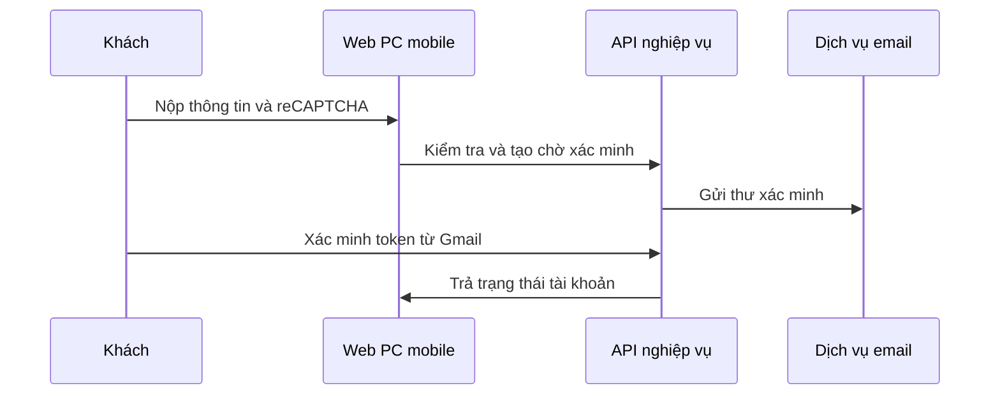

| Bước | Bàn giao | Dữ liệu đọc/ghi | Guard và điểm kiểm chứng |
|---|---|---|---|
| 1 | Khách → Web PC mobile: Nộp thông tin và reCAPTCHA | Đầu vào chưa ghi nghiệp vụ | Không tự chọn role nội bộ |
| 2 | Web PC mobile → API nghiệp vụ: Kiểm tra và tạo chờ xác minh | users, user_tokens cần khôi phục | Unique, token hạn và rate limit |
| 3 | API nghiệp vụ → Dịch vụ email: Gửi thư xác minh | Kết quả gửi, không log token | Lỗi gửi không kích hoạt |
| 4 | Khách → API nghiệp vụ: Xác minh token từ Gmail | users và user_tokens | Dùng một lần, chỉ Customer |
| 5 | API nghiệp vụ → Web PC mobile: Trả trạng thái tài khoản | Projection hồ sơ | Chỉ đăng nhập khi đủ điều kiện |

**Ngoại lệ và phục hồi:** Mã sai/hết hạn, email trùng, reCAPTCHA sai và gửi lại quá giới hạn phải có nhánh kiểm thử.

**Kết quả cần nghiệm thu:** Có tài khoản chờ xác minh và đường dẫn theo dõi; không tự đăng ký Admin. Tài khoản chỉ được verified một lần theo token hợp lệ; link dùng được PC/mobile.

**Quy tắc:** BR-ACC-01, BR-ACC-04, BR-ACC-02. Xem [03](business-rules.md); giá trị trạng thái ở [02](state-machines.md) và [06](../api/data-contracts.md).

## SP-MF-02 Đăng nhập duy trì và kết thúc phiên

**Hiện trạng:** HIỆN CÓ API và UI login/logout.

**Use case:** SP-UC-001, SP-UC-002.

**Kích hoạt/tiền điều kiện:** Tài khoản được cấp, có mật khẩu và đủ điều kiện.

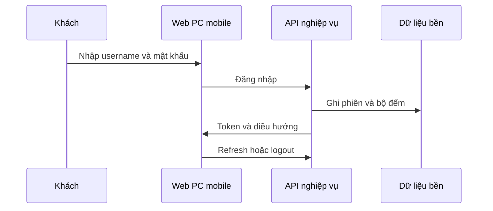

| Bước | Bàn giao | Dữ liệu đọc/ghi | Guard và điểm kiểm chứng |
|---|---|---|---|
| 1 | Khách → Web PC mobile: Nhập username và mật khẩu | Chưa ghi nghiệp vụ | Không đưa mật khẩu vào log |
| 2 | Web PC mobile → API nghiệp vụ: Đăng nhập | users, roles | Kiểm tra mật khẩu trước trạng thái |
| 3 | API nghiệp vụ → Dữ liệu bền: Ghi phiên và bộ đếm | users, refresh_tokens | Active verified approved, không khóa |
| 4 | API nghiệp vụ → Web PC mobile: Token và điều hướng | Auth state UI | Role đúng, không nhầm Customer USER |
| 5 | Web PC mobile → API nghiệp vụ: Refresh hoặc logout | refresh_tokens | Revoke token được gửi, không hứa revoke mọi JWT |

**Ngoại lệ và phục hồi:** Lỗi 401/403/423/429 phân biệt đúng; API lỗi không giả đăng nhập thành công.

**Kết quả cần nghiệm thu:** Chỉ tài khoản đủ điều kiện được vào đúng màn hình; refresh không vượt điều kiện tài khoản. Refresh token bị thu hồi không được cấp access mới.

**Quy tắc:** BR-ACC-02, BR-ACC-03. Xem [03](business-rules.md); giá trị trạng thái ở [02](state-machines.md) và [06](../api/data-contracts.md).

## SP-MF-03 Hồ sơ và quyền liên kết ô tô

**Hiện trạng:** HIỆN CÓ một phần UI và API.

**Use case:** SP-UC-005, SP-UC-006.

**Kích hoạt/tiền điều kiện:** JWT hợp lệ, user tồn tại.

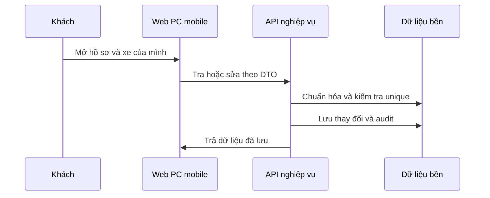

| Bước | Bàn giao | Dữ liệu đọc/ghi | Guard và điểm kiểm chứng |
|---|---|---|---|
| 1 | Khách → Web PC mobile: Mở hồ sơ và xe của mình | Profile UI | USER ở /app/customer/profile |
| 2 | Web PC mobile → API nghiệp vụ: Tra hoặc sửa theo DTO | users, vehicles | Giới hạn chủ sở hữu |
| 3 | API nghiệp vụ → Dữ liệu bền: Chuẩn hóa và kiểm tra unique | vehicles, sessions, bookings | Không tự chiếm xe vãng lai |
| 4 | API nghiệp vụ → Dữ liệu bền: Lưu thay đổi và audit | users/vehicles, audit_logs khi service ghi | Không xóa lịch sử |
| 5 | API nghiệp vụ → Web PC mobile: Trả dữ liệu đã lưu | Hồ sơ và danh sách | Reload khớp DB |

**Ngoại lệ và phục hồi:** Đổi xe đang có quyền cố định là quy trình bổ sung; không suy ra PUT xe hiện tại đã hỗ trợ mọi thay đổi.

**Kết quả cần nghiệm thu:** Chỉ hồ sơ mình thay đổi, tải lại còn dữ liệu đã lưu. Dữ liệu xe đúng chủ, không đổi quyền gói hoặc phiên âm thầm.

**Quy tắc:** BR-RBAC-01, BR-VEH-01, BR-VEH-02. Xem [03](business-rules.md); giá trị trạng thái ở [02](state-machines.md) và [06](../api/data-contracts.md).

## SP-MF-04 Khai báo bãi sơ đồ và khai thác

**Hiện trạng:** API có, form và schema khu/fuel còn thiếu.

**Use case:** SP-UC-009, SP-UC-010, SP-UC-014.

**Kích hoạt/tiền điều kiện:** Admin hợp lệ, nguồn tên/địa chỉ/sức chứa được xác nhận.

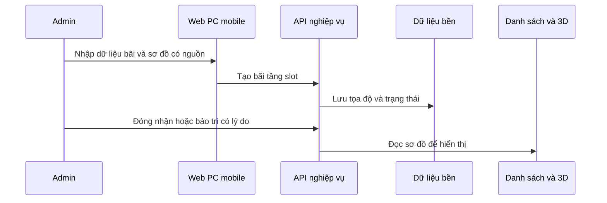

| Bước | Bàn giao | Dữ liệu đọc/ghi | Guard và điểm kiểm chứng |
|---|---|---|---|
| 1 | Admin → Web PC mobile: Nhập dữ liệu bãi và sơ đồ có nguồn | Form Admin cần bổ sung | Không seed bãi/slot vận hành |
| 2 | Web PC mobile → API nghiệp vụ: Tạo bãi tầng slot | parking_lots/floors/slots | Admin, unique và quan hệ đúng |
| 3 | API nghiệp vụ → Dữ liệu bền: Lưu tọa độ và trạng thái | Slot physical bốn giá trị | Không trộn RESERVED |
| 4 | Admin → API nghiệp vụ: Đóng nhận hoặc bảo trì có lý do | Bãi/slot, phiên/dispatch, audit | Không mất xe/cam kết |
| 5 | API nghiệp vụ → Danh sách và 3D: Đọc sơ đồ để hiển thị | Snapshot chung cần ghép | Mã và vị trí khớp DB |

**Ngoại lệ và phục hồi:** Đang có xe/assignment không được đổi màu để trả chỗ; dữ liệu GPS/giờ mở cửa chưa có field phải bổ sung hợp đồng.

**Kết quả cần nghiệm thu:** Bãi được lưu DB và không xóa lịch sử xe/booking để vượt ràng buộc. Mã/số/vị trí ô có thể ánh xạ nhất quán, dữ liệu có lịch sử. Xe đang ở bãi vẫn tra/ra được; khả dụng cập nhật đúng phạm vi.

**Quy tắc:** BR-PARK-03, BR-DATA-02, BR-PARK-01, BR-DATA-01. Xem [03](business-rules.md); giá trị trạng thái ở [02](state-machines.md) và [06](../api/data-contracts.md).

## SP-MF-05 Phân công bãi và hai nhiệm vụ Staff

**Hiện trạng:** Phân công bãi có; nhiệm vụ chưa có.

**Use case:** SP-UC-011, SP-UC-012, SP-UC-013.

**Kích hoạt/tiền điều kiện:** Admin đang hoạt động.

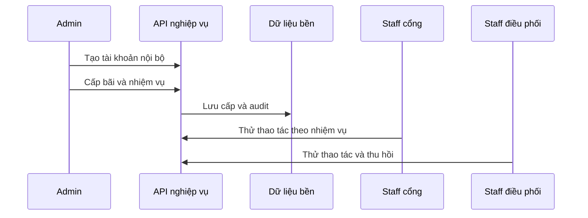

| Bước | Bàn giao | Dữ liệu đọc/ghi | Guard và điểm kiểm chứng |
|---|---|---|---|
| 1 | Admin → API nghiệp vụ: Tạo tài khoản nội bộ | users, roles | Chỉ STAFF/MANAGER qua Create hiện tại |
| 2 | Admin → API nghiệp vụ: Cấp bãi và nhiệm vụ | staff_lot_assignments, duty cần bổ sung | Admin hoặc quyền được duyệt |
| 3 | API nghiệp vụ → Dữ liệu bền: Lưu cấp và audit | Assignment active, actor/time | Không hai active assignment trùng |
| 4 | Staff cổng → API nghiệp vụ: Thử thao tác theo nhiệm vụ | Guard user/bãi/duty | Cổng không tự xác nhận ô |
| 5 | Staff điều phối → API nghiệp vụ: Thử thao tác và thu hồi | Guard cập nhật theo quyền | Điều phối không thu/trả |

**Ngoại lệ và phục hồi:** Code hiện dùng chung CanOperateSessionOrDispatchAsync; phải bổ sung guard trước khi kết luận phân quyền nhiệm vụ đạt.

**Kết quả cần nghiệm thu:** Phân quyền không tự tăng qua dữ liệu client; có actor/lịch sử. Chỉ bãi được giao được sử dụng; cấp bãi chưa đồng nghĩa có cả hai nhiệm vụ Staff. Hai Staff bị giới hạn nhiệm vụ đúng cả khi gọi API trực tiếp.

**Quy tắc:** BR-ACC-04, BR-RBAC-01, BR-RBAC-02. Xem [03](business-rules.md); giá trị trạng thái ở [02](state-machines.md) và [06](../api/data-contracts.md).

## SP-MF-06 Xem công khai danh sách và 3D

**Hiện trạng:** API public core có, Guest UI và viewer chung chưa đủ.

**Use case:** SP-UC-007, SP-UC-008, SP-UC-028.

**Kích hoạt/tiền điều kiện:** Không cần đăng nhập; có dữ liệu bãi được xác nhận.

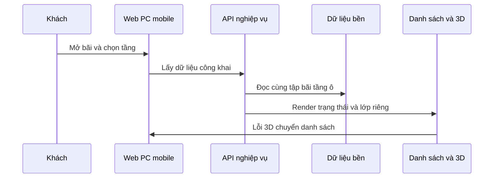

| Bước | Bàn giao | Dữ liệu đọc/ghi | Guard và điểm kiểm chứng |
|---|---|---|---|
| 1 | Khách → Web PC mobile: Mở bãi và chọn tầng | Không yêu cầu token cho phần public đích | Không tạo giữ khi xem |
| 2 | Web PC mobile → API nghiệp vụ: Lấy dữ liệu công khai | lots/floors/slots | Bỏ biển số ảnh phiên riêng |
| 3 | API nghiệp vụ → Dữ liệu bền: Đọc cùng tập bãi tầng ô | DB core, snapshot đề xuất | Rỗng trả rỗng, lỗi báo lỗi |
| 4 | API nghiệp vụ → Danh sách và 3D: Render trạng thái và lớp riêng | Snapshot chung cần ghép | Không sinh xe mẫu |
| 5 | Danh sách và 3D → Web PC mobile: Lỗi 3D chuyển danh sách | Trạng thái xác nhận cuối | PC/mobile cùng mã/time |

**Ngoại lệ và phục hồi:** Viewer hiện trả dictionary/RESERVED và trường nội bộ; cần thay projection, không chỉ ẩn nhãn trên UI.

**Kết quả cần nghiệm thu:** Chỉ xem không tạo giữ/xe; phân biệt public API đã có với GPS/map UI chưa có. Xem đúng dữ liệu API; không suy ra đã đặt chỗ hoặc đã có xe ở ô. PC/mobile đối chiếu đúng mã/vị trí/số ô, tương tác quan sát không đổi nghiệp vụ.

**Quy tắc:** BR-RBAC-03, BR-PARK-02, BR-PARK-01, BR-BOOK-01, BR-3D-01. Xem [03](business-rules.md); giá trị trạng thái ở [02](state-machines.md) và [06](../api/data-contracts.md).

## SP-MF-07 Nhận xe vãng lai tự động và tạo phiên chờ xác minh

**Hiện trạng:** Check-in và ảnh/AI có module; toàn luồng còn một phần.

**Use case:** SP-UC-025, SP-UC-026, SP-UC-015.

**Kích hoạt/tiền điều kiện:** Dịch vụ ảnh cấu hình, file hợp lệ và quyền người gửi.

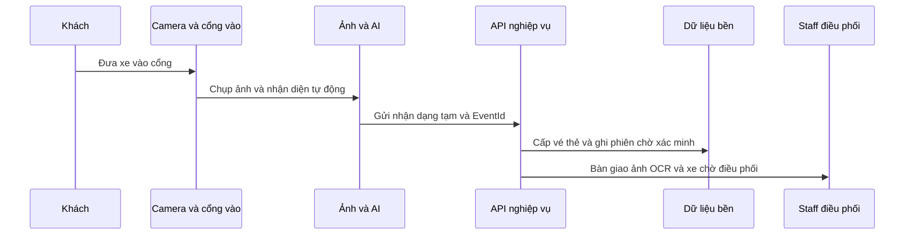

| Bước | Bàn giao | Dữ liệu đọc/ghi | Guard và điểm kiểm chứng |
|---|---|---|---|
| 1 | Khách → Camera và cổng vào: Đưa xe vào cổng | Xe thật và thời điểm vào | Không cần Customer ID |
| 2 | Camera và cổng vào → Ảnh và AI: Chụp ảnh và nhận diện | Ảnh Cloudinary/OCR/Gemini | Giữ kết quả gốc, lỗi và confidence |
| 3 | Ảnh và AI → API nghiệp vụ: Gửi nhận dạng tạm và EventId | Recognition request cần bổ sung | Không chờ Staff cổng xác nhận ở luồng chuẩn |
| 4 | API nghiệp vụ → Dữ liệu bền: Kiểm tra sức chứa/chống trùng, cấp vé/thẻ và ghi phiên | recognition, ticket, session ACTIVE, booking nếu có, audit | Idempotency theo event/vé; biển số chưa chính thức |
| 5 | API nghiệp vụ → Staff điều phối: Bàn giao ảnh/OCR và xe chờ xác minh | Phiên `WAITING_VERIFICATION` và vé cần bổ sung | Ô chưa OCCUPIED do check-in |

**Ngoại lệ và phục hồi:** Không đọc được chuyển `NEEDS_REVIEW` để Staff tại ô nhập/xác minh; Staff cổng chỉ xử lý lỗi thiết bị/luồng vào. Bãi đầy/đóng hoặc request chưa rõ phải dừng/tra lại bằng EventId/vé, không sinh lượt giả.

**Kết quả cần nghiệm thu:** Ảnh và OCR tạm truy vết được, không lộ public/sai bãi. AI được phép khởi tạo phiên chờ xác minh nhưng không tự cho rằng xe đã đỗ. Xe đã vào được tính trong sức chứa; OCR sai được sửa tại ô mà không tạo session thứ hai.

**Quy tắc:** BR-IMG-02, BR-IMG-03, BR-IMG-01, BR-VEH-03, BR-SES-01, BR-SES-02, BR-SES-03, BR-PARK-02. Xem [03](business-rules.md); giá trị trạng thái ở [02](state-machines.md) và [06](../api/data-contracts.md).

## SP-MF-08 Hàng chờ cổng và xác minh tín hiệu ô

**Hiện trạng:** Pipeline riêng có; hàng chờ chung DB/UI chưa đủ.

**Use case:** SP-UC-016, SP-UC-027.

**Kích hoạt/tiền điều kiện:** Nhân viên đúng bãi/nhiệm vụ; có mã phiên thống nhất khi tích hợp.

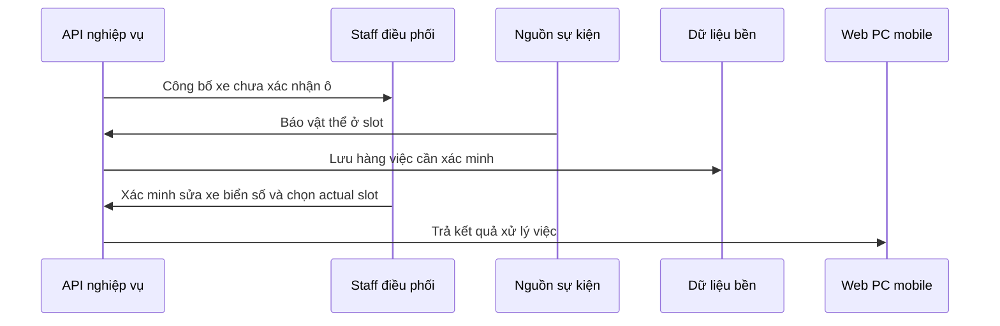

| Bước | Bàn giao | Dữ liệu đọc/ghi | Guard và điểm kiểm chứng |
|---|---|---|---|
| 1 | API nghiệp vụ → Staff điều phối: Công bố xe chưa xác nhận | Session, ảnh và OCR tạm | Một nguồn phiên; biển số chưa chính thức |
| 2 | Nguồn sự kiện → API nghiệp vụ: Báo vật thể ở slot | EventId/source/time | Sensor chưa biết xe nào |
| 3 | API nghiệp vụ → Dữ liệu bền: Lưu hàng việc cần xác minh | Log bền đề xuất | Thứ tự thời gian và actor |
| 4 | Staff điều phối → API nghiệp vụ: Xác minh/sửa biển số, thông tin xe và chọn actual slot | Recognition/session/slot mapping | Đúng nhiệm vụ và bãi; lưu actor/time/lý do sửa |
| 5 | API nghiệp vụ → Web PC mobile: Trả kết quả xử lý việc | Log và trạng thái mới | Đổi trạng thái hàng việc; không xóa lịch sử |

**Ngoại lệ và phục hồi:** Không nối EventParkingSession chuỗi với core ID bằng ép kiểu; hai nguồn phải hợp nhất trước nghiệm thu.

**Kết quả cần nghiệm thu:** Không bỏ sót xe chờ, không render xe chờ thành xe đã đỗ. Một sự kiện có kết quả truy vết bền và không tạo nguồn xe cạnh tranh.

**Quy tắc:** BR-SES-02, BR-EVT-03, BR-EVT-01, BR-EVT-02. Xem [03](business-rules.md); giá trị trạng thái ở [02](state-machines.md) và [06](../api/data-contracts.md).

## SP-MF-09 Phân ô và xác nhận xe đã đỗ

**Hiện trạng:** API có; duty/fuel/UI/snapshot cần ghép.

**Use case:** SP-UC-017, SP-UC-018.

**Kích hoạt/tiền điều kiện:** Phiên mở, ô cùng bãi và nhận được xe; reassign chỉ PENDING/ASSIGNED.

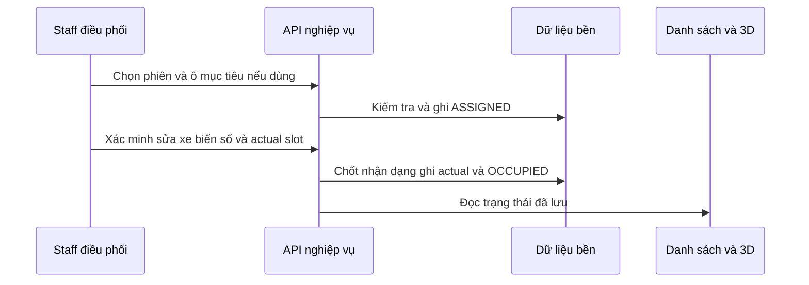

| Bước | Bàn giao | Dữ liệu đọc/ghi | Guard và điểm kiểm chứng |
|---|---|---|---|
| 1 | Staff điều phối → API nghiệp vụ: Chọn phiên và ô mục tiêu nếu dùng | dispatch request | Xe vãng lai không tự đặt chiếm ô |
| 2 | API nghiệp vụ → Dữ liệu bền: Kiểm tra và ghi ASSIGNED | dispatch, session.CurrentSlotId, audit | Slot EMPTY và chưa assignment xung đột |
| 3 | Staff điều phối → API nghiệp vụ: Xác minh/sửa xe, biển số và actual slot | Lệnh ASSIGNED hoặc session chờ xác minh | Quan sát ảnh/xe và quyền điều phối |
| 4 | API nghiệp vụ → Dữ liệu bền: Chốt nhận dạng, ghi actual và OCCUPIED | recognition, vehicle, dispatch, slot, session, audit | Unique xe và tranh chấp ô trong cùng giao dịch |
| 5 | API nghiệp vụ → Danh sách và 3D: Đọc trạng thái đã lưu | Snapshot đích | Xe hiện sau xác nhận, không sau phân ô |

**Ngoại lệ và phục hồi:** Fuel checker hiện stub; unique ASSIGNED chưa tự bảo vệ mọi actual-slot race, cần thử đồng thời PostgreSQL.

**Kết quả cần nghiệm thu:** Ô vẫn EMPTY về vật lý khi mới phân; không coi assignment là quyền đặt ô của khách vãng lai. Chỉ sau xác nhận tại ô mới có biển số chính thức và xe trong slot; truy vết OCR gốc, giá trị sửa, người/thời điểm xác nhận.

**Quy tắc:** BR-DSP-01, BR-DSP-02, BR-SES-02, BR-DSP-03, BR-3D-01. Xem [03](business-rules.md); giá trị trạng thái ở [02](state-machines.md) và [06](../api/data-contracts.md).

## SP-MF-10 Sai ô và chuyển xe đã đỗ

**Hiện trạng:** Wrong-slot từ ASSIGNED có; relocation đã đỗ chưa có.

**Use case:** SP-UC-019, SP-UC-020.

**Kích hoạt/tiền điều kiện:** Lệnh đang ASSIGNED; biết ô thực tế và có bằng chứng.

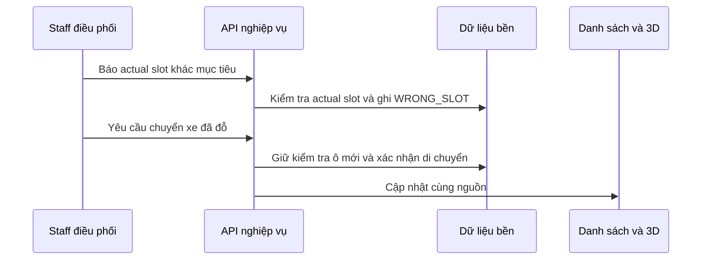

| Bước | Bàn giao | Dữ liệu đọc/ghi | Guard và điểm kiểm chứng |
|---|---|---|---|
| 1 | Staff điều phối → API nghiệp vụ: Báo actual slot khác mục tiêu | ReportWrongSlotRequest | Chỉ từ ASSIGNED hiện tại |
| 2 | API nghiệp vụ → Dữ liệu bền: Kiểm tra actual slot và ghi WRONG_SLOT | Actual OCCUPIED, session cập nhật, audit | Không ghi đè ô đã có xe |
| 3 | Staff điều phối → API nghiệp vụ: Yêu cầu chuyển xe đã đỗ | Relocation đề xuất | Có lý do và quyền |
| 4 | API nghiệp vụ → Dữ liệu bền: Giữ kiểm tra ô mới và xác nhận di chuyển | Lịch sử di chuyển cần bổ sung | Không trả ô cũ khi xe chưa rời |
| 5 | API nghiệp vụ → Danh sách và 3D: Cập nhật cùng nguồn | Slot cũ/mới và phiên | Không mất xe giữa hai ô |

**Ngoại lệ và phục hồi:** Reassign chỉ PENDING/ASSIGNED. Không hướng dẫn gọi lại trên OCCUPIED/WRONG_SLOT như chức năng đã có.

**Kết quả cần nghiệm thu:** Trạng thái mô tả đúng xe thực tế, không che sai lệch bằng đổi màu. Mỗi thời điểm nguồn xác nhận không ghi hai xe cùng ô hoặc làm mất xe giữa hai bước.

**Quy tắc:** BR-DSP-01, BR-DSP-04, BR-DSP-02. Xem [03](business-rules.md); giá trị trạng thái ở [02](state-machines.md) và [06](../api/data-contracts.md).

## SP-MF-11 Quẹt vé/thẻ tại cổng ra, tra xe và tính phí

**Hiện trạng:** Tra phiên có, phí đầy đủ chưa có.

**Use case:** SP-UC-021, SP-UC-022.

**Kích hoạt/tiền điều kiện:** Xe tự tới cổng ra và quẹt vé/thẻ; đúng quyền bãi/sở hữu.

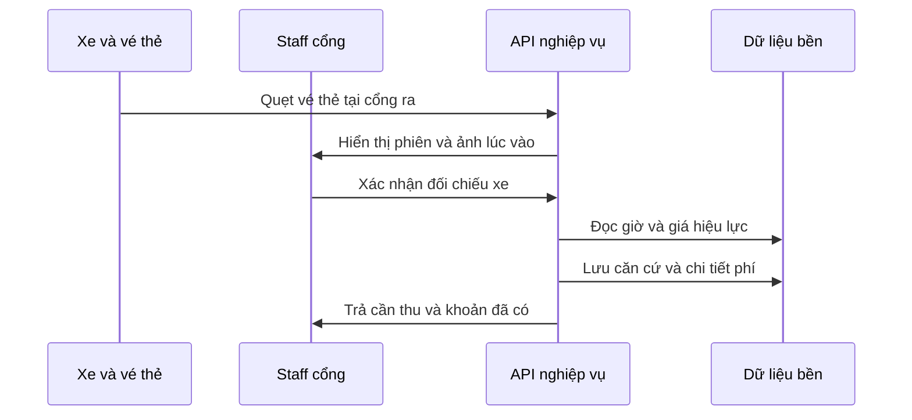

| Bước | Bàn giao | Dữ liệu đọc/ghi | Guard và điểm kiểm chứng |
|---|---|---|---|
| 1 | Xe và vé/thẻ → API nghiệp vụ: Quẹt tại cổng ra | Ticket/card/access event | Một mã gắn một phiên mở; retry chống trùng |
| 2 | API nghiệp vụ → Staff cổng: Hiển thị phiên và ảnh lúc vào | sessions, vehicles, ảnh liên quan | Đúng bãi và xe; không lộ phiên khác |
| 3 | Staff cổng → API nghiệp vụ: Xác nhận đối chiếu xe | Kết quả đối chiếu/ngoại lệ | Sai xe/thẻ không tính nhầm phiên |
| 4 | API nghiệp vụ → Dữ liệu bền: Đọc giờ/giá và lưu chi tiết phí | Pricing/fee assessment, phiên bản giá, mốc tính, đã thu | Không lấy amount UI; DEC-04 đã chốt |
| 5 | API nghiệp vụ → Staff cổng: Trả cần thu và khoản đã có | Fee breakdown | Chưa chuyển COMPLETED |

**Ngoại lệ và phục hồi:** Thiếu giá, vé không khớp, phí chưa rõ chuyển xác minh; không dùng TotalFee mặc định 0 làm bằng chứng miễn phí.

**Kết quả cần nghiệm thu:** Không cần bước “khách yêu cầu lấy xe”: một lần quẹt tại cổng ra chọn đúng phiên, hiển thị thông tin lúc vào và kích hoạt tính phí. Dữ liệu ngoài bãi không lộ; căn cứ phí tách khỏi tiền thực nhận và trạng thái xe ra.

**Quy tắc:** BR-RBAC-01, BR-SES-04, BR-SES-05, BR-PAY-01, BR-PAY-03. Xem [03](business-rules.md); giá trị trạng thái ở [02](state-machines.md) và [06](../api/data-contracts.md).

## SP-MF-12 Thu tiền tại quầy và biên lai

**Hiện trạng:** YÊU CẦU; chưa có module khoản thu core.

**Use case:** SP-UC-023.

**Kích hoạt/tiền điều kiện:** Phí hợp lệ, phương thức được phép, có bằng chứng nhận tiền.

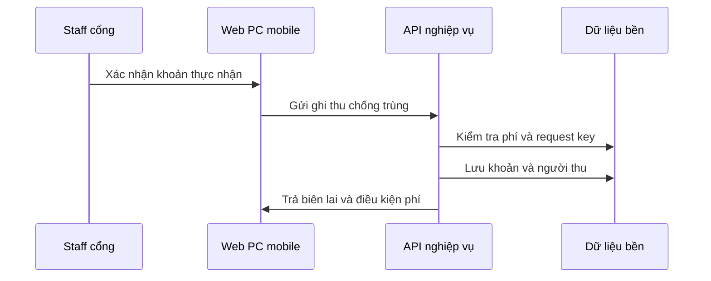

| Bước | Bàn giao | Dữ liệu đọc/ghi | Guard và điểm kiểm chứng |
|---|---|---|---|
| 1 | Staff cổng → Web PC mobile: Xác nhận khoản thực nhận | Phương thức/chứng từ/mã yêu cầu | Đã nhận tiền theo nguồn đáng tin |
| 2 | Web PC mobile → API nghiệp vụ: Gửi ghi thu chống trùng | Payment request đề xuất | Chỉ Staff cổng đủ quyền |
| 3 | API nghiệp vụ → Dữ liệu bền: Kiểm tra phí và request key | Payments/fee đề xuất | Không tin tiền UI, không thu lặp |
| 4 | API nghiệp vụ → Dữ liệu bền: Lưu khoản và người thu | Payment/receipt/audit | Chứng từ và thời điểm |
| 5 | API nghiệp vụ → Web PC mobile: Trả biên lai và điều kiện phí | Đã thu/còn thiếu | Ô vẫn có xe cho tới xác nhận ra |

**Ngoại lệ và phục hồi:** Timeout chuyển tra trạng thái, không thu lại ngay. Với tiền gói cố định áp dụng quy trình Staff ghi chứng từ và người có quyền xác nhận.

**Kết quả cần nghiệm thu:** Một khoản thực nhận được lưu một lần; phiên/ô chưa bị trả do tiền.

**Quy tắc:** BR-PAY-02, BR-PAY-03, BR-PAY-04. Xem [03](business-rules.md); giá trị trạng thái ở [02](state-machines.md) và [06](../api/data-contracts.md).

## SP-MF-13 Đối chiếu và xác nhận xe rời bãi

**Hiện trạng:** Check-out có, guard tiền/vé/duty còn thiếu.

**Use case:** SP-UC-024.

**Kích hoạt/tiền điều kiện:** Xe đã tới cổng ra và quẹt vé/thẻ; xe/phiên đã đối chiếu; đủ phí hoặc ngoại lệ được duyệt; xác nhận xe ra thực tế.

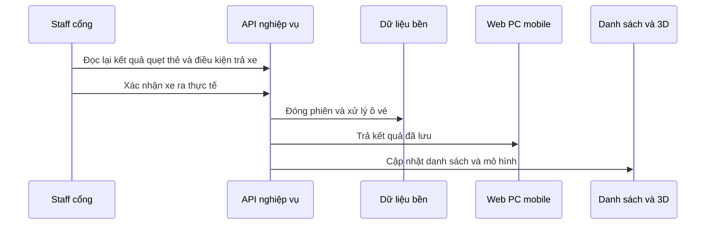

| Bước | Bàn giao | Dữ liệu đọc/ghi | Guard và điểm kiểm chứng |
|---|---|---|---|
| 1 | Staff cổng → API nghiệp vụ: Đọc lại kết quả quẹt thẻ và điều kiện trả xe | Phiên/vé/xe/ảnh vào/phí | Đủ điều kiện hoặc ngoại lệ duyệt |
| 2 | Staff cổng → API nghiệp vụ: Xác nhận xe ra thực tế | Giờ/ảnh/người thao tác | Không dựa riêng vào trạng thái trả tiền |
| 3 | API nghiệp vụ → Dữ liệu bền: Đóng phiên và xử lý ô vé | session, dispatch, slot, ticket đề xuất, audit | Nguyên tử theo chính sách trả ô |
| 4 | API nghiệp vụ → Web PC mobile: Trả kết quả đã lưu | COMPLETED/giờ ra | Retry không tạo lần ra khác |
| 5 | API nghiệp vụ → Danh sách và 3D: Cập nhật danh sách và mô hình | Snapshot đích | Giải phóng đúng ô, lịch sử còn |

**Ngoại lệ và phục hồi:** Code hiện chưa check đủ phí; endpoint đang tồn tại không được dùng để khẳng định đã đạt toàn nghiệp vụ trả xe.

**Kết quả cần nghiệm thu:** Phiên COMPLETED phản ánh xe đã ra, ô/vé đúng trạng thái và lịch sử còn.

**Quy tắc:** BR-SES-05, BR-PAY-03, BR-DATA-02. Xem [03](business-rules.md); giá trị trạng thái ở [02](state-machines.md) và [06](../api/data-contracts.md).

## SP-MF-14 Sự kiện và đồng bộ sau mất kết nối

**Hiện trạng:** Pipeline bộ nhớ có; bền và snapshot chung chưa đạt.

**Use case:** SP-UC-027, SP-UC-029.

**Kích hoạt/tiền điều kiện:** Có EventId, nguồn/time, mã liên kết và quyền nguồn xác nhận.

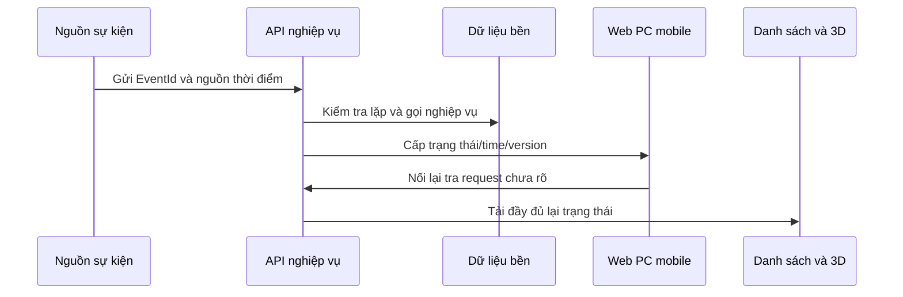

| Bước | Bàn giao | Dữ liệu đọc/ghi | Guard và điểm kiểm chứng |
|---|---|---|---|
| 1 | Nguồn sự kiện → API nghiệp vụ: Gửi EventId và nguồn thời điểm | Request sự kiện | Actor/device xác thực, không tin body actor |
| 2 | API nghiệp vụ → Dữ liệu bền: Kiểm tra lặp và gọi nghiệp vụ | Event log bền và core đề xuất | Không tạo hai session quyết định |
| 3 | API nghiệp vụ → Web PC mobile: Cấp trạng thái/time/version | Snapshot đích | Cũ không ghi đè mới |
| 4 | Web PC mobile → API nghiệp vụ: Nối lại tra request chưa rõ | Cùng EventId/idempotency key | Không tạo thao tác mới mù |
| 5 | API nghiệp vụ → Danh sách và 3D: Tải đầy đủ lại trạng thái | Cùng nguồn với PC/mobile | Báo thời điểm xác nhận cuối |

**Ngoại lệ và phục hồi:** Hiện InMemory/NoOp/AlwaysCompatible chưa đạt các bước lưu bền/quyền; bật compile flag không tự giải quyết mapping.

**Kết quả cần nghiệm thu:** Một sự kiện có kết quả truy vết bền và không tạo nguồn xe cạnh tranh. Hai thiết bị về cùng dữ liệu server, không mất lịch sử hoặc tăng xe/tiền do retry.

**Quy tắc:** BR-EVT-01, BR-EVT-02, BR-EVT-03, BR-3D-02, BR-DATA-01. Xem [03](business-rules.md); giá trị trạng thái ở [02](state-machines.md) và [06](../api/data-contracts.md).

## SP-MF-15 Đặt trước nhận xe và hủy giữ

**Hiện trạng:** API booking đơn giản có; nghiệp vụ đầy đủ Sprint 4 còn thiếu.

**Use case:** SP-UC-030, SP-UC-031, SP-UC-032.

**Kích hoạt/tiền điều kiện:** Customer có xe trong quyền; giá/giữ/khung giờ đã cấu hình cho luồng đích.

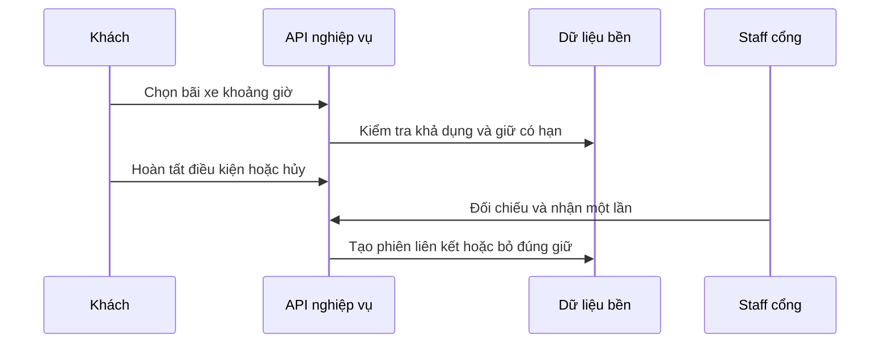

| Bước | Bàn giao | Dữ liệu đọc/ghi | Guard và điểm kiểm chứng |
|---|---|---|---|
| 1 | Khách → API nghiệp vụ: Chọn bãi xe khoảng giờ | Booking request | Không chọn chiếm slot vãng lai |
| 2 | API nghiệp vụ → Dữ liệu bền: Kiểm tra khả dụng và giữ có hạn | Booking/hold/time đề xuất | Giao khung giờ, không trừ sai tương lai |
| 3 | Khách → API nghiệp vụ: Hoàn tất điều kiện hoặc hủy | Tiền/expiry cần bổ sung | Chưa rõ tiền phải đối soát |
| 4 | Staff cổng → API nghiệp vụ: Đối chiếu và nhận một lần | Booking đúng xe/bãi/giờ | Không dùng booking hai lần |
| 5 | API nghiệp vụ → Dữ liệu bền: Tạo phiên liên kết hoặc bỏ đúng giữ | Session/booking/audit | Không tạo xe do đặt, không trả ô có xe do hết hạn |

**Ngoại lệ và phục hồi:** PENDING hiện không có hold expiry và được đếm không theo khung giờ; CHECKED_IN hiện mới kiểm tra cơ bản theo bãi/biển số.

**Kết quả cần nghiệm thu:** Booking chưa tạo xe hoặc phiên, không nhận vượt và không nhầm PENDING là đã trả tiền. Không mất phiên đang đỗ; hủy không tự hoàn tiền thành công. Xe chỉ thành Có xe sau xác nhận ô; booking và phiên có liên kết duy nhất.

**Quy tắc:** BR-BOOK-01, BR-BOOK-02, BR-PAY-02, BR-BOOK-04, BR-PAY-05, BR-BOOK-03, BR-SES-02. Xem [03](business-rules.md); giá trị trạng thái ở [02](state-machines.md) và [06](../api/data-contracts.md).

## SP-MF-16 Đăng ký ô cố định và phát thẻ

**Hiện trạng:** YÊU CẦU Sprint 5; chưa có schema/API.

**Use case:** SP-UC-033, SP-UC-034.

**Kích hoạt/tiền điều kiện:** Tài khoản/xe xác minh, có khu/ô và kỳ/chính sách được chốt.

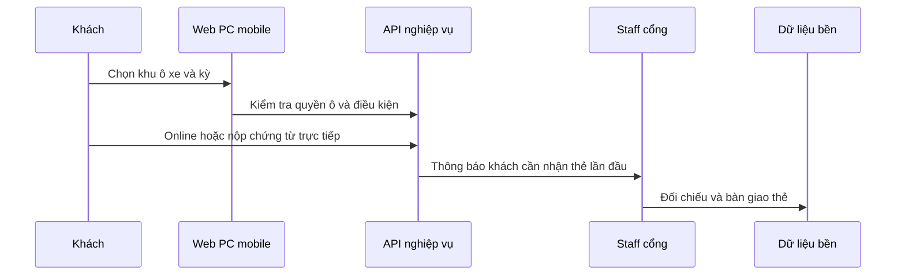

| Bước | Bàn giao | Dữ liệu đọc/ghi | Guard và điểm kiểm chứng |
|---|---|---|---|
| 1 | Khách → Web PC mobile: Chọn khu ô xe và kỳ | Gói/quyền đề xuất | Khu trong hoặc ngoài theo parent |
| 2 | Web PC mobile → API nghiệp vụ: Kiểm tra quyền ô và điều kiện | Pass/slot/xe/giá đề xuất | Không bán cùng quyền xung đột |
| 3 | Khách → API nghiệp vụ: Online hoặc nộp chứng từ trực tiếp | Payment/approval đề xuất | Staff ghi chứng từ chưa tự duyệt |
| 4 | API nghiệp vụ → Staff cổng: Thông báo khách cần nhận thẻ lần đầu | Notification đề xuất | Không coi đã phát trước khi tới |
| 5 | Staff cổng → Dữ liệu bền: Đối chiếu và bàn giao thẻ | Card/assignment/actor/time đề xuất | Quyền dịch vụ không tự tạo xe |

**Ngoại lệ và phục hồi:** Kỳ/giá/quyền duyệt và loại thẻ còn quyết định mở; không biến số tiền mẫu thành chính sách chính thức.

**Kết quả cần nghiệm thu:** Có quyền ô/xe/kỳ truy vết; chưa có xe vật lý chỉ vì đăng ký thành công. Phân biệt đã đăng ký và đã nhận thẻ; truy vết đúng khách/xe.

**Quy tắc:** BR-FIX-01, BR-VEH-02, BR-PAY-04, BR-FIX-03, BR-SES-04. Xem [03](business-rules.md); giá trị trạng thái ở [02](state-machines.md) và [06](../api/data-contracts.md).

## SP-MF-17 Sử dụng và gia hạn quyền cố định

**Hiện trạng:** YÊU CẦU; chưa có module gói/thẻ/barrier.

**Use case:** SP-UC-035, SP-UC-036.

**Kích hoạt/tiền điều kiện:** Thẻ đúng xe/khu và quyền còn hiệu lực; có điều kiện nhận xe.

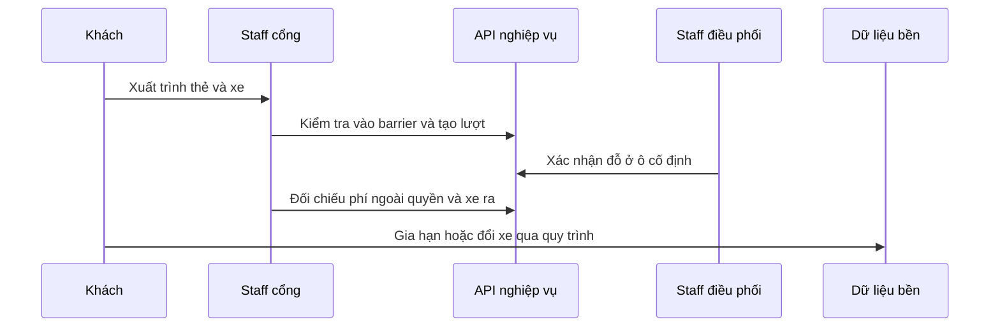

| Bước | Bàn giao | Dữ liệu đọc/ghi | Guard và điểm kiểm chứng |
|---|---|---|---|
| 1 | Khách → Staff cổng: Xuất trình thẻ và xe | Thẻ/xe/quyền đề xuất | Đúng người xe kỳ khu |
| 2 | Staff cổng → API nghiệp vụ: Kiểm tra vào barrier và tạo lượt | Pass/phiên/slot/log đề xuất | Sai xe/thẻ không tự mở |
| 3 | Staff điều phối → API nghiệp vụ: Xác nhận đỗ ở ô cố định | Slot/phiên và bảng IoT | Bảng vật lý hiển thị đầy đủ biển số đăng ký theo quyền hiệu lực; Web App lọc theo actor |
| 4 | Staff cổng → API nghiệp vụ: Đối chiếu phí ngoài quyền và xe ra | Phiên/fee/payment đề xuất | Hết gói không xóa xe |
| 5 | Khách → Dữ liệu bền: Gia hạn hoặc đổi xe qua quy trình | Renewal/change/approval đề xuất | Một request không cộng kỳ hai lần |

**Ngoại lệ và phục hồi:** Không tự quy gói năm bằng 365 ngày; chuyển xe cần giữ lịch sử và xác minh, không sửa trực tiếp để bỏ qua đối chiếu.

**Kết quả cần nghiệm thu:** Mỗi lượt có phiên riêng, quyền gói không thay bằng chứng xe vào/ra. Lịch sử quyền cũ còn, kỳ mới có ngày bắt đầu/kết thúc rõ, không tự đổi số xe vật lý.

**Quy tắc:** BR-FIX-01, BR-PRV-01, BR-PAY-03, BR-SES-05, BR-VEH-02, BR-PAY-02. Xem [03](business-rules.md); giá trị trạng thái ở [02](state-machines.md) và [06](../api/data-contracts.md).

## SP-MF-18 Report chiếm ô và xử lý vi phạm

**Hiện trạng:** YÊU CẦU, chi tiết chính sách cần chốt.

**Use case:** SP-UC-037, SP-UC-038.

**Kích hoạt/tiền điều kiện:** Người gửi có quyền ô trong kỳ, có ảnh/quan sát hợp lệ.

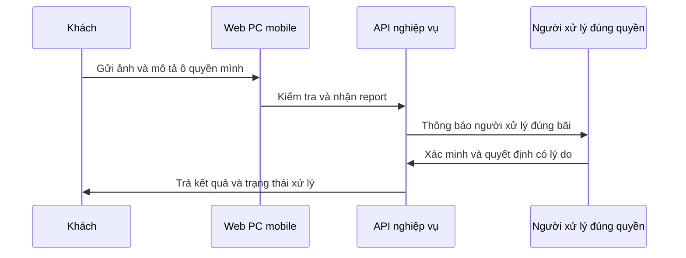

| Bước | Bàn giao | Dữ liệu đọc/ghi | Guard và điểm kiểm chứng |
|---|---|---|---|
| 1 | Khách → Web PC mobile: Gửi ảnh và mô tả ô quyền mình | Report/evidence đề xuất | Có quyền ô tại thời điểm |
| 2 | Web PC mobile → API nghiệp vụ: Kiểm tra và nhận report | Report/ảnh đề xuất | Không báo thay người khác |
| 3 | API nghiệp vụ → Người xử lý đúng quyền: Thông báo người xử lý đúng bãi | Notification đề xuất | Kết quả gửi có trạng thái |
| 4 | Người xử lý đúng quyền → API nghiệp vụ: Xác minh và quyết định có lý do | Review/decision đề xuất | Chỉ xử phạt khi có chính sách/quyền |
| 5 | API nghiệp vụ → Khách: Trả kết quả và trạng thái xử lý | Report history | Không tự tạo khoản phạt từ report |

**Ngoại lệ và phục hồi:** Mức phạt, khiếu nại và kênh thu chưa duyệt; thiếu bằng chứng có thể bị từ chối, không ghi thành vi phạm chắc chắn.

**Kết quả cần nghiệm thu:** Report có trạng thái theo dõi và người tiếp nhận, chưa tự phát sinh phạt. Có lịch sử quyết định, không sửa occupancy hoặc thu tiền ngoài quyền để kết thúc report.

**Quy tắc:** BR-FIX-04, BR-IMG-02, BR-PAY-04, BR-DATA-02. Xem [03](business-rules.md); giá trị trạng thái ở [02](state-machines.md) và [06](../api/data-contracts.md).

## SP-MF-19 Hoàn tiền và đối soát khoản chưa rõ

**Hiện trạng:** YÊU CẦU SRS; chưa có schema/API.

**Use case:** SP-UC-039.

**Kích hoạt/tiền điều kiện:** Giao dịch gốc hợp lệ, chính sách và quyền hoàn đã được duyệt.

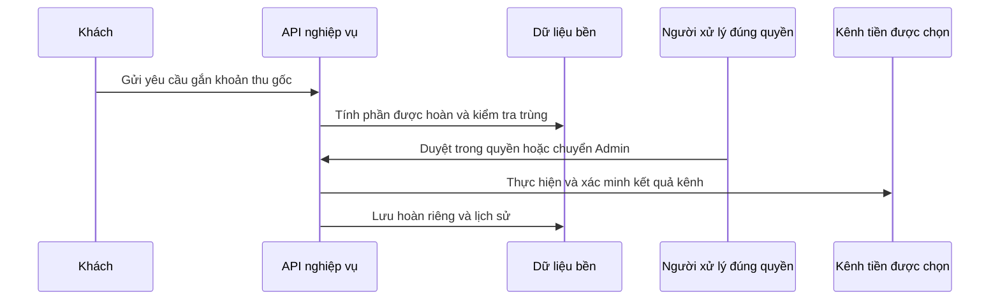

| Bước | Bàn giao | Dữ liệu đọc/ghi | Guard và điểm kiểm chứng |
|---|---|---|---|
| 1 | Khách → API nghiệp vụ: Gửi yêu cầu gắn khoản thu gốc | Refund request đề xuất | Đúng chủ/đúng dịch vụ |
| 2 | API nghiệp vụ → Dữ liệu bền: Tính phần được hoàn và kiểm tra trùng | Payments/refunds đề xuất | Không vượt căn cứ còn hoàn được |
| 3 | Người xử lý đúng quyền → API nghiệp vụ: Duyệt trong quyền hoặc chuyển Admin | Approval đề xuất | Không suy quyền Manager mặc định |
| 4 | API nghiệp vụ → Kênh tiền được chọn: Thực hiện và xác minh kết quả kênh | Kết quả xác nhận/UNKNOWN | Retry không trả tiền lần hai |
| 5 | API nghiệp vụ → Dữ liệu bền: Lưu hoàn riêng và lịch sử | Refund/payment/audit đề xuất | Không xóa khoản thu gốc |

**Ngoại lệ và phục hồi:** Hết timeout không đồng nghĩa thất bại; quyết định tiền cần nguồn đáng tin và chính sách DEC-13/14.

**Kết quả cần nghiệm thu:** Tổng hoàn hợp lệ không vượt căn cứ, báo cáo truy vết thu và hoàn riêng.

**Quy tắc:** BR-PAY-05, BR-PAY-02. Xem [03](business-rules.md); giá trị trạng thái ở [02](state-machines.md) và [06](../api/data-contracts.md).

## SP-MF-20 Đối soát lưu bền và phục hồi

**Hiện trạng:** Dashboard/core DB có; báo cáo tiền/phục hồi/event bền chưa đủ.

**Use case:** SP-UC-040, SP-UC-041, SP-UC-042.

**Kích hoạt/tiền điều kiện:** Đúng phạm vi; chọn khoảng giờ và nguồn dữ liệu rõ.

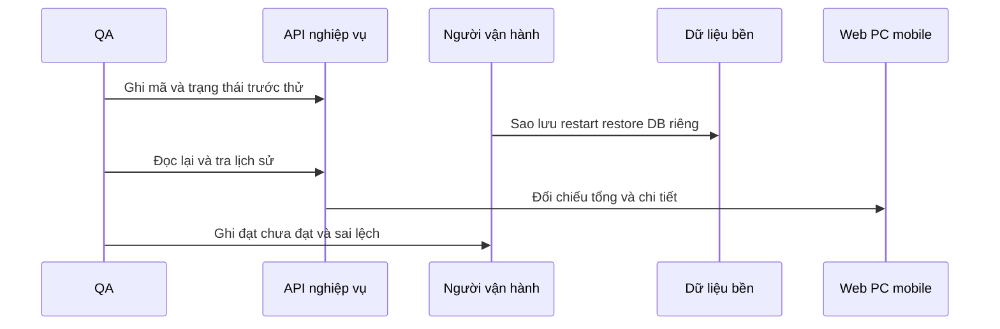

| Bước | Bàn giao | Dữ liệu đọc/ghi | Guard và điểm kiểm chứng |
|---|---|---|---|
| 1 | QA → API nghiệp vụ: Ghi mã và trạng thái trước thử | Phiên/ô/ảnh/tiền/actor | Dữ liệu có nguồn xác nhận |
| 2 | Người vận hành → Dữ liệu bền: Sao lưu restart restore DB riêng | DB và tham chiếu ảnh | Không reset vận hành |
| 3 | QA → API nghiệp vụ: Đọc lại và tra lịch sử | Core và log/tiền khi bổ sung | Quyền theo bãi còn hiệu lực |
| 4 | API nghiệp vụ → Web PC mobile: Đối chiếu tổng và chi tiết | Báo cáo từ nguồn thật | Không KPI/doanh thu ngẫu nhiên |
| 5 | QA → Người vận hành: Ghi đạt chưa đạt và sai lệch | Bằng chứng restore | Simulator chỉ bằng chứng trong phạm vi test |

**Ngoại lệ và phục hồi:** 314 test InMemory không chứng minh phục hồi/tranh chấp thật; cần bằng chứng mã phiên/ô/ảnh/tiền trước và sau.

**Kết quả cần nghiệm thu:** Mọi tổng có dữ liệu chi tiết giải thích, không lộ bãi khác hoặc tiền cá nhân. Trạng thái đã xác nhận không mất hoặc phát sinh thêm xe/kỳ/tiền sau phục hồi. Phân biệt rõ bằng chứng test mô phỏng với lượt vận hành đã lưu DB.

**Quy tắc:** BR-RBAC-01, BR-DATA-02, BR-PAY-01, BR-DATA-01, BR-EVT-01, BR-EVT-03. Xem [03](business-rules.md); giá trị trạng thái ở [02](state-machines.md) và [06](../api/data-contracts.md).

## Điều kiện bàn giao một luồng

Mỗi luồng phải có hợp đồng API/quyền/guard/lỗi, migration nếu thay dữ liệu, người nhận module và bằng chứng đi qua điểm xác nhận cuối. Kiểm tra cả request lặp, hai người cùng thao tác, lỗi API/DB/AI và restart theo phạm vi. Hoạt ảnh hoặc thao tác trong viewer không thay bằng chứng dữ liệu đã lưu.

Đối với Sprint 3, bãi/sơ đồ/giá/ảnh/sự kiện cần nguồn thực tế được xác nhận; chưa có thiết bị thì dùng xác nhận thực tế từ Staff đúng nhiệm vụ. Không dùng simulator/seed/reset làm nguồn vận hành. Các luồng tiền/gói/report còn thiếu được giữ dưới trạng thái yêu cầu, không gọi là đã demo thành công.
