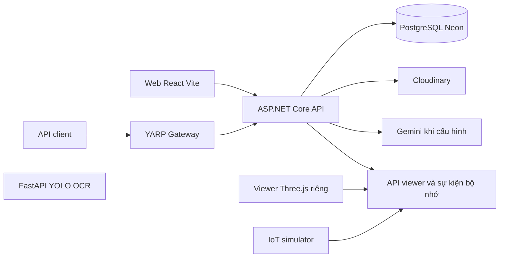

# Tham chiếu tổng thể Smart Parking

**Trạng thái:** Hiện hành về nghiệp vụ; hiện trạng triển khai đối chiếu tại mốc ghi bên dưới.
**Chủ sở hữu:** BA/Product và Technical Lead.
**Rà soát gần nhất:** 28/10/2026.
**Phạm vi:** Sprint 3–5.

**Ngày đối chiếu:** 28/10/2026. **Nhánh:** `Sprint3/demo`. **Commit:** `4bed0c8a929fe050d644aa4e07c0a1caa77d8d0e`. Quy ước và nguồn ở [README](../README.md).

Hệ thống quản lý bãi ô tô, lượt vãng lai và khu gửi cố định; dữ liệu vật lý ô, phiên xe, đặt chỗ, quyền gói và tiền được theo dõi riêng. Mục tiêu Sprint 3 là tài khoản, xem slot công khai, xe vào cổng → chờ điều phối → xác nhận ô → thu tiền → xe ra, đồng bộ PC/mobile/3D bằng dữ liệu lưu DB.

## 1 Phân kỳ sản phẩm

| Phạm vi | Kết quả nghiệp vụ cần đạt | Hiện trạng đáng chú ý |
|---|---|---|
| Sprint 3 | Guest; đăng ký/xác minh; hai nhiệm vụ Staff; khai báo bãi/ô/giá/tương thích; vãng lai; ảnh; phí; lưu bền và 3D | Có nền API, nhiều bước chưa ghép; đăng ký/xác minh đã bị gỡ |
| Sprint 4 | Đặt trước khả năng phục vụ khu vãng lai, xử lý khung giờ/giữ/hủy và tiền liên quan | API booking đơn giản đã có sớm; chưa tương đương đầy đủ yêu cầu |
| Sprint 5 | Đăng ký khu cố định, gói/thẻ, ô riêng, quyền xe và luồng cấp thẻ | Chưa có schema/API tương ứng tại mốc đối chiếu |
| Phần phụ thuộc chính sách | Gói năm, hoàn tiền, report/phạt chiếm ô, đổi xe, quyền Manager nâng cao | SRS bao quát một số nội dung; chưa coi mọi chi tiết đã duyệt |

Khu cố định có thể nằm trong bãi gốc sau barrier hoặc thành khu riêng bên ngoài. Cần biểu diễn được cả hai bố cục. Khách đặt vãng lai giữ khả năng tiếp nhận, không được tự chiếm một slot cụ thể chỉ bằng thao tác đặt.

## 2 Kiến trúc hiện tại



- Backend là một ứng dụng API theo Clean Architecture trên .NET 10, không phải nhiều microservice nghiệp vụ đã triển khai riêng. FastAPI nhận diện biển số là dịch vụ riêng.
- React được build vào `backend/src/SmartParking.Api/wwwroot/app`; mặc định mở `/app/`. Viewer mở `/3d-viewer.html`. Wrapper React của viewer chưa được dùng trong App chính.
- YARP ở cổng development 5070, downstream API 5295. Proxy hiện có `/api/**`, `/health`, `/swagger/**`; không mặc định cả web `/app/` và FastAPI đã đi qua gateway. Vite development đang proxy API trực tiếp về 5295.
- 14 bảng được ánh xạ trong `SmartParkingDbContext`. Sự kiện/viewer dùng repository/dictionary trong bộ nhớ; simulator có nguồn JSON. Đây là các nguồn tách biệt cần tích hợp.
- Hướng đích: API nghiệp vụ là nguồn xác nhận, PostgreSQL lưu trạng thái và lịch sử, danh sách/2D/3D đọc cùng snapshot. AI/OCR ở cổng được phép tạo dữ liệu nhận dạng tạm và phiên chờ xác minh; cảm biến slot cung cấp vị trí thực tế. Staff điều phối tại ô xác nhận/sửa biển số, thông tin xe và actual slot trong cùng bước trước khi coi xe đã đỗ.

## 3 Tác nhân và mã vai trò

| Tác nhân nghiệp vụ | Mã hiện có | Phạm vi |
|---|---|---|
| Guest | Không có role/token | Chỉ đọc công khai; đến gửi vãng lai không cần tài khoản |
| Customer | `USER` | Hồ sơ, xe, đặt và lịch sử của mình |
| Admin | `ADMIN` | Quản trị toàn hệ thống; thao tác nhạy cảm theo chức năng được cấp |
| Manager | `MANAGER` | Bãi được phân công; quyền nâng cao phải chốt |
| Staff cổng | Hiện cùng `STAFF`; nhiệm vụ chưa có | Giám sát nhận xe tự động, xử lý ảnh/OCR lỗi, cấp/thu vé hoặc thẻ, khoản thu và xác nhận ra theo quyền; không bắt buộc xác nhận biển số ở luồng vào chuẩn |
| Staff điều phối | Hiện cùng `STAFF`; nhiệm vụ chưa có | Xác minh/sửa biển số và thông tin xe tại ô, gắn actual slot, phân/đổi/xác nhận/sai ô |
| Hệ thống/thiết bị | Chưa có miền danh tính thiết bị thống nhất | Nguồn ảnh/sự kiện có định danh; không giả token người dùng |

Hai nhiệm vụ Staff là quyền theo bãi của cùng nhóm nhân viên, không tự biến thành hai role đã có trong bảng `roles`.

## 4 Ma trận quyền nghiệp vụ đích

`Bãi` là bãi được phân công; `Mình` là dữ liệu thuộc người gọi; `Chốt` là quyền đóng mặc định đến khi có quyết định. Đây là yêu cầu, không phải mô tả toàn bộ quyền đã triển khai.

| Hành động | Guest | Customer | Staff cổng | Staff điều phối | Manager | Admin |
|---|---|---|---|---|---|---|
| Xem slot công khai | Có | Có | Có | Có | Có | Có |
| Xem biển số/ảnh/thông tin xe trên Web App | Không | Chỉ xe/phiên/quyền của mình | Bãi và nhiệm vụ | Bãi và nhiệm vụ | Bãi được giao | Theo quyền quản trị |
| Hồ sơ/xe cá nhân | Không | Mình | Hồ sơ mình | Hồ sơ mình | Hồ sơ mình | Theo quyền quản trị |
| Nhận xe/tra vé | Không | Không | Bãi | Chỉ dữ liệu cần đối chiếu | Chốt | Theo quyền vận hành |
| Xác nhận ô/đổi ô | Không | Không | Không mặc định | Bãi | Chốt | Theo quyền vận hành |
| Ghi khoản thu/xác nhận ra | Không | Không | Bãi và quyền thu | Không | Chốt | Theo quyền thu/vận hành |
| Đổi trạng thái bảo trì/đóng nhận | Không | Không | Không mặc định | Không mặc định | Bãi | Toàn hệ thống |
| Tạo nội bộ/phân công nhiệm vụ | Không | Không | Không | Không | Chốt | Toàn hệ thống |
| Ban hành giá/gói, duyệt hoàn/phạt | Không | Không | Không | Không | Chốt | Theo chính sách |
| Đặt vãng lai/gói cố định | Đăng nhập trước | Mình | Không thay khách mặc định | Không | Không mặc định | Không mặc định |

Hiện API dùng role + phân công bãi; `CanOperateSessionOrDispatchAsync` chưa tách nhiệm vụ. Một số route events/viewer/IoT chưa có xác thực; bảng ở đây không chứng nhận các route đó an toàn khi triển khai dữ liệu thật.

## 5 Các bất biến phải thống nhất

1. Mỗi ô có một trong bốn trạng thái vật lý `EMPTY`, `OCCUPIED`, `MAINTENANCE`, `UNAVAILABLE`. Phân ô/giữ/đặt là lớp riêng.
2. Check-in tự động có thể tạo phiên `ACTIVE` từ ảnh/OCR và thẻ/vé vào, nhưng biển số/thông tin xe vẫn là dữ liệu tạm cho tới khi Staff điều phối xác minh tại ô; chưa chứng minh xe đã đỗ vào slot. `CurrentSlotId` hiện còn được gán ngay lúc phân ô, không được dùng một mình làm bằng chứng đã đỗ.
3. Một xe không có nhiều phiên mở; một ô/vé không phục vụ hai phiên xung đột. Kiểm tra đồng thời tại DB và dịch vụ, không chỉ tắt nút.
4. Xe chờ điều phối vẫn tiêu thụ khả năng nhận xe. Slot trống vật lý chưa chắc có thể nhận thêm.
5. Thanh toán không tạo xe; thu tiền chưa chứng minh xe đã rời ô/bãi. Chỉ ghi trạng thái sau xác nhận hợp lệ.
6. Public Web/API không thấy biển số/ảnh/chủ xe/chi tiết tiền của người khác. Web App trả dữ liệu xe theo actor, sở hữu, bãi và nhiệm vụ. Riêng bảng IoT vật lý tại slot cố định được hiển thị đầy đủ biển số đã đăng ký của slot; không dùng projection này làm API public.
7. Reload, retry, restart và phục hồi không tạo thêm xe/thu tiền hoặc mất lịch sử.

## 6 Sức chứa hiện tại và phần cần bổ sung

`ParkingLotCapacityHelper` đang tính:

```text
usable = số slot hoạt động thuộc tầng hoạt động,
         loại MAINTENANCE và UNAVAILABLE
inside = số phiên ACTIVE hoặc PAID
physicalOccupied = số slot OCCUPIED
holds = số booking PENDING
used = max(inside, physicalOccupied) + holds
available = max(0, usable - used)
```

Khi chưa khai báo slot nào, code dùng `parking_lots.total_capacity`; nếu đã khai báo nhưng mọi ô không dùng được thì usable = 0. `TotalCapacity` trong kết quả helper mang nghĩa sức chứa khai thác, không phải luôn bằng tổng ô vật lý. Số ô `OCCUPIED` hiện được đếm không cùng bộ lọc active/floor như usable; cần đối chiếu sai lệch.

Booking `PENDING` hiện được tính theo trạng thái, chưa lọc giao khung giờ và chưa thấy tác vụ tự hết hạn. Ngưỡng gần đầy khoảng 5 trong nghiệp vụ chưa có cấu hình nghiệp vụ chính. Không lấy công thức hiện tại làm bảo đảm đã xử lý toàn bộ đặt tương lai/khu cố định.

## 7 Sổ quyết định và chênh lệch nguồn

Giữ mã DEC-01…DEC-17 từ SRS. Cột dưới là phần còn cần quyết định, không tự điền người phê duyệt.

| Mã | Nội dung cần khóa | Điều đã biết hoặc nguồn ưu tiên |
|---|---|---|
| DEC-01 | Khôi phục/phân kỳ đăng ký; thời hạn xác minh và giới hạn gửi | Sprint 3 yêu cầu Gmail/reCAPTCHA; code đã gỡ đăng ký ở `adac2d6` |
| DEC-02 | Chuẩn biển số, xác minh liên kết/đổi xe, giới hạn xe | Hiện uppercase+trim và unique; vãng lai dùng kết quả OCR tạm khi tạo phiên, Staff tại ô xác nhận/sửa trước khi chuyển OCCUPIED; không tự nhận quyền xe vãng lai |
| DEC-03 | Đóng bãi/bảo trì khi còn xe và cam kết đặt/gói | Không xóa phiên/quyền lợi để đóng bãi |
| DEC-04 | Giá, làm tròn, giờ bắt đầu/kết thúc và phiên bản giá | Chưa có bảng giá chính; không mặc định 20.000đ, 22h hay 15 phút |
| DEC-05 | Bản đồ, vị trí, bán kính và geocoding | Chưa coi hình minh họa trang chủ là tìm bãi GPS đã triển khai |
| DEC-06 | Ngưỡng gần đầy, giữ sức chứa, quyền chọn/đổi ô | Vãng lai không đặt chiếm ô cụ thể; khách tự tìm ô và Staff xác nhận thực tế |
| DEC-07 | Hạn giữ và thời lượng đặt | Chưa có `hold_expires_at` hoặc tác vụ hết hạn trong core |
| DEC-08 | Tiền trước, đến sớm/trễ, không đến, hủy/hoàn | Chưa coi `PENDING` là booking đã trả tiền |
| DEC-09 | Kỳ gói tháng/tuần/nhiều ngày/năm và ô cố định | Nguồn chốt yêu cầu khu/ô riêng; SRS cũ để bảo đảm ô là câu hỏi |
| DEC-10 | Phí ngoài quyền gói/hết hạn khi xe còn ở bãi | Phiên vẫn tồn tại đến khi xe ra |
| DEC-11 | Gói kết hợp đặt vãng lai | Chưa chốt phí/ưu tiên; không đếm xe hai lần |
| DEC-12 | QR/RFID, phát thẻ lần đầu, mất/hỏng, barrier | Có nghiệp vụ cấp thẻ; vãng lai quẹt vé/thẻ tại cổng ra để tải phiên và tính phí; chưa có entity vé/thẻ ở core |
| DEC-13 | Thu tại quầy, online, chứng từ và đối soát | Vãng lai thu tại điểm ra; gói có lựa chọn online/trực tiếp, quy trình xác nhận cần khóa |
| DEC-14 | Quyền Manager, thu/hoàn/phạt, xác nhận thu gói trực tiếp | Nguồn chốt nêu Staff ghi chứng từ và báo Manager cho giao dịch gói; không tự mở rộng thành quyền duyệt |
| DEC-15 | Môi trường demo và tiêu chí đo | Sprint 3 dùng dữ liệu có nguồn thật; số đo cần bằng chứng thực tế |
| DEC-16 | Ai thắng khi cảm biến và Staff khác nhau, version, trả ô | Không tự đặt thứ tự ưu tiên hoặc tin `TriggeredBy` từ body |
| DEC-17 | Lưu ảnh/log, sao lưu, giữ dữ liệu và quyền xóa | Chưa có thời hạn chính thức trong nguồn; cần tách biển số full trên bảng IoT vật lý với projection Web/API theo quyền |
| SP-DEC-18 | Quy trình report chiếm ô và quyền phạt/thông báo | Quyền gửi report và ảnh nằm trong định hướng chốt; mức phạt/kênh thu chưa chốt |
| SP-DEC-19 | Hai sơ đồ khu cố định và cách quản lý khu ngoài bãi gốc | Cần mô hình quan hệ, không chỉ hai cảnh 3D rời |

## 8 Hiện trạng để bàn giao

Đã nối React: login/logout, xem bãi/tầng/slot cho Customer, hồ sơ và thêm/sửa xe, tổng quan Admin và tra cứu bãi/phiên cho Manager/Staff. API còn có quản trị tài khoản, CRUD bãi/tầng/ô, phân công, phiên, điều phối, booking và ảnh. AI, viewer, event và simulator có module riêng nhưng chưa thành toàn luồng lưu DB thống nhất.

Chưa có luồng hoàn chỉnh: phí/khoản thu/biên lai, vé/thẻ, khu/gói cố định, hai nhiệm vụ Staff, đồng bộ web/3D theo DB, Guest UI hoàn chỉnh. Xem [use cases](use-cases.md) để đối chiếu từng hành vi.

Build solution gồm gateway và build React đã thành công; 314 test backend và 6 test frontend đã đạt trong lần rà soát. Test backend dùng InMemory/giao dịch giả: không thay thế thử Neon, concurrency thật, Gmail, Cloudinary, camera hoặc mobile. Không suy ra tỷ lệ hoàn thành sản phẩm từ số test.

## 9 Nguồn mã chính

- [DbContext và 14 nhóm dữ liệu](https://github.com/silver-phung/smart-parking-system/blob/4bed0c8/backend/src/SmartParking.Infrastructure/Data/SmartParkingDbContext.cs)
- [DI và nguồn sự kiện hiện tại](https://github.com/silver-phung/smart-parking-system/blob/4bed0c8/backend/src/SmartParking.Infrastructure/DependencyInjection.cs)
- [Quyền theo bãi](https://github.com/silver-phung/smart-parking-system/blob/4bed0c8/backend/src/SmartParking.Infrastructure/Services/ParkingAuthorizationService.cs)
- [Sức chứa](https://github.com/silver-phung/smart-parking-system/blob/4bed0c8/backend/src/SmartParking.Infrastructure/Common/ParkingLotCapacityHelper.cs)
- [Router React](https://github.com/silver-phung/smart-parking-system/blob/4bed0c8/frontend/smart-parking/src/App.jsx)
- [Thay đổi gỡ đăng ký](https://github.com/silver-phung/smart-parking-system/commit/adac2d63e82599edff682c396b6ea14b5e4752c1)
