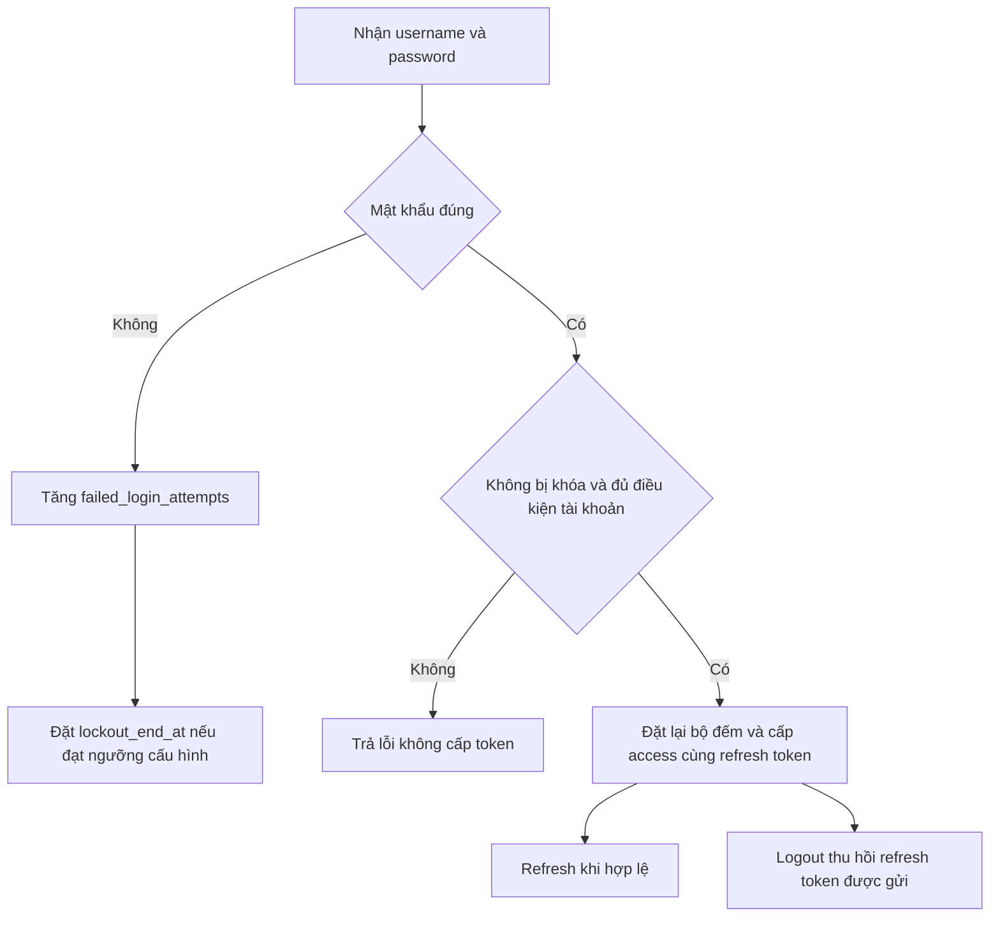
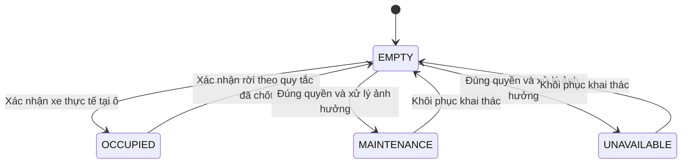
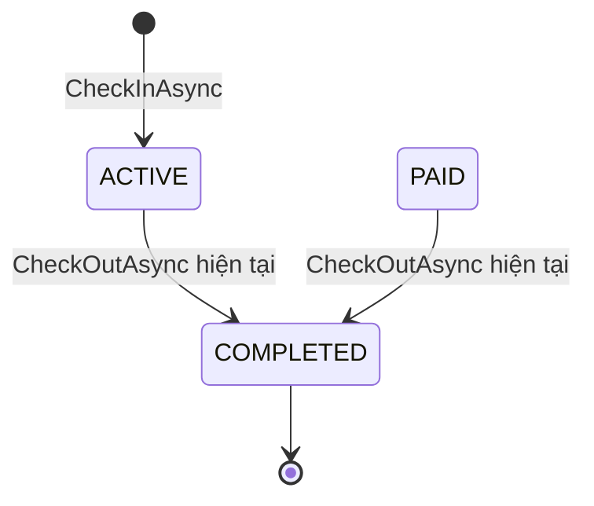
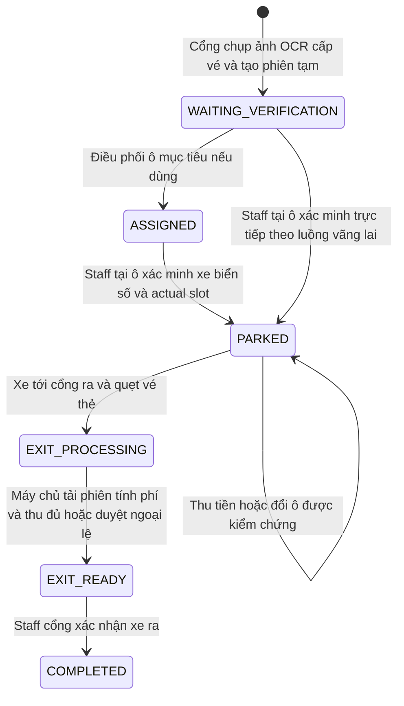
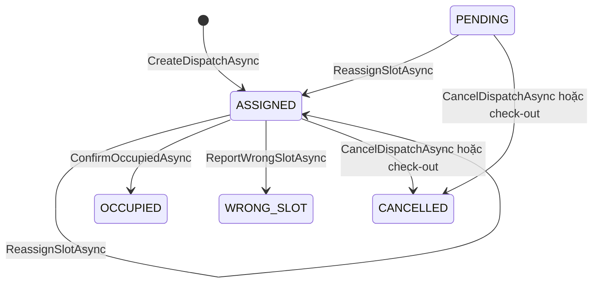
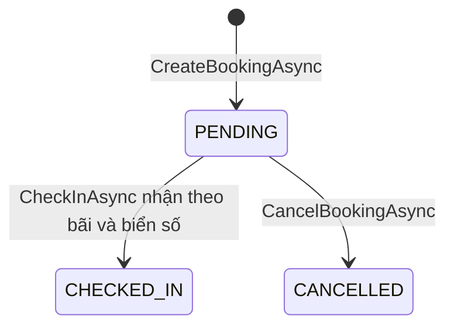
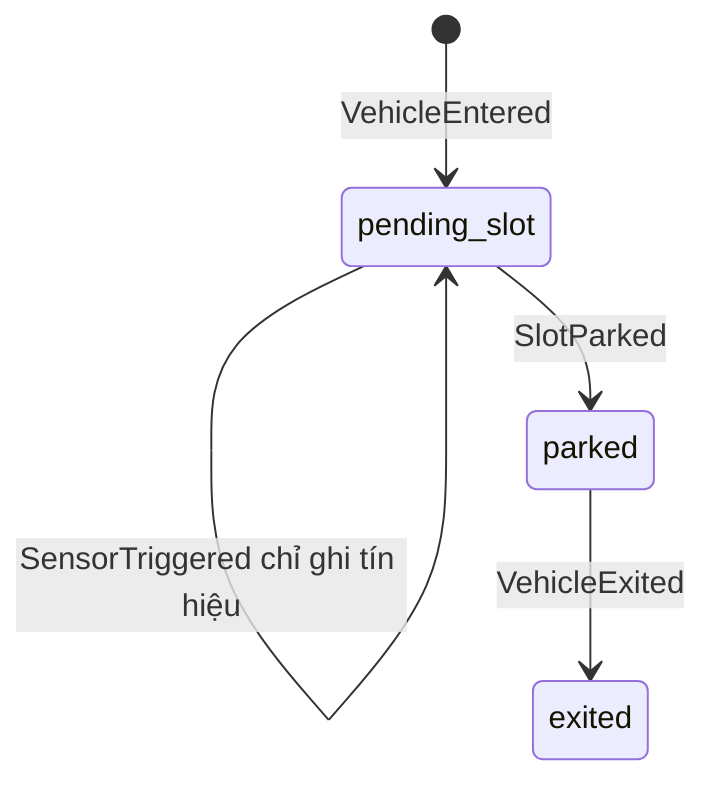
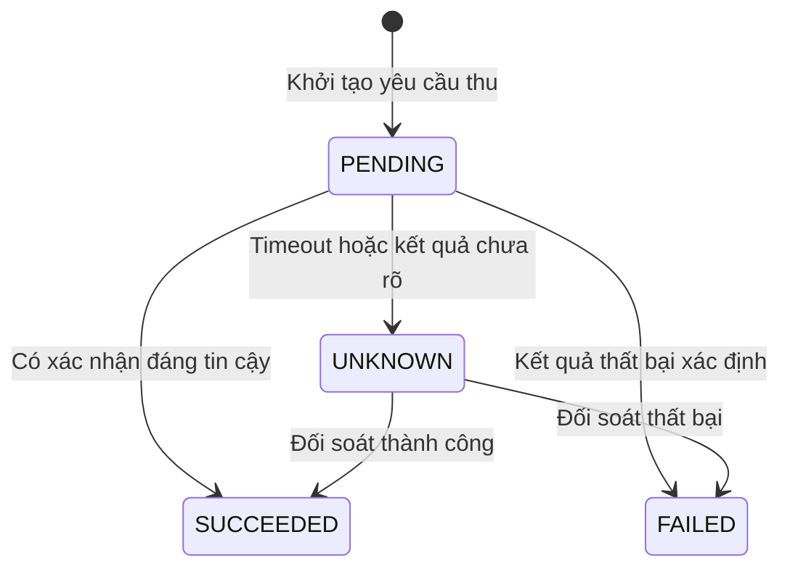
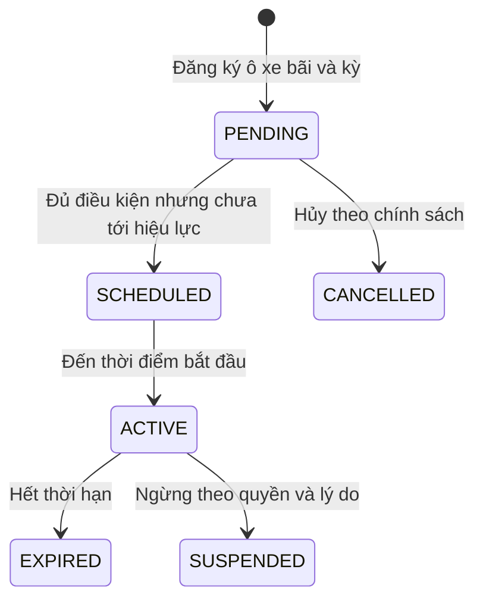
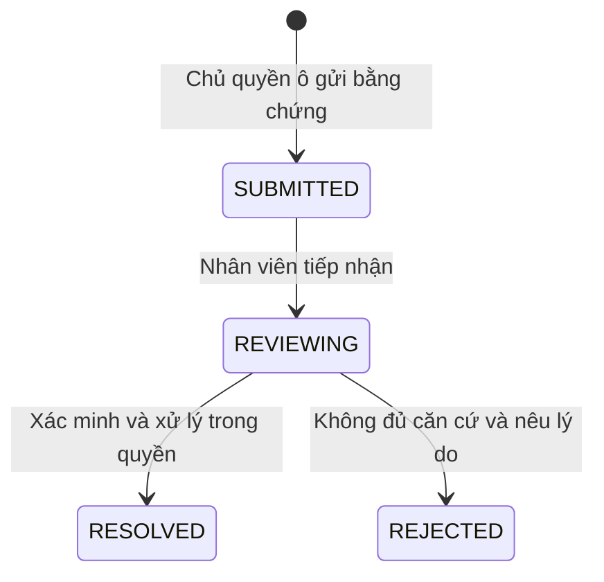

# Vòng đời trạng thái Smart Parking

**Trạng thái:** Hiện hành về nghiệp vụ; mỗi sơ đồ ghi rõ HIỆN CÓ hay ĐỀ XUẤT.  
**Chủ sở hữu:** BA/Product và Backend.  
**Rà soát gần nhất:** 28/10/2026.  
**Phạm vi:** Tài khoản, slot, session, dispatch, booking, payment, pass và report.

**Mốc đối chiếu:** `Sprint3/demo` tại `4bed0c8`, 28/10/2026. Quy ước ở [README](../README.md); mã chính xác ở [06 Enum domains](../api/data-contracts.md), dữ liệu ở [01 ER plan](../architecture/data-model.md).

Một trạng thái chỉ có ý nghĩa trong đối tượng của nó. `PAID` của phiên không thay một khoản thu có chứng từ; `ASSIGNED` của điều phối không làm ô có xe; `CHECKED_IN` của booking không chứng minh xe đã ở đúng ô. Các sơ đồ hiện trạng dưới đây không bổ sung ngầm chức năng chưa có.

## SM-01 Tài khoản và phiên đăng nhập

`users.is_active`, `is_email_verified`, `approval_status`, `lockout_end_at` là các chiều độc lập. Không gộp thành một enum mới.

| Bước | Guard và quyền | Đọc/ghi | Hiện trạng |
|---|---|---|---|
| Login thành công | Mật khẩu đúng, không lockout, verified, active, APPROVED | Đọc users/roles; ghi users và refresh_tokens | HIỆN CÓ |
| Sai mật khẩu | Tăng đếm; đạt ngưỡng thì đặt hạn khóa | users | HIỆN CÓ; không dùng số mẫu làm chính sách |
| Refresh | Hash tồn tại, chưa revoke/hết hạn; tài khoản còn đủ điều kiện | refresh_tokens, users, roles | HIỆN CÓ; không xoay refresh token ở phiên bản này |
| Logout | Nhận raw refresh token để thu hồi; token đã thiếu vẫn trả thành công | refresh_tokens | HIỆN CÓ; không có nghĩa thu hồi ngay mọi JWT trên mọi thiết bị |
| Đăng ký/xác minh | Customer tự đăng ký, xác minh Gmail/reCAPTCHA theo Sprint 3 | users, user_tokens và email | YÊU CẦU; endpoint/service đã bị gỡ |

Admin tạo tài khoản nội bộ hiện đặt verified và APPROVED trực tiếp. `PENDING`/`REJECTED` tồn tại trong miền dữ liệu nhưng không có nghĩa đã có màn hình/endpoint duyệt riêng. Vai trò và active được kiểm tra lại trong quá trình xác thực JWT; nhiệm vụ Staff chưa có.

## SM-02 Trạng thái vật lý của ô

Đây là vòng đời nghiệp vụ cần bảo vệ. Controller quản lý cho phép cập nhật trạng thái qua dịch vụ; phải rà guard tại từng chuyển, không coi mọi mũi tên là đã được chứng minh trên PostgreSQL thật.

| Trạng thái | Hiển thị | Điều kiện/bất biến |
|---|---|---|
| EMPTY | Xanh và chữ Trống | Không có xe vật lý; có thể vẫn được phân/giữ theo nghiệp vụ |
| OCCUPIED | Đỏ và chữ Có xe | Có xác nhận thực tế, tham chiếu phiên/ô đúng |
| MAINTENANCE | Vàng và chữ Bảo trì | Không nhận lượt mới; không xóa xe/phiên đang tồn tại |
| UNAVAILABLE | Xám và chữ Không khả dụng | Không khai thác; khôi phục cần đúng quyền |

`RESERVED` trong viewer hiện tại là sai khác cần sửa: nó được trả như `PhysicalStatus` thứ năm. Hướng đích dùng lớp `assignment/hold` riêng. Chọn ô, xoay camera, mua gói hoặc thanh toán không được đổi trạng thái vật lý.

## SM-03 Phiên đỗ core hiện có

Nguồn: `parking_sessions.status` và `ParkingSessionService`.

`PAID` và `CANCELLED` có trong CHECK/constant; chưa có endpoint phí tạo chuyển ACTIVE → PAID hoặc lệnh hủy phiên được công bố. Không vẽ các mũi tên đó như chức năng đã chạy.

| Chuyển | Guard hiện có | Ghi dữ liệu | Khoảng trống |
|---|---|---|---|
| Tạo ACTIVE | Đúng quyền bãi; bãi hoạt động; biển số request chưa có ACTIVE/PAID; còn sức chứa hoặc booking được nhận | vehicles nếu cần; parking_sessions; booking CHECKED_IN nếu có; audit_logs | Core hiện yêu cầu biển số như dữ liệu chính thức; chưa có nhận dạng tạm/vé/EventId và chưa hỗ trợ đầy đủ luồng cổng tự động |
| ACTIVE/PAID → COMPLETED | Phiên tồn tại/chưa kết thúc; người gọi có quyền vận hành bãi | Giờ ra/status/ảnh; hủy dispatch PENDING/ASSIGNED; trả ô OCCUPIED về EMPTY; audit | Chưa kiểm tra đủ phí, vé và xác nhận xe theo hợp đồng đầy đủ |
| Gửi check-out lần nữa | COMPLETED/CANCELLED | Không tạo lần hoàn tất mới; hiện trả lỗi | Cần kiểm tra retry đồng thời trên DB thật |

Check-in có thể nhận SlotId và lưu `CurrentSlotId`, nhưng không tự đổi slot thành OCCUPIED. Vì vậy không render xe chỉ dựa vào `CurrentSlotId != null`.

**Hướng đích đã chốt:** camera/AI tại cổng tạo recognition result và session ACTIVE `WAITING_VERIFICATION` mà không chờ Staff cổng xác nhận. Kết quả OCR chưa được ghi đè như biển số chính thức; chống lặp dùng EventId/vé/thẻ. Staff điều phối tại slot xác nhận/sửa biển số và actual slot, rồi mới áp kiểm tra unique xe chính thức và chuyển physical sang OCCUPIED.

## SM-04 Các bước vận hành đích của một phiên

Các mã `WAITING`, `ASSIGNED`, `PARKED`, `EXIT_READY` ở sơ đồ này là **ĐỀ XUẤT trạng thái vận hành**, chưa phải giá trị hợp lệ để ghi vào `parking_sessions.status` hiện tại. Có thể suy diễn từ phiên/dispatch hoặc thêm cột riêng sau quyết định thiết kế.

`WAITING_VERIFICATION`, `EXIT_PROCESSING` và các mã còn lại ở sơ đồ là trạng thái vận hành đích. Biển số OCR trong `WAITING_VERIFICATION` là dữ liệu tạm; Staff tại ô là người chốt/sửa biển số cùng actual slot. Tiền được ghi riêng; `EXIT_READY` chưa trả ô. Điểm trả ô khi xe rời ô hay khi ra cổng và khoảng chờ phải khóa tại DEC-16. Khi xe chưa rời, booking hết hạn hoặc phí đã đủ không được làm ô trống.

## SM-05 Điều phối hiện có

Create hiện tạo ASSIGNED trực tiếp; PENDING là miền được hỗ trợ bởi một số guard, chưa có lệnh tạo PENDING riêng.

| Thao tác | Guard và ghi chéo bảng |
|---|---|
| Phân ô | Phiên chưa kết thúc, cùng bãi, ô hoạt động/EMPTY, chưa có dispatch ASSIGNED xung đột; ghi dispatch và session.CurrentSlotId, không ghi OCCUPIED |
| Xác nhận đúng | Chỉ ASSIGNED; ô chưa OCCUPIED/MAINTENANCE/UNAVAILABLE; dispatch OCCUPIED, actual_slot_id = assigned_slot_id, confirmed_at; slot OCCUPIED |
| Báo sai ô | Chỉ ASSIGNED; actual slot hợp lệ cùng bãi và không xung đột; dispatch WRONG_SLOT, actual slot OCCUPIED, ô được phân về EMPTY; session chuyển tham chiếu actual slot |
| Đổi ô | Chỉ PENDING/ASSIGNED; ô mới hợp lệ; cập nhật assignment và session, lưu audit |
| Hủy | Chỉ PENDING/ASSIGNED; bỏ liên kết phân nếu phù hợp; không làm trống ô đang OCCUPIED |

**Giới hạn quan trọng:** OCCUPIED/WRONG_SLOT hiện không được `ReassignSlotAsync` nhận. Quy trình di chuyển một xe đã xác nhận đỗ sang ô khác chưa hoàn chỉnh; không hướng dẫn gọi lại endpoint đổi ô như thể đã hỗ trợ.

## SM-06 Booking core và hướng nghiệp vụ đặt trước

`EXPIRED` có trong dữ liệu nhưng chưa thấy lịch xử lý tự hết hạn. Booking có start/end; chưa có hold expiry hoặc payment state. Check-in hiện tìm PENDING theo bãi/biển số, chưa chứng minh kiểm tra đầy đủ khung giờ. Mọi PENDING hiện được trừ sức chứa, không theo giao khoảng thời gian.

Hướng đích cần phân biệt giữ tạm có hạn, đã xác nhận đủ điều kiện, đã nhận xe, hủy/hết hạn và kết quả tiền. Đây là thiết kế bổ sung Sprint 4; tên mã đích chỉ được sử dụng sau khi sửa DTO/migration. Hủy/hết hạn không thay slot OCCUPIED và không xóa khoản thu.

## SM-07 Sự kiện hiện có

Sơ đồ thể hiện luồng chuẩn của pipeline riêng; các ngoại lệ như xe chưa đỗ đã ra phải theo guard và xác minh của service. Đây không phải cùng enum hay cùng nguồn lưu với `parking_sessions`.

- `EventId` trùng được nhận diện và trả `duplicate` trong phạm vi repository hiện tại.
- `accepted/rejected/duplicate/pending_verification` là kết quả xử lý, không phải trạng thái xe.
- `pending_verification` tồn tại trong miền; đường xử lý cụ thể cần đối chiếu sự kiện và lỗi, không mặc định có hàng đợi xác minh bền.
- Repository hiện ở bộ nhớ; tính chống trùng không bền qua restart. Bridge hiện NoOp. Bật compile flag EF/LIVE_BRIDGE chưa đủ để hợp nhất nguồn và quyền.
- Danh tính actor cần lấy từ xác thực, không tin chuỗi `TriggeredBy` do client tự khai.

## SM-08 Khoản thu và đối soát đích

**YÊU CẦU/ĐỀ XUẤT**, chưa có bảng/API khoản thu core.

Khoản thu thành công giữ nguyên lịch sử; hoàn tiền là bản ghi riêng tham chiếu giao dịch gốc. Một mã yêu cầu/retry không ghi thêm khoản. Online cần xác minh phía máy chủ; trực tiếp cần chứng từ và quyền theo loại dịch vụ. Các trạng thái ở đây chưa phải enum DB hiện có.

## SM-09 Quyền gửi cố định và thẻ đích

**YÊU CẦU/ĐỀ XUẤT**, chưa có bảng/API gói/thẻ core. Quyền dịch vụ và thẻ vật lý có hai vòng đời.

Thẻ vật lý đề xuất READY → IN_USE → READY theo cấp/thu; LOST/DAMAGED/RETIRED chặn cấp mới. Không nhầm thẻ đang được khách giữ cho gói cố định với vé vãng lai cần thu hồi mỗi lượt; loại tái sử dụng phải chốt DEC-12. Mua/gia hạn không tự mở phiên, barrier chỉ mở sau kiểm tra xe/thẻ/quyền/khu hợp lệ.

## SM-10 Report chiếm ô đích

**YÊU CẦU/ĐỀ XUẤT**, chưa có bảng/API report/phạt core.

Không có chuyển tự động “gửi report → tạo khoản phạt phải thu”. Mức phạt, người duyệt, khiếu nại, kênh thu và thông báo nằm ở SP-DEC-18.

## Kiểm tra xuyên các máy trạng thái

| Tình huống | Kết quả bắt buộc |
|---|---|
| Check-in rồi reload | Xe còn trong danh sách chờ; chưa tạo xe ở ô chưa xác nhận |
| Phân ô rồi xác nhận | Lớp assignment đổi trước; physical chỉ đổi ở xác nhận thực tế |
| Thu đủ phí nhưng xe còn trong bãi | Phiên chưa COMPLETED, ô không bị trả do tiền |
| Hết hạn booking khi ô có xe | Chỉ xử lý quyền giữ, không xóa phiên/xe |
| Gia hạn gói rồi retry | Không cộng kỳ/thu tiền hai lần |
| Event cũ tới sau trạng thái mới | Ghi bằng chứng/lý do, không áp ghi đè mù |
| Hai người cùng xác nhận một ô | Một kết quả hợp lệ, kết quả còn lại xung đột; không mất lịch sử |

Các ca này là tiêu chí kiểm tra, không phải tuyên bố đã đạt. Nguồn triển khai: [session service](https://github.com/silver-phung/smart-parking-system/blob/4bed0c8/backend/src/SmartParking.Infrastructure/Services/ParkingSessionService.cs), [dispatch service](https://github.com/silver-phung/smart-parking-system/blob/4bed0c8/backend/src/SmartParking.Infrastructure/Services/ParkingDispatchService.cs), [event service](https://github.com/silver-phung/smart-parking-system/blob/4bed0c8/backend/src/SmartParking.Application/Events/ParkingEventService.cs).
